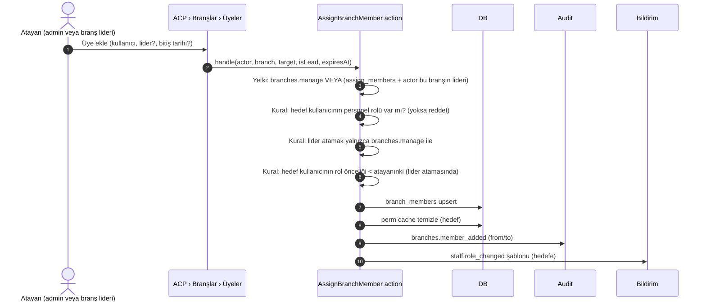

# ADMIN — Yönetim, Rol Matrisi ve Branş Mekanizması

> **Sürüm:** 1.0.0 · **Son güncelleme:** 2026-11-11 · **Durum:** Onay bekliyor
> **İlgili:** [ROUTES §6](ROUTES.md#6-yönetim-paneli-admin) · [ARCHITECTURE §5.4](ARCHITECTURE.md#54-yetkilendirme-modeli-üç-katman) · [DATABASE §3](DATABASE.md#3-kimlik-erişim-ve-personel)

---

## 1. Yetki modeli — özet

```text
Kullanıcı ──< user_roles (süreli olabilir) >── Rol ──< role_permissions >── İzin
    │
    └──< branch_members (lider olabilir, süreli olabilir) >── Branş ── (fraksiyon / kategori / başvuru türü)

Etkin yetki = (rollerden gelen izinler) ∩ (kaynak branş kapsamı) ∩ (iş kuralları: hiyerarşi, dört göz, durum)
```

- **İzin** ne yapılabileceğini söyler (`support.reply`).
- **Branş** nerede yapılabileceğini söyler (yalnızca "LSPD Fraksiyonu" branşının ticket'ları).
- **Hiyerarşi** kime yapılabileceğini söyler (kendinden düşük öncelikli personele).
- İzin kataloğunun tek kaynağı `config/permissions.php` dosyasıdır. Sistem rolleri ve rol ↔ izin matrisi `config/roles.php` dosyasındadır (§3'ten üretilir; `RoleMatrixTest` ikisini karşılaştırır). `AccessControlSeeder` DB'yi bunlarla senkronlar. Kodda bulunmayan bir izin ACP'den oluşturulamaz.
- **Faz 4 kararı:** Sistem rolleri (`is_system`) ACP'de **salt okunurdur**; izinleri her seed çalıştırmasında matristen yeniden yazılır. ACP (`roles.manage`, yalnızca süper admin) **özel** roller oluşturur, düzenler ve siler (öncelik 1–89, kullanımdaki rol silinemez).
- Personel olmayan (rolsüz veya yalnızca kozmetik rollü) kullanıcı `/admin/*` altında **404** alır (yönetim alanının varlığı ifşa edilmez). Personel olup ilgili izni olmayan **403** alır.

## 2. Roller

| Slug | Ad | Öncelik | Personel | Sistem | Amaç |
|---|---|---|---|---|---|
| `super_admin` | Süper Admin | 100 | ✓ | ✓ | Sistem sahibi. Tüm izinler (`Gate::before`) |
| `admin` | Yönetici | 90 | ✓ | ✓ | Genel web ve oyuncu yönetimi. Finans ve entegrasyon hariç |
| `community_manager` | Topluluk Yöneticisi | 70 | ✓ | ✓ | İçerik yayını, duyurular, etkinlikler, Akademi |
| `game_master` | Oyun Yöneticisi (GM) | 70 | ✓ | ✓ | Oyun içi moderasyon, hesap ve karakter işlemleri, kalıcı ban |
| `finance_manager` | Finans Yöneticisi | 70 | ✓ | ✓ | Ödeme, iade, bakiye düzeltme, mutabakat |
| `moderator` | Moderatör | 50 | ✓ | ✓ | Sınırlı ceza ve oyun komutları |
| `faction_manager` | Fraksiyon Yöneticisi | 50 | ✓ | ✓ | **Branşına bağlı** fraksiyonun başvuruları ve sayfası |
| `support_agent` | Destek Yetkilisi | 30 | ✓ | ✓ | **Branşındaki** destek talepleri |
| `content_editor` | İçerik Editörü | 30 | ✓ | ✓ | İçerik taslağı hazırlama (yayın yetkisi yok) |
| *(rol yok)* | Oyuncu | 0 | — | — | Varsayılan. Rol satırı gerekmez |

Kozmetik roller (`is_staff=false`, ör. "Destekçi", "Etkinlik Kazananı") ACP'den oluşturulabilir. Bu roller `/admin` alanını açmaz, yalnızca profil rozeti olarak gösterilir.

## 3. İzin kataloğu ve rol matrisi

**Gösterim:** ✅ izin var · 🔸 izin var ama **branş kapsamlı** · — izin yok. `super_admin` tüm izinlere sahiptir (tabloda gösterilmez).
**Kısaltmalar:** ADM = admin, CM = community_manager, GM = game_master, FIN = finance_manager, MOD = moderator, FAC = faction_manager, SUP = support_agent, ED = content_editor. ⚠ = hassas izin (`is_sensitive`, atanırken ek onay gerekir).

### 3.1 Kullanıcılar ve oyun

| İzin | Açıklama | ADM | CM | GM | FIN | MOD | FAC | SUP | ED |
|---|---|---|---|---|---|---|---|---|---|
| `users.read` | Kullanıcı listesi ve profil (e-posta maskeli) | ✅ | ✅ | ✅ | ✅ | ✅ | ✅ | ✅ | — |
| `users.read_pii` ⚠ | Tam e-posta ve kişisel alanlar | ✅ | — | — | ✅ | — | — | — | — |
| `users.update` | Doğrulama e-postasını yeniden gönderme, profil düzeltme | ✅ | — | — | — | — | — | ✅ | — |
| `users.suspend` ⚠ | Hesabı askıya alma / açma | ✅ | — | ✅ | — | — | — | — | — |
| `users.security_read` ⚠ | Güvenlik olayları (maskeli IP) | ✅ | — | — | — | — | — | — | — |
| `users.anonymize` ⚠ | KVKK silme / anonimleştirme | ✅ | — | — | — | — | — | — | — |
| `game_accounts.read` | MTA hesap bağlantıları | ✅ | — | ✅ | — | ✅ | ✅ | ✅ | — |
| `game_accounts.manage` ⚠ | Bağlantı kaldırma onayı, iptal, manuel bağlama | ✅ | — | ✅ | — | — | — | — | — |
| `characters.read` | Karakter kayıtları | ✅ | — | ✅ | — | ✅ | ✅ | ✅ | — |
| `characters.review` | Karakterin web profil görünürlüğünü yönetme | ✅ | — | ✅ | — | — | — | — | — |
| `devices.read` | Cihaz ilişkilendirme talepleri (R2) | ✅ | — | ✅ | — | — | — | — | — |
| `devices.approve` ⚠ | Cihaz onayı (R2) | ✅ | — | ✅ | — | — | — | — | — |
| `servers.maintenance` | Sunucu bakım bayrağı | ✅ | — | ✅ | — | — | — | — | — |
| `game_commands.read` | Komut kuyruğu | ✅ | — | ✅ | — | ✅ | — | — | — |
| `game_commands.warn` | Oyun içi uyarı | ✅ | — | ✅ | — | ✅ | — | — | — |
| `game_commands.kick` | Kick / mute | ✅ | — | ✅ | — | ✅ | — | — | — |
| `game_commands.ban_temp` | Süreli ban / jail / unban | ✅ | — | ✅ | — | ✅ | — | — | — |
| `game_commands.ban_perm` ⚠ | Kalıcı ban | ✅ | — | ✅ | — | — | — | — | — |
| `game_commands.announce` | Oyun içi duyuru | ✅ | ✅ | ✅ | — | — | — | — | — |

### 3.2 Destek ve başvurular

| İzin | Açıklama | ADM | CM | GM | FIN | MOD | FAC | SUP | ED |
|---|---|---|---|---|---|---|---|---|---|
| `support.read` | Ticket kuyruğu ve detay | ✅ | — | 🔸 | — | 🔸 | 🔸 | 🔸 | — |
| `support.reply` | Public yanıt, durum değiştirme | ✅ | — | 🔸 | — | 🔸 | 🔸 | 🔸 | — |
| `support.internal_note` | İç not yazma | ✅ | — | 🔸 | — | 🔸 | 🔸 | 🔸 | — |
| `support.assign` | Atama, öncelik, escalation | ✅ | — | 🔸 | — | — | 🔸 | 🔸 | — |
| `support.close` | Kapatma | ✅ | — | 🔸 | — | 🔸 | 🔸 | 🔸 | — |
| `support.all_branches` | Tüm branşların kuyruğu | ✅ | — | — | — | — | — | — | — |
| `support.manage` | Kategoriler ve makrolar | ✅ | — | — | — | — | — | — | — |
| `applications.read` | Başvurular | ✅ | — | 🔸 | — | — | 🔸 | — | — |
| `applications.review` | Başvuru kararı | ✅ | — | 🔸 | — | — | 🔸 | — | — |
| `applications.all_branches` | Tüm başvuru türleri | ✅ | — | — | — | — | — | — | — |
| `applications.types.manage` | Başvuru türlerini yönetme | ✅ | — | — | — | — | — | — | — |

### 3.3 Moderasyon

| İzin | Açıklama | ADM | CM | GM | FIN | MOD | FAC | SUP | ED |
|---|---|---|---|---|---|---|---|---|---|
| `sanctions.read` | Ceza kayıtları | ✅ | — | ✅ | — | ✅ | — | ✅ | — |
| `sanctions.create` | Ceza oluşturma (kalıcı ban hariç) | ✅ | — | ✅ | — | ✅ | — | — | — |
| `sanctions.revoke` | Cezayı kaldırma | ✅ | — | ✅ | — | — | — | — | — |
| `sanctions.ban_permanent` ⚠ | Kalıcı ban cezası | ✅ | — | ✅ | — | — | — | — | — |
| `sanctions.appeals.review` | İtiraz kararı | ✅ | — | ✅ | — | — | — | — | — |

### 3.4 Ekonomi ve ödeme

| İzin | Açıklama | ADM | CM | GM | FIN | MOD | FAC | SUP | ED |
|---|---|---|---|---|---|---|---|---|---|
| `wallet.read` | Cüzdanlar ve ledger | ✅ | — | — | ✅ | — | — | — | — |
| `wallet.adjust.request` ⚠ | Düzeltme / ters kayıt talebi | — | — | — | ✅ | — | — | — | — |
| `wallet.adjust.approve` ⚠ | Düzeltme onayı (dört göz) | — | — | — | ✅ | — | — | — | — |
| `payments.read` | Ödemeler ve webhook geçmişi | ✅ | — | — | ✅ | — | — | — | — |
| `payments.refund.request` ⚠ | İade talebi | — | — | — | ✅ | — | — | — | — |
| `payments.refund.approve` ⚠ | İade onayı (dört göz) | — | — | — | ✅ | — | — | — | — |
| `payments.reconcile` | Mutabakat raporu | — | — | — | ✅ | — | — | — | — |
| `payments.packages.manage` | Kredi paketleri | — | — | — | ✅ | — | — | — | — |

> Brief §12.2: Destek personeli finansal verilere erişemez. Finans yöneticisi içerik ve rol yönetemez. Bu iki kural `RoleMatrixTest` ile korunur.

### 3.5 İçerik ve iletişim

| İzin | Açıklama | ADM | CM | GM | FIN | MOD | FAC | SUP | ED |
|---|---|---|---|---|---|---|---|---|---|
| `content.read` | CMS listeleri ve önizleme | ✅ | ✅ | — | — | — | ✅ | — | ✅ |
| `content.create` | Taslak oluşturma | ✅ | ✅ | — | — | — | — | — | ✅ |
| `content.update` | Düzenleme, incelemeye gönderme | ✅ | ✅ | — | — | — | — | — | ✅ |
| `content.publish` | Yayın, zamanlama, kural sürümü artırma | ✅ | ✅ | — | — | — | — | — | — |
| `content.delete` | Silme (sistem kayıtları hariç) | ✅ | ✅ | — | — | — | — | — | — |
| `factions.update_own` | Kendi fraksiyonunun metin alanları | — | — | — | — | — | 🔸 | — | — |
| `media.upload` | Medya yükleme | ✅ | ✅ | — | — | — | ✅ | — | ✅ |
| `media.delete` | Medya silme | ✅ | ✅ | — | — | — | — | — | — |
| `academy.manage` | Akademi dersleri ve konuları | ✅ | ✅ | — | — | — | — | — | ✅ |
| `announcements.manage` | Duyuru taslağı | ✅ | ✅ | — | — | — | — | — | — |
| `announcements.publish` | Duyuru yayını (e-posta dahil) | ✅ | ✅ | — | — | — | — | — | — |
| `templates.read` | Mesaj şablonları | ✅ | ✅ | — | — | — | — | — | — |
| `templates.manage` ⚠ | Şablon düzenleme | ✅ | — | — | — | — | — | — | — |
| `contact.read` | İletişim mesajları | ✅ | ✅ | — | — | — | — | ✅ | — |

### 3.6 Personel, sistem ve denetim

| İzin | Açıklama | ADM | CM | GM | FIN | MOD | FAC | SUP | ED |
|---|---|---|---|---|---|---|---|---|---|
| `staff.read` | Personel listesi, branşlar | ✅ | ✅ | ✅ | — | — | — | — | — |
| `staff.manage` ⚠ | Rol atama / kaldırma (hiyerarşi içinde) | ✅ | — | — | — | — | — | — | — |
| `roles.read` | Rol ve izin görüntüleme | ✅ | — | — | — | — | — | — | — |
| `roles.manage` ⚠ | Rol oluşturma, izin eşleme | — | — | — | — | — | — | — | — |
| `branches.manage` | Branş oluşturma, lider atama | ✅ | — | — | — | — | — | — | — |
| `branches.assign_members` | Liderlik ettiği branşa üye ekleme/çıkarma | ✅ | — | 🔸 | — | 🔸 | 🔸 | 🔸 | — |
| `settings.read` | Sistem ayarları ve sağlık | ✅ | — | — | — | — | — | — | — |
| `settings.update` ⚠ | Ayar değiştirme (süper-only gruplar hariç) | ✅ | — | — | — | — | — | — | — |
| `integrations.manage` ⚠ | MTA sunucuları ve credential'lar | — | — | — | — | — | — | — | — |
| `audit.read` | Audit log | ✅ | — | — | 🔸 | — | — | — | — |
| `activity.read` | Admin görüntüleme logları | — | — | — | — | — | — | — | — |

- `audit.read` FIN için 🔸 olarak işaretlidir: kapsam **eylem öneki** `wallet.*`, `payments.*`, `refunds.*` ile sınırlıdır (branş değil).
- `branches.assign_members` 🔸 olarak işaretlidir: yalnızca kişinin `is_lead=true` olduğu branşlarda geçerlidir.

## 4. Süper Admin

### 4.1 Yetkiler
- Tüm izinler (`Gate::before`). Matristeki "—" hücreleri süper admin için geçerli değildir.
- **Yalnızca süper admin yapabilir:** `roles.manage`, `integrations.manage`, `activity.read`, süper-only ayar grupları (`security`, `mail`, `features.payments`), başka bir süper admin atama/kaldırma, `audit:verify` sonuçlarını ACP'de görme.
- Dört göz kuralı süper admin için de geçerlidir: süper admin kendi açtığı düzeltme veya iade talebini **onaylayamaz**. Tek süper admin varsa eşik üstü finans işlemleri ikinci bir finans yöneticisi gerektirir.

### 4.2 Koruma kuralları

| Kural | Uygulama |
|---|---|
| Atama | `super_admin` rolü yalnızca mevcut bir süper admin tarafından, PC ile atanır. `audit(roles.super_admin_assigned, critical)` yazılır ve tüm süper adminlere e-posta gider |
| Son süper admin | Aktif son süper adminin rolü kaldırılamaz, hesabı askıya alınamaz veya anonimleştirilemez (DB sayımı + transaction lock) |
| Önerilen sayı | 2 süper admin (biri break-glass). ACP dashboard'u tek süper admin varsa uyarı gösterir |
| MFA | Zorunlu. Kurtarma kodları çevrimdışı saklanır |
| Oturum | Admin idle 30 dk. Hassas işlemlerde her seferinde PC (10 dk penceresi) |
| IP allowlist (opsiyonel) | `security.admin_ip_allowlist` doluysa `/admin` yalnızca listedeki CIDR'lerden açılır (`AdminIpAllowlist` middleware'i). Kilitlenme durumunda CLI ile kapatılır: `php artisan mrp:admin-allowlist --clear` |

### 4.3 Break-glass (acil erişim)
1. Sunucuya SSH ile bağlanılır → `php artisan mrp:make-super-admin {email}` (mevcut kullanıcıya rol verir ya da yeni kullanıcı oluşturur, parolayı interaktif sorar).
2. Komut `audit(roles.super_admin_break_glass, critical, actor_type=system)` yazar ve tüm süper adminlere bildirim gönderir.
3. İlk girişte MFA kurulumu zorunludur.

## 5. Branş (birim) atama mekanizması

### 5.1 Branş nedir?
Branş, personelin **çalışma alanıdır**. Rol "ne yapabilirsin" sorusunu, branş "hangi kuyrukta ve hangi kaynak üzerinde" sorusunu cevaplar. Böylece bir Fraksiyon Yöneticisi yalnızca kendi fraksiyonunun başvurularını görür; bir Destek Yetkilisi yalnızca kendi kategorisindeki ticket'larla çalışır.

| Branş türü | Örnek | Bağlı kaynaklar |
|---|---|---|
| `support` | Destek – Genel, Destek – Teknik | `support_categories.branch_id` |
| `moderation` | Moderasyon | Şikayet kategorileri, itirazlar (R2) |
| `faction` | Fraksiyon – LSPD (`faction_id` dolu) | Fraksiyon başvuru türü, fraksiyon sayfası (`factions.update_own`), fraksiyon ticket kategorisi |
| `content` | İçerik | (kapsam gerektirmez; organizasyon amaçlı) |
| `economy` | Finans | Ödeme itirazı ticket kategorisi |
| `game` | Oyun Yönetimi | Hata bildirimi kategorisi |
| `general` | Yönetim | Escalation hedefi |

Seed branşları: `destek-genel`, `destek-teknik`, `moderasyon`, `icerik`, `finans`, `yonetim`. Her fraksiyon oluşturulduğunda ACP "Bu fraksiyon için branş oluştur" seçeneği sunar (`fraksiyon-{slug}`).

### 5.2 Kapsam kontrolü

```php
// App\Services\Authorization\BranchScope
public function allows(User $user, int $branchId, string $permission): bool
{
    if (! $user->can($permission)) return false;                         // 1) izin
    if ($user->can($this->allBranchesPermissionFor($permission))) return true; // 2) *.all_branches
    return $user->activeBranchIds()->contains($branchId);               // 3) üyelik (süresi dolmamış)
}
```

- Liste sorguları da kapsamlıdır: `SupportTicket::query()->visibleTo($user)` scope'u `whereIn('branch_id', $user->activeBranchIds())` uygular (all_branches yoksa).
- `admin` rolü `support.all_branches` ve `applications.all_branches` izinlerine sahiptir. Süper admin zaten tüm izinlere sahiptir.

### 5.3 Atama akışı



| Kural | Gerekçe |
|---|---|
| Branş üyesi olabilmek için en az bir personel rolü gerekir | Rolsüz kullanıcı branş üyeliğiyle hiçbir izin kazanmaz; bu tutarsızlığı önler |
| Rolü olup branşı olmayan, branş kapsamlı izin sahibi personel | Hiçbir kuyruğu görmez. ACP'de "branşsız personel" uyarısı gösterilir |
| Branş lideri yalnızca kendi branşına, lider **olmayan** üye ekler/çıkarır | Liderler birbirini çıkaramaz |
| Süreli üyelik | `expires_at` geçince zamanlayıcı üyeliği siler ve audit yazar (stajyer/deneme personeli için) |
| Personelin son rolü kaldırılınca | Tüm branş üyelikleri otomatik silinir, atanmış açık ticket'ları "atanmamış" olur, oturumları yenilenir |

### 5.4 Ticket yönlendirme ve escalation
1. Oyuncu kategori seçer → `ticket.branch_id = category.branch_id`.
2. Kuyrukta "Atanmamış" filtresi gösterilir. Personel "Kendine al" (`claim`) diyebilir; lider veya `support.assign` sahibi branş içinde atayabilir.
3. Escalation: `support.assign` sahibi ticket'ı başka bir branşa taşır (not zorunlu). `assigned_to` sıfırlanır, `support_ticket_events(escalated)` + audit yazılır. Varsayılan escalation hedefi `branches.parent_id` ile gelir.
4. Otomatik atama (round-robin) R2 seçeneğidir: branş ayarı `auto_assign=true` olduğunda, aktif (son 15 dk'da ACP'de görülen) üyeler arasında en az açık ticket'ı olana atanır.

### 5.5 Başvurular ve fraksiyonlar
- `application_types.branch_id` inceleyen ekibi belirler. Fraksiyon başvurusu → `fraksiyon-{slug}` branşı.
- `faction_manager` rolü + `fraksiyon-lspd` üyeliği = yalnızca LSPD başvurularını görme ve karara bağlama, LSPD sayfasının metinlerini düzenleme.
- Fraksiyon yöneticisi başka bir fraksiyonun başvurusuna URL ile erişmeye çalışırsa 404 döner (varlık ifşa edilmez; `PanelOwnershipTest` benzeri `BranchScopeTest`).

## 6. Personel yaşam döngüsü

| Adım | Kim | Ne olur |
|---|---|---|
| 1. Aday | — | Oyuncu web hesabı vardır (doğrulanmış e-posta şarttır) |
| 2. Rol atama | `staff.manage` (hiyerarşi içinde) | `user_roles` + opsiyonel `expires_at`. Audit `roles.assigned`. Hedefe e-posta + panel bildirimi |
| 3. MFA kurulumu | Personel | `/admin`'e ilk girişte zorunlu yönlendirme. Kurulmadan hiçbir admin ekranı açılmaz |
| 4. Branş ataması | `branches.manage` / lider | §5.3 |
| 5. Çalışma | | Tüm admin görüntülemeleri `admin_activity_logs`, kritik işlemler `audit_logs` tablosuna yazılır |
| 6. Geçici rol bitişi | Zamanlayıcı | Rol silinir, audit `roles.expired`, bildirim gönderilir |
| 7. Çıkış (offboarding) | `staff.manage` | Tüm roller kaldırılır → branşlar silinir → atanmış işler serbest bırakılır → **tüm oturumlar sonlandırılır** → audit `staff.offboarded`. Oyuncu hesabı yaşamaya devam eder |
| 8. MFA sıfırlama | Süper admin | Personel cihazını kaybettiyse: kimlik doğrulaması ACP dışında yapılır → `two_factor_*` alanları temizlenir → audit `security.mfa_reset` (critical) |

## 7. Sistem ayarları kataloğu

`system_settings` varsayılanları (`SettingsSeeder`). **S** = yalnızca süper admin değiştirebilir.

| Grup | Anahtar | Tip | Varsayılan | Public | Açıklama |
|---|---|---|---|---|---|
| site | `site.name` | string | `Meridyen Roleplay` | ✓ | Marka adı (D-13) |
| site | `site.short_name` | string | `Meridyen` | ✓ | PWA kısa adı |
| site | `site.tagline` | string | `Şehrin ritmi senin hikâyen.` | ✓ | Slogan (taslak) |
| site | `site.description` | string | — | ✓ | Varsayılan meta açıklama |
| site | `site.logo_media_id` | int | null | ✓ | |
| site | `site.og_default_media_id` | int | null | ✓ | |
| site | `site.contact_email` | string | — | ✓ | |
| site | `site.data_controller` | json | — | ✓ | KVKK veri sorumlusu bilgileri |
| server | `server.primary_slug` | string | `main` | ✓ | Public sayfadaki sunucu |
| server | `server.show_player_count` | bool | true | ✓ | |
| social | `social.discord_invite` | url | — | ✓ | |
| social | `social.youtube_url` | url | — | ✓ | |
| features | `features.registration` | bool | true | ✓ | |
| features | `features.wallet` | bool | false | ✓ | |
| features | `features.payments` **S** | bool | false | ✓ | |
| features | `features.applications` | bool | false | ✓ | |
| features | `features.sanctions` | bool | false | ✓ | |
| features | `features.devices` | bool | false | ✓ | |
| features | `features.events` | bool | true | ✓ | |
| features | `features.pwa` | bool | true | ✓ | |
| accounts | `accounts.max_links_per_user` | int | 3 | | |
| support | `support.max_attachments` | int | 3 | | |
| support | `support.auto_resolve_days` | int | 7 | | `waiting_for_player` → `resolved` |
| support | `support.auto_close_days` | int | 7 | | `resolved` → `closed` |
| support | `support.expected_response_text` | string | `Genellikle 24 saat içinde yanıtlıyoruz.` | ✓ | Gerçekçi tutulmalı |
| wallet | `wallet.four_eyes_threshold` | int | 500 | | Kredi cinsinden |
| wallet | `wallet.allow_self_apply_below_threshold` | bool | true | | FR-WAL-006 |
| maintenance | `maintenance.banner_enabled` | bool | false | ✓ | |
| maintenance | `maintenance.banner_text` | string | — | ✓ | |
| maintenance | `maintenance.full` | bool | false | | 503 (personel muaf) |
| rules | `rules.current_version` | string | `2026.11.0` | ✓ | Yalnızca `bump-version` ile |
| rules | `rules.change_note` | string | — | ✓ | |
| analytics | `analytics.enabled` | bool | false | ✓ | Çerez onayı olmadan çalışmaz |
| security **S** | `security.admin_ip_allowlist` | json | `[]` | | Boş = kapalı |
| security **S** | `security.new_login_alerts` | bool | true | | |
| mail **S** | `mail.from_name` | string | `Meridyen Roleplay` | | SMTP secret'ları `.env` içindedir, burada değil |

## 8. Audit eylem kataloğu

Her kritik eylem `AuditLogger::record(action, target, changes, reason, severity)` ile yazılır. Eylem adları sabittir (`App\Enums\AuditAction`).

| Eylem | Önem | Gerekçe zorunlu |
|---|---|---|
| `auth.admin_login`, `auth.admin_logout` | info | |
| `auth.admin_login_failed` | warning | |
| `users.suspended`, `users.unsuspended` | warning | ✓ |
| `users.anonymized` | warning | ✓ |
| `roles.assigned`, `roles.revoked`, `roles.expired` | warning | ✓ (assign/revoke) |
| `roles.created`, `roles.updated`, `roles.deleted`, `roles.permissions_synced` | critical | ✓ |
| `roles.super_admin_assigned`, `roles.super_admin_revoked`, `roles.super_admin_break_glass` | critical | ✓ |
| `branches.created`, `branches.updated`, `branches.member_added`, `branches.member_removed`, `branches.lead_changed` | info | |
| `staff.offboarded` | warning | ✓ |
| `security.mfa_reset` | critical | ✓ |
| `accounts.linked`, `accounts.unlink_requested` | info | |
| `accounts.unlinked`, `accounts.link_revoked`, `accounts.manual_linked` | warning | ✓ |
| `devices.approved`, `devices.rejected`, `devices.revoked` | warning | ✓ |
| `characters.visibility_changed` | info | ✓ |
| `support.escalated` | info | ✓ |
| `applications.decided` | info | ✓ |
| `sanctions.created`, `sanctions.revoked` | warning | ✓ |
| `sanctions.appeal_decided` | warning | ✓ |
| `game_commands.dispatched`, `game_commands.failed` | warning | |
| `wallet.adjustment_requested`, `wallet.adjustment_approved`, `wallet.adjustment_rejected`, `wallet.adjustment_applied` | critical | ✓ |
| `wallet.reversal_applied` | critical | ✓ |
| `wallet.reconciliation_mismatch` | critical | |
| `payments.succeeded` (sistem) | info | |
| `refunds.requested`, `refunds.approved`, `refunds.rejected`, `refunds.completed` | critical | ✓ |
| `content.published`, `content.unpublished`, `content.deleted`, `rules.version_bumped` | info | (bump için ✓) |
| `templates.updated` | warning | |
| `settings.updated` | warning (S gruplar: critical) | |
| `integrations.credential_created`, `integrations.credential_revoked`, `integrations.server_updated` | critical | |
| `servers.maintenance_toggled` | warning | |
| `bridge.signature_alert` (eşik aşımı) | critical | |

`changes` alanında şu anahtarlar her zaman `[REDACTED]` olur: `password, secret, token, two_factor_*, serial, address`.

## 9. ACP navigasyon haritası

Menü izinlere göre filtrelenir (görünmeyen menü = erişim yok değildir; erişim kontrolü her zaman backend'dedir).

```text
Genel bakış                         /admin
Oyuncular
  ├─ Kullanıcılar                   users.read
  ├─ Oyun hesapları                 game_accounts.read
  ├─ Karakterler                    characters.read
  └─ Cihaz talepleri (R2)           devices.read
Destek
  ├─ Ticket kuyruğu  [sayaç]        support.read
  ├─ Kategoriler · Makrolar         support.manage
  └─ İletişim mesajları             contact.read
Başvurular (R2)                     applications.read
Moderasyon (R2)
  ├─ Cezalar                        sanctions.read
  ├─ İtirazlar                      sanctions.appeals.review
  └─ Oyun komutları                 game_commands.read
Ekonomi (R2)
  ├─ Genel bakış · İşlemler         wallet.read
  ├─ Düzeltme talepleri [sayaç]     wallet.read
  ├─ Ödemeler · İadeler             payments.read
  └─ Paketler · Mutabakat           payments.packages.manage / payments.reconcile
İçerik
  ├─ Sayfalar · Ana sayfa bölümleri content.read
  ├─ Haberler · Etkinlikler         content.read
  ├─ Oyun sistemleri · Meslekler · Fraksiyonlar
  ├─ Kurallar · SSS
  ├─ Akademi                        academy.manage
  ├─ Navigasyon · Sosyal bağlantılar
  ├─ Medya kütüphanesi
  ├─ Duyurular                      announcements.manage
  └─ Mesaj şablonları               templates.read
Ekip
  ├─ Personel                       staff.read
  ├─ Branşlar                       staff.read
  └─ Roller ve izinler              roles.read
Sistem
  ├─ Ayarlar                        settings.read
  ├─ MTA entegrasyonu               integrations.manage
  ├─ Sistem sağlığı                 settings.read
  ├─ Audit log                      audit.read
  └─ Görüntüleme logları            activity.read
```

## 10. Dört göz ve hassas işlem özeti

| İşlem | Talep | Onay | Aynı kişi olabilir mi? | Ek |
|---|---|---|---|---|
| Bakiye düzeltme (eşik üstü) | `wallet.adjust.request` | `wallet.adjust.approve` | **Hayır** | PC her iki adımda |
| Bakiye düzeltme (eşik altı) | `wallet.adjust.request` | aynı kişi uygulayabilir (ayar) | Evet | PC |
| Ters kayıt | `wallet.adjust.request` | `wallet.adjust.approve` | **Hayır** | |
| İade | `payments.refund.request` | `payments.refund.approve` | **Hayır** | |
| Kalıcı ban | `sanctions.ban_permanent` | — | — | PC + gerekçe + kanıt bağlantısı zorunlu |
| İtiraz kararı | — | `sanctions.appeals.review` | Cezayı veren **karar veremez** | |
| Süper admin atama | süper admin | — | — | PC + tüm süper adminlere bildirim |
| Manuel hesap bağlama | `game_accounts.manage` | — | — | PC + gerekçe + kanıt |
