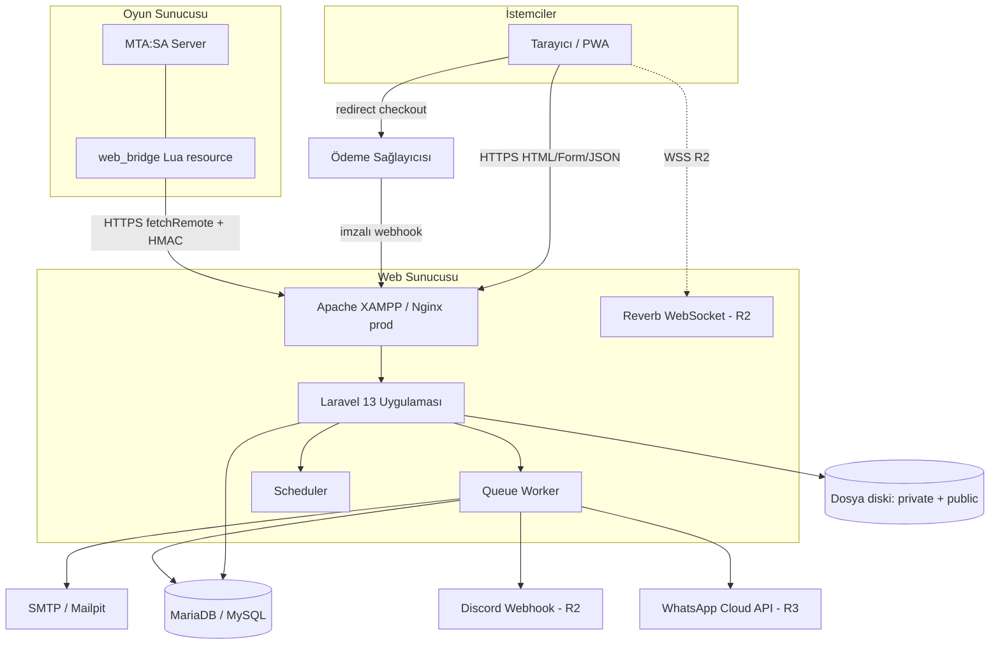
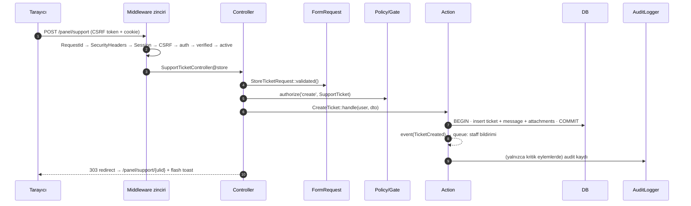
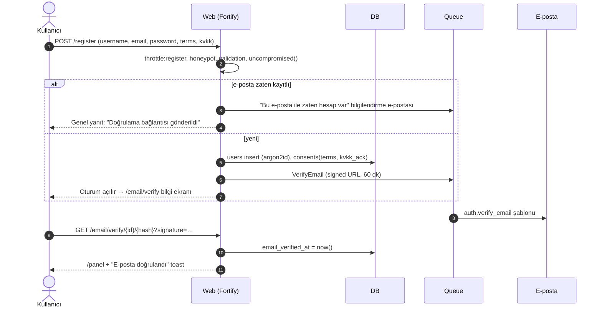
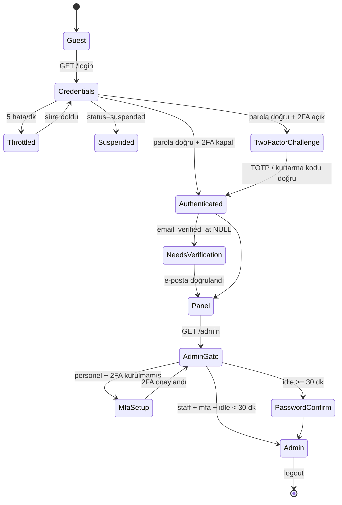
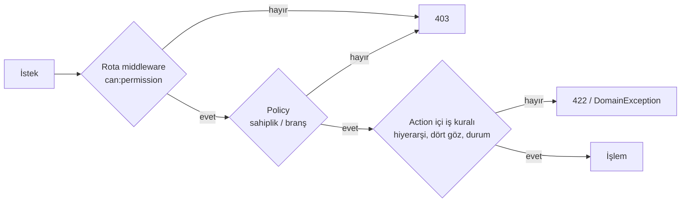
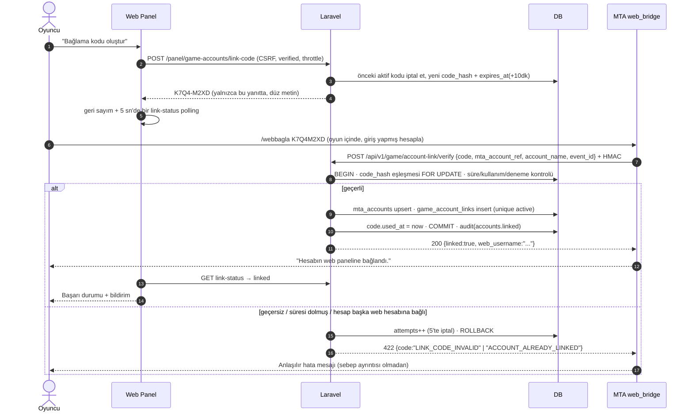
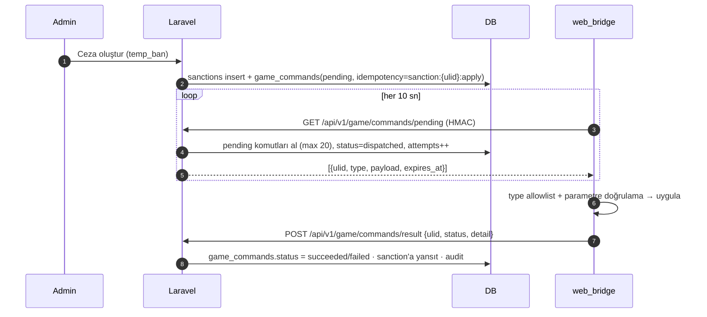
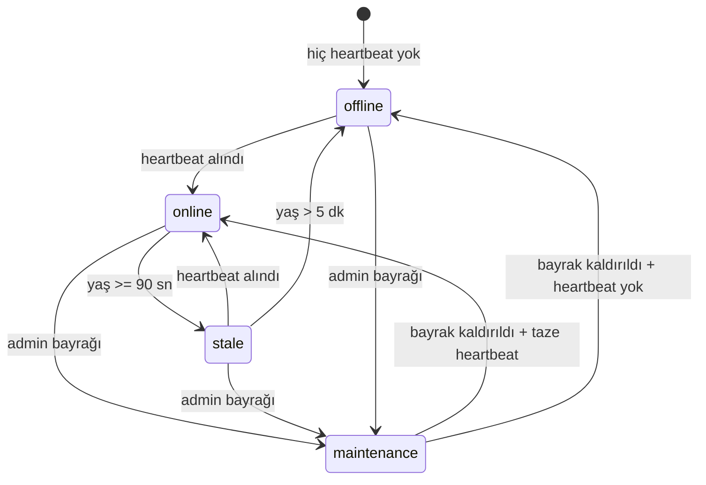
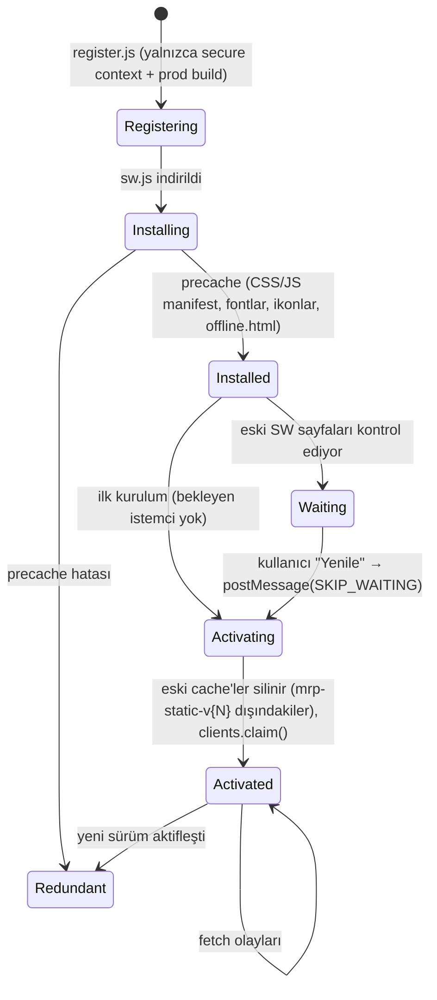

# ARCHITECTURE — Sistem Mimarisi

> **Sürüm:** 1.0.1 · **Son güncelleme:** 2026-11-11 · **Durum:** Onay bekliyor (Faz 1 uygulama notları işlendi)
> **İlgili:** [ROUTES](ROUTES.md) · [DATABASE](DATABASE.md) · [RULES](RULES.md) · [DESIGN](DESIGN.md)

---

## 1. Teknoloji yığını (kesinleşmiş)

| Katman | Seçim | Sürüm | Not |
|---|---|---|---|
| Dil | PHP | 8.4 (8.5 uyumlu) | `declare(strict_types=1)` |
| Framework | Laravel | 13.x | Monolith (D-01) |
| Auth backend | Laravel Fortify | 1.x | Headless. Görünümler bizim Blade dosyalarımız |
| Veritabanı | MariaDB 10.11 / MySQL 8.4 | | Eloquent (PDO) |
| Şablon | Blade + Blade bileşenleri | | `resources/views/components/ui/*` |
| CSS | Tailwind CSS | 4.x | `@theme` token'ları (DESIGN §3) |
| JS | Alpine.js **CSP build** (`@alpinejs/csp`) | 3.x | `unsafe-eval` gerektirmez (SEC-024) |
| İkon | Lucide (`mallardduck/blade-lucide-icons`) | | `<x-lucide-server />` |
| Build | Vite + `laravel-vite-plugin` | 8.x / 3.x | |
| Fontlar | Self-host (`@fontsource-variable/archivo`, `@fontsource-variable/jetbrains-mono`) | | Harici font CDN'i yok (KVKK + CSP) |
| Markdown | `league/commonmark` + `symfony/html-sanitizer` | | |
| Görsel işleme | `intervention/image` (GD sürücüsü) | 4.x | WebP varyantları, EXIF temizliği |
| Kuyruk | Database driver (R1), Redis (opsiyonel) | | |
| Gerçek zaman | Polling (R1), Laravel Reverb (R2) | | D-08 |
| Test | Pest | 4.x | + Laravel plugin |
| Statik analiz | Larastan | 3.x | seviye 6 → 8 hedef |
| Format | Laravel Pint | | PSR-12 + Laravel preset |
| MTA tarafı | Lua (MTA:SA 1.6 server) | | `mta-resource/web_bridge` |

## 2. Sistem bağlam diyagramı



**Temel ilke:** Bağlantı yönü hep **MTA → Web** şeklindedir. Web, MTA'ya bağlanmaz. Komutları MTA çeker (pull). Böylece MTA sunucusunda dışarı açık bir HTTP portu gerekmez.

## 3. Dizin mimarisi

```text
roleplay-web/
├── app/
│   ├── Actions/                    # Tek amaçlı iş eylemleri (iş mantığının ana yeri)
│   │   ├── Accounts/               # CreateLinkCode, VerifyLinkCode, RequestUnlink, ApproveUnlink
│   │   ├── Auth/                   # Fortify action'ları: CreateNewUser, ResetUserPassword…
│   │   ├── Applications/           # Submit, Decide, RequestInfo
│   │   ├── Content/                # PublishContent, ReorderSections, UploadMedia
│   │   ├── Moderation/             # IssueSanction, RevokeSanction, DecideAppeal
│   │   ├── Payments/               # CreateCheckout, ProcessPaymentEvent, RequestRefund
│   │   ├── Staff/                  # AssignRole, RevokeRole, AssignBranchMember
│   │   ├── Support/                # CreateTicket, ReplyToTicket, AssignTicket, EscalateTicket
│   │   ├── Users/                  # SuspendUser, AnonymizeUser
│   │   └── Wallet/                 # RequestAdjustment, ApproveAdjustment
│   ├── Console/Commands/           # mrp:make-super-admin, audit:verify, data:prune, bridge:*
│   ├── Enums/                      # Backed enum'lar: TicketStatus, UserStatus, Permission…
│   ├── Events/ · Listeners/        # Domain olayları (TicketReplied → bildirim)
│   ├── Exceptions/                 # Domain exception'ları (InsufficientBalance, ReplayDetected)
│   ├── Http/
│   │   ├── Controllers/
│   │   │   ├── Public/             # HomeController, NewsController, RulesController…
│   │   │   ├── Panel/              # DashboardController, SupportTicketController…
│   │   │   ├── Admin/              # UserController, RoleController, AuditLogController…
│   │   │   ├── Api/V1/Public/      # ServerStatusController
│   │   │   ├── Api/V1/Game/        # HeartbeatController, AccountLinkController…
│   │   │   └── Webhooks/           # PaymentWebhookController
│   │   ├── Middleware/             # §5.3 listesi
│   │   ├── Requests/               # FormRequest'ler (Panel/, Admin/, Game/)
│   │   └── Resources/              # JSON Resource'lar (köprü + public API)
│   ├── Jobs/                       # ProcessPaymentEvent, SendAnnouncementEmails, AggregateServerStats
│   ├── Models/                     # Eloquent modelleri (ince: ilişkiler, cast'ler, scope'lar)
│   ├── Notifications/              # Laravel Notification → MessageDispatcher kanalları
│   ├── Policies/                   # Sahiplik + branş kapsamı
│   ├── Providers/                  # AppServiceProvider, AuthServiceProvider (Gate tanımları), FortifyServiceProvider
│   ├── Services/
│   │   ├── Audit/                  # AuditLogger (hash zinciri)
│   │   ├── Authorization/          # PermissionRegistry, BranchScope, RoleHierarchy
│   │   ├── Bridge/                 # SignatureVerifier, NonceStore, ServerStatusResolver, CommandQueue
│   │   ├── Content/                # SectionRegistry, MarkdownRenderer, SlugGenerator, MediaProcessor
│   │   ├── Messaging/              # TemplateRenderer, MessageDispatcher, Channels/{Mail,Panel,Discord,WhatsApp}
│   │   ├── Payments/               # PaymentProvider (interface), PaymentManager, Providers/{Fake,…}
│   │   ├── Settings/               # SettingsRepository
│   │   └── Wallet/                 # LedgerService, ReconciliationService
│   ├── Support/                    # Yardımcılar: IpMasker, UserAgentSummary, Money, RequestId, SafeHtml
│   └── View/Components/            # Sınıflı Blade bileşenleri (DataTable, StatusBadge…)
├── bootstrap/app.php               # Routing, middleware alias/grupları, exception render
├── config/
│   ├── roleplay.php                # Proje ayarları: bridge, link kodu, karakter allowlist, limitler
│   └── permissions.php             # İzin anahtarları kataloğu (tek kaynak)
├── database/
│   ├── migrations/ · factories/ · seeders/
├── lang/tr/ · lang/tr.json         # Tüm arayüz metinleri
├── resources/
│   ├── css/app.css                 # Tailwind v4 + @theme token'ları
│   ├── js/
│   │   ├── app.js                  # Alpine CSP + bileşen kaydı
│   │   ├── components/             # Alpine.data(): copyAddress, serverStatus, modal, toast…
│   │   └── pwa/register.js         # SW kaydı + güncelleme akışı
│   └── views/
│       ├── layouts/                # public, panel, admin, auth, mail
│       ├── components/ui/          # Tasarım sistemi bileşenleri
│       ├── components/{public,panel,admin}/
│       ├── public/ · panel/ · admin/ · auth/ · errors/
│       └── sections/               # CMS sistem şablonları (hero.blade.php…)
├── routes/
│   ├── web.php                     # Public + auth
│   ├── panel.php                   # /panel (bootstrap/app.php'de yüklenir)
│   ├── admin.php                   # /admin
│   ├── api.php                     # /api/v1/public, /api/v1/game
│   ├── webhooks.php                # /webhooks/*
│   └── console.php                 # Scheduler tanımları
├── public/
│   ├── index.php · build/ · manifest.webmanifest · sw.js · offline.html · icons/
├── storage/app/{private,public}/
├── tests/{Unit,Feature,Arch}/      # Arch: mimari kuralları (Pest arch testleri)
├── mta-resource/web_bridge/        # Lua resource (§7.7)
└── docs/                           # Tek doğruluk kaynağı
```

### 3.1 Katman kuralları (Pest `arch()` testleriyle zorlanır)

| Katman | Yapabilir | Yapamaz |
|---|---|---|
| Controller | Request al, `authorize`, Action/Service çağır, view/redirect/JSON döndür | DB sorgusu yazmak (basit `paginate` listeleri hariç), iş kuralı içermek |
| FormRequest | Doğrulama, normalize etme, `authorize()` (yalnızca basit sahiplik) | Yan etki üretmek |
| Action | Tek iş kuralı, transaction, event dispatch, audit | HTTP nesnesine (`Request`) bağımlı olmak |
| Service | Yeniden kullanılabilir alan mantığı (ledger, imza, render) | View döndürmek |
| Model | İlişki, cast, scope, accessor | Başka modeli kaydetmek, HTTP çağrısı yapmak |
| View | Görüntüleme | Sorgu çalıştırmak (lazy loading yasak) |

## 4. İstek yaşam döngüsü



- **PRG (Post/Redirect/Get):** Başarılı form POST'ları her zaman `303` ile yönlendirir. Doğrulama hatası `back()->withErrors()->withInput()` ile döner (US-PUB: form verisi kaybolmaz).
- **Çift gönderim:** Formlarda `idempotency_key` gizli alanı kullanılır. Ayrıca butonlar Alpine ile gönderim sırasında `disabled` + `aria-busy` olur.

## 5. Kimlik doğrulama ve yetkilendirme

### 5.1 Kayıt ve doğrulama akışı



> Kayıt formu "zaten kayıtlı" durumunda da aynı ekranı gösterir. Gerçek hesap sahibine ayrı bir bilgilendirme e-postası gider (SEC-005).

### 5.2 Giriş ve 2FA akışı



### 5.3 Middleware kataloğu

| Alias | Sınıf | Görev |
|---|---|---|
| `request.id` | `AssignRequestId` | `X-Request-Id` üretir veya geçerli biçimdekini taşır, Laravel `Context`'e ekler (global) |
| `security.headers` | `SecurityHeaders` | CSP nonce (`Vite::useCspNonce()`), HSTS (prod + HTTPS), nosniff, referrer, permissions, COOP, X-Frame-Options (global). Yerel Vite HMR açıkken dev sunucusuna izin verir |
| `site.maintenance` | `MaintenanceGate` | `settings.maintenance.*`: banner veya 503 (personel muaf) |
| `share.settings` | `ShareSiteSettings` | `is_public` ayarları ve tema tercihlerini view'lara paylaşır |
| `verify.origin` | `VerifyOrigin` | Durum değiştiren isteklerde `Sec-Fetch-Site` / `Origin` cross-site ise 419 (CSRF'ye ek katman, RULES §7) |
| `auth` | Laravel | Oturum zorunlu |
| `verified` | Laravel | E-posta doğrulanmış olmalı |
| `active` | `EnsureAccountActive` | `suspended/anonymized` kullanıcının oturumunu sonlandırır |
| `staff` | `EnsureStaff` | En az bir `is_staff` rolü. Yoksa 404 döner (ACP varlığı gizlenir) |
| `mfa` | `EnsureTwoFactorConfirmed` | Personel için 2FA zorunlu → kurulum sayfasına yönlendirir |
| `admin.idle` | `AdminIdleTimeout` | Son admin etkinliği > 30 dk → `password.confirm` |
| `admin.activity` | `LogAdminActivity` | `admin_activity_logs` (terminable, yanıttan sonra yazar) |
| `can:<perm>` | Laravel Gate | İzin kontrolü |
| `password.confirm` | Laravel | Kritik işlemler için 10 dk parola onayı |
| `feature:<key>` | `EnsureFeatureEnabled` | `settings.features.<key>` kapalıysa 404 |
| `noindex` | `NoIndex` | `X-Robots-Tag: noindex, nofollow` + `Cache-Control: no-store` |
| `bridge.auth` | `VerifyBridgeSignature` | HMAC + timestamp + nonce + credential scope (§7.2) |
| `bridge.scope:<scope>` | `EnsureBridgeScope` | Credential scope kontrolü |
| `webhook.verify:<provider>` | `VerifyWebhookSignature` | Sağlayıcı adapter'ının `verifyWebhook()` metodu |
| `throttle:<limiter>` | Laravel | SRS §5.4 tablosu |

Grup tanımları (`bootstrap/app.php`):

```text
global = [request.id (en başta), …Laravel global…, security.headers (en sonda)]
         Global oldukları için eşleşmeyen rotalardaki 404/500 sayfaları da kimlik ve güvenlik başlıklarını alır.
web    = [EncryptCookies, AddQueuedCookies, StartSession, ShareErrorsFromSession,
          ValidateCsrfToken, SubstituteBindings, verify.origin, site.maintenance, share.settings]
panel  = web + [auth, active, noindex]                 (+ verified rota bazında)
admin  = web + [auth, verified, active, staff, mfa, admin.idle, admin.activity, noindex]
bridge = [bridge.auth, throttle:bridge]                (session/CSRF yok)
hooks  = [throttle:webhooks]                           (+ webhook.verify rota bazında)
```

> **Faz 1 durumu (2026-11-11):** `request.id`, `security.headers` (global) ve `verify.origin` (web) uygulandı. `panel` ve `admin` grupları şimdilik `web + auth`; eksik halkalar ilgili fazda eklenir. Fortify rotaları Faz 3'e kadar kapalıdır (`Fortify::ignoreRoutes()`).

### 5.4 Yetkilendirme modeli (üç katman)



1. **İzin (RBAC):** `Gate::before` → `super_admin` için `true` döner. Diğer kullanıcılar için kullanıcının etkin izinleri `user_roles` (süresi dolmamış) → `role_permissions` üzerinden hesaplanır ve `perm:{user_id}` anahtarıyla 10 dk cache'lenir. Rol veya izin değişince cache temizlenir.
2. **Kapsam (Policy):** Oyuncu kaynaklarında `user_id === auth id`. Personel kaynaklarında branş üyeliği (`BranchScope::allows($user, $branchId)`) veya `*.all_branches` izni.
3. **İş kuralı (Action):** Rol hiyerarşisi (`RoleHierarchy::canManage`), dört göz (`approved_by !== requested_by`), durum makinesi geçerliliği.

Ayrıntılı rol matrisi ve branş mekanizması: [ADMIN.md](ADMIN.md).

## 6. Oturum (session) yönetimi

| Konu | Karar |
|---|---|
| Driver | `database` (`sessions` tablosu). Production'da Redis'e geçiş yapılandırma değişikliğidir, ancak "oturumlarım" ekranı için `sessions` tablosu korunur |
| Cookie | `HttpOnly`, `SameSite=Lax`, `Secure` (prod). Prod adı `__Host-mrp_session` |
| Ömür | `SESSION_LIFETIME=120` (idle), `expire_on_close=false` |
| Mutlak ömür | Session'a `auth.started_at` yazılır. 7 günü aşınca `EnsureAccountActive` çıkış yaptırır (remember cookie varsa yeniden kimlik doğrular ve yeni session açar) |
| Remember me | 30 gün (`remember_token`). Parola değişince döndürülür (`Auth::logoutOtherDevices`) |
| Yenileme | Login, 2FA, parola değişimi ve rol değişiminde `session()->regenerate()` |
| Admin idle | Session'a `admin.last_seen` yazılır. 30 dk aşılırsa `password.confirm` istenir (`admin.idle`) |
| Oturum listesi | `sessions where user_id = ?` → IP maskelenir, UA özetlenir, mevcut oturum "Bu cihaz" olarak işaretlenir |
| Oturum kapatma | Tekil: `DELETE sessions WHERE id=? AND user_id=?`. Diğerleri: `Auth::logoutOtherDevices($password)` + toplu silme. Hepsi: + `logout` |
| Askıya alma | `SuspendUser` action'ı kullanıcının tüm `sessions` kayıtlarını siler ve `remember_token` değerini döndürür |
| Çıkış | `Auth::logout()`, `invalidate()`, `regenerateToken()`, `Clear-Site-Data: "cache"` başlığı |

## 7. MTA köprüsü (Bridge)

### 7.1 Sorumluluk ayrımı

| MTA (`web_bridge`) | Web (Laravel) |
|---|---|
| Oyuncu oturumu, oyun hesabı ve karakter verisinin sahibi | Web hesabı, ticket, CMS, ledger verisinin sahibi |
| Heartbeat, olay ve sonuç gönderir | İmzayı doğrular, idempotent işler, durumu hesaplar |
| `/webbagla` komutunu işler, kodu web'e doğrulatır | Kodu üretir, hash'ler, tek kullanımlık doğrular |
| Bekleyen komutları çeker ve allowlist dışını reddeder | Komutları kuyruğa koyar ve sonuçları izler |
| Serial'i yalnızca server-side `getPlayerSerial` ile okur | Serial'i yalnızca HMAC olarak saklar |

### 7.2 İmza protokolü

```text
canonical = METHOD + "\n" + PATH + "\n" + TIMESTAMP + "\n" + NONCE + "\n" + hex(sha256(BODY))
signature = hex(hmac_sha256(secret, canonical))

Başlıklar:
  X-Bridge-Key:       mrp_live_8f3a…        (integration_credentials.key_id)
  X-Bridge-Timestamp: 1762867200            (unix saniye, UTC)
  X-Bridge-Nonce:     32 byte rastgele, hex (64 karakter)
  X-Bridge-Signature: 64 karakter hex
  Content-Type:       application/json
```

`VerifyBridgeSignature` doğrulama sırası (her adımda erken ret + `bridge` log kanalı):

1. Başlıklar mevcut ve biçimleri geçerli mi? → değilse `401 SIGNATURE_INVALID`.
2. `key_id` aktif bir credential'a ait mi (revoked/expired değil)? → değilse `401`.
3. `|now - timestamp| <= 300` mü? → değilse `401` (`bridge.stale_timestamp`).
4. Gövde ≤ 64 KB mı? → değilse `413`.
5. İmzayı yeniden hesapla, `hash_equals` ile karşılaştır → eşleşmezse `401`.
6. `INSERT bridge_nonces(nonce)` → duplicate key ise `409 REPLAY_DETECTED`. (Nonce imzadan **sonra** yazılır; böylece saldırgan rastgele nonce'larla tabloyu dolduramaz.)
7. `credential.last_used_at` güncellenir (dakikada en fazla bir kez). İstek `mta_server` bağlamıyla controller'a geçer.

> **Path canonicalization:** `PATH`, sorgu dizesi hariç ve URL-decode edilmemiş istek yoludur (`/api/v1/game/heartbeat`). GET isteklerinde `BODY` boş string kabul edilir (`sha256("")`).

### 7.3 Lua tarafında HMAC (Faz 7 spike)

MTA'nın `hash()` fonksiyonunun kurulu sürümde HMAC'i doğrudan destekleyip desteklemediği Faz 7'nin **ilk görevinde** doğrulanır:

- **Destek varsa:** yerel fonksiyon kullanılır.
- **Destek yoksa:** `hash("sha256", …)` (hex çıktı) üzerine RFC 2104 HMAC uygulanır: `H((K ⊕ opad) ‖ H((K ⊕ ipad) ‖ m))`. Hex çıktı byte dizisine çevrilir. Anahtar 64 byte bloğa tamamlanır.
- Her iki durumda da `mta-resource/web_bridge/tests/` altındaki **ortak test vektörleri** (RFC 4231 + projeye özel 3 canonical örnek) hem Pest'te hem Lua'da aynı sonucu vermelidir.

### 7.4 Hesap bağlama akışı (D-07)



### 7.5 Komut kuyruğu (pull modeli, R2)



**Komut allowlist'i** (`config/roleplay.php` ve Lua `shared/constants.lua` içinde birebir aynı):

| Tür | Payload | Gerekli izin |
|---|---|---|
| `player.warn` | `{account_ref, message}` | `game_commands.warn` |
| `player.kick` | `{account_ref, reason}` | `game_commands.kick` |
| `player.mute` | `{account_ref, minutes, reason}` | `game_commands.kick` |
| `player.jail` | `{account_ref, minutes, reason}` | `game_commands.ban_temp` |
| `player.ban` | `{account_ref, minutes \| null, reason}` | `game_commands.ban_temp` / `.ban_perm` (null) |
| `player.unban` | `{account_ref}` | `game_commands.ban_temp` |
| `server.announce` | `{message}` (≤ 200 karakter) | `game_commands.announce` |
| `account.link_revoked` | `{account_ref}` | sistem |

Lua tarafı bilinmeyen türü **çalıştırmaz**, `failed: unsupported_command` döner. Genel amaçlı `loadstring`, `executeSQLQuery` veya shell komutu kesinlikle yoktur.

### 7.6 Cihaz/serial ilişkilendirme (R2)

Akış §7.4 ile aynıdır, şu farklarla: kod `purpose=device_link` ile üretilir, oyun içi komut `/cihazbagla KOD` olur, Lua resource server-side `getPlayerSerial(player)` değerini okur ve yalnızca istek gövdesinde gönderir. Backend `serial_hmac = HMAC(serial, BRIDGE_SERIAL_PEPPER)` hesaplar, **ham değeri saklamaz ve loglamaz**. Ardından `mta_account_devices(status=pending_approval)` oluşturur. `devices.approve` yetkilisi onaylayınca durum `active` olur. Tüm geçişler audit'e yazılır.

### 7.7 Lua resource yapısı

```text
mta-resource/web_bridge/
├── meta.xml                 # <min_mta_version server="1.6.0"/>, ACL: callRemote/fetchRemote hakları
├── config.example.lua       # BASE_URL, KEY_ID, SECRET (gerçek config.lua .gitignore'da)
├── README.md
├── shared/constants.lua     # Komut allowlist'i, olay türleri, sürüm
├── server/
│   ├── main.lua             # Başlatma, config doğrulama, zamanlayıcılar
│   ├── request.lua          # fetchRemote sarmalayıcı: timeout, retry (1s, 5s, 15s), kuyruk
│   ├── signature.lua        # canonical metin + HMAC
│   ├── heartbeat.lua        # 30 sn'de bir
│   ├── player_events.lua    # onPlayerLogin / onPlayerQuit → olay kuyruğu
│   ├── account_link.lua     # /webbagla, /cihazbagla komutları (oyuncu başına 10 sn bekleme)
│   ├── character_sync.lua   # Karakter özetini gönder (giriş, karakter değişimi)
│   ├── commands.lua         # pending poll (10 sn) + allowlist yürütücü + result
│   └── util.lua             # uuid v4, json, log (secret maskeleme)
└── tests/vectors.lua        # HMAC test vektörleri
```

**Dayanıklılık:** Olaylar bellek içi kuyruğa alınır (max 500). Ağ hatasında üstel geri çekilmeyle (1 / 5 / 15 sn, max 5 deneme) tekrar gönderilir. `event_id` sabit kaldığı için tekrar gönderim güvenlidir (FR-BRG-007).

### 7.8 Sunucu durumu çözümleyici



`ServerStatusResolver::resolve(MtaServer): ServerStatus` saf bir fonksiyondur ve saatine (`now`) enjekte edilen `Clock` ile birim test edilir. Public JSON: `{status, players (online/stale ise), max_players, last_heartbeat_at, freshness_seconds, connect: {host, port, uri}}`.

## 8. PWA yaşam döngüsü

### 8.1 Kapsam
- Kurulabilir uygulama: **oyuncu paneli odaklı** (`start_url=/panel?source=pwa`, `scope=/`).
- Offline hedefi: uygulama kabuğu ve "Çevrimdışısın" sayfası. Kişisel veri offline'da **gösterilmez**.
- Web Push: R2 (VAPID, `user_contact_channels` değil, ayrı `push_subscriptions` tablosuyla; o fazda DATABASE güncellenir).

### 8.2 Service worker yaşam döngüsü



- **Sürümleme:** `sw.js` dosyası build sırasında Vite manifest hash'inden üretilen `CACHE_VERSION` ile yazılır. Her deploy yeni SW demektir.
- **Güncelleme UX:** `registration.waiting` varsa veya `updatefound → installed` olursa toast gösterilir: "Yeni sürüm hazır" + **Yenile**. Onayda `SKIP_WAITING`, `controllerchange` olayında tek seferlik `location.reload()` yapılır. Kullanıcı form doldururken zorla yenileme yapılmaz.
- **Kontrol sıklığı:** Sayfa yüklemede ve görünürlük değişiminde `registration.update()` çağrılır (en fazla saatte bir).

### 8.3 Fetch stratejileri

| İstek | Strateji | Not |
|---|---|---|
| `/build/assets/*` (hash'li) | Cache-first | Immutable |
| Fontlar, ikonlar, `offline.html` | Precache | |
| Public HTML (`/`, `/news/*`, `/rules`…) | Network-first, 3 sn timeout → cache → `offline.html` | Yalnızca 200 ve `Cache-Control` içinde `private`/`no-store` olmayan yanıtlar cache'lenir |
| Public görseller (`/storage/media/*`) | Stale-while-revalidate | Max 60 kayıt, 7 gün (LRU) |
| `/panel/*`, `/admin/*`, `/login`, `/register`, `/email/*` | **Network-only** | Offline'da `offline.html` gösterilir. HTML cache'lenmez (FR-PWA-003) |
| `/api/*`, `/webhooks/*`, POST/PUT/DELETE | **Network-only** | Asla SW'den geçirilerek cache'lenmez |

### 8.4 Çıkış ve gizlilik
Çıkış yanıtı `Clear-Site-Data: "cache"` başlığını taşır. Ayrıca `register.js`, logout formu gönderilirken SW'ye `CLEAR_RUNTIME_CACHE` mesajı gönderir. Precache (statik varlıklar) korunur, runtime cache temizlenir.

### 8.5 Geliştirme ortamı notu
Service worker yalnızca **güvenli bağlamda** çalışır. `http://roleplay-web.test` güvenli bağlam **değildir**. PWA testi için iki seçenek vardır:
1. `php artisan serve` ile `http://localhost:8000` (localhost güvenli sayılır).
2. mkcert ile yerel sertifika + Apache SSL vhost (`https://roleplay-web.test`). Kurulum adımları [TODO.md](TODO.md) içindedir.

Geliştirmede (`APP_ENV=local`) SW varsayılan olarak **kaydedilmez** (`PWA_DEV=true` ile açılır). Böylece Vite HMR ile çakışmaz.

## 9. Gerçek zaman ve polling

| Uç | Aralık | Koşul | Optimizasyon |
|---|---|---|---|
| `GET /api/v1/public/server-status` | 30 sn | Sekme görünürken | 15 sn sunucu cache, `ETag`/`304` |
| `GET /panel/notifications/count` | 60 sn | Sekme görünürken | `ETag` (okunmamış sayısı + son id) |
| `GET /panel/game-accounts/link-status` | 5 sn | Yalnızca aktif kod varken, max 10 dk | |
| `GET /panel/payments/{ulid}/status` | 5 sn | `pending` sipariş sayfasında | |
| `GET /admin/support/counters` | 30 sn | ACP açıkken | Kullanıcı branşlarına göre cache 15 sn |

Alpine bileşeni `poller` ortak yardımcıdır: `document.visibilityState` takibi yapar, hata durumunda üstel geri çekilme uygular (max 5 dk) ve `prefers-reduced-data` durumunda aralığı iki katına çıkarır.

R2'de Reverb'e geçildiğinde aynı olaylar private kanallarla yayınlanır (`private-user.{id}`, `private-staff.branch.{id}`). Polling, WebSocket koptuğunda yedek yol olarak kalır (brief §15.3).

## 10. Kuyruk ve zamanlayıcı

| Zamanlama | Komut / Job | Amaç |
|---|---|---|
| Her dakika | `content:publish-scheduled` | Zamanlanmış içerikleri yayına al (FR-CMS-008) |
| Her dakika | `bridge:requeue-stale-commands` | 2 dk sonuçsuz komutları yeniden kuyruğa al (FR-BRG-011) |
| Her 5 dk | `admin:compute-dashboard-metrics` | Dashboard metrikleri cache (FR-ADM-010) |
| Her 15 dk | `bridge:maintain` | 15 dk'dan eski nonce'lar, 30 gün+ heartbeat, 90 gün+ `game_events`, 7 gün+ bağlama kodları; süresi dolan komutlar `expired` (Faz 7: tek komutta birleştirildi) |
| Saatlik | `users:expire-suspensions`, `roles:expire-temporary`, `branches:expire-members` | Süreli durumlar |
| Saatlik | `support:auto-transition` | FR-SUP-005 otomatik geçişler |
| Günlük 00:10 | `bridge:maintain --stats` | `server_stats_daily` (dünün tepe/ortalama oyuncu, uptime oranı, tekil hesap) |
| Günlük 02:00 | `wallet:reconcile` | FR-WAL-007 |
| Günlük 03:00 | `backup:run` (prod) | NFR-REL-004 |
| Günlük 03:30 | `data:prune` | SRS §6.2 saklama süreleri |
| Günlük 04:00 | `users:anonymize-pending` | FR-AUTH-020 |

Kuyruklar (öncelik sırasıyla): `critical` (ödeme olayları, güvenlik e-postaları) → `default` → `mail` → `bulk` (duyuru e-postaları). Geliştirmede `php artisan queue:work --queue=critical,default,mail,bulk` kullanılır.

## 11. Önbellekleme

| Anahtar / Etiket | TTL | Temizleme |
|---|---|---|
| `settings` | ∞ | Ayar kaydında |
| `perm:{user_id}` | 10 dk | Rol, izin veya branş değişiminde |
| `nav:{location}` | ∞ | Navigasyon düzenlemesinde |
| `content:{type}:{slug}` (render HTML) | ∞ | İçerik kaydı/yayını |
| `page:home` (bölümler) | 10 dk | Bölüm kaydı |
| `server-status:{server}` | 15 sn | Heartbeat'te üzerine yazılır |
| `dashboard:panel:{user_id}` | 60 sn | İlgili olaylarda unutulur |
| `dashboard:admin` | 5 dk | Zamanlayıcı |

Geliştirmede database cache driver'ı etiketleri desteklemez. Bu nedenle `CacheKeys` yardımcısı etiket yerine **sürüm anahtarı** deseni kullanır (`content:v{n}:…`, `n` değişince eski anahtarlar ölü kalır ve TTL ile temizlenir). Bu desen Redis'te de aynı şekilde çalışır.

## 12. Dosya depolama

| Disk | Kök | Kullanım | Erişim |
|---|---|---|---|
| `public` | `storage/app/public` → `public/storage` | CMS medyası (WebP varyantları) | Doğrudan, `Cache-Control: max-age=2592000` |
| `private` | `storage/app/private` | Ticket ekleri, dışa aktarımlar | Yalnızca yetkili controller (stream, `attachment`, `nosniff`) |

Laravel'in `local` disk için sunduğu imzalı URL rotaları (`storage/{path}`, GET + PUT) **kapalıdır** (`config/filesystems.php` › `'serve' => false`). Özel dosyalar yalnızca yetki kontrollü controller ile verilir.

Yükleme dizinlerinde betik çalıştırma kapalıdır (`public/storage/.htaccess`: `php_flag engine off` + `RemoveHandler .php`; Nginx'te `location ~* /storage/.*\.php$ { deny all; }`).

## 13. Loglama ve hata işleme

- Kanallar SRS NFR-OBS-002'deki gibidir. `RedactSensitiveData` log processor şu anahtarları maskeler: `password, token, secret, signature, serial, authorization, cookie, code`.
- `bootstrap/app.php` › `withExceptions`: JSON isteklerde SRS §8 formatı, web'de hata view'ları. `ReplayDetected`, `SignatureInvalid` gibi domain exception'larının kendi HTTP kodu vardır.
- Production'da `APP_DEBUG=false`. CI'da `config:show app.debug` kontrolü yapılır.

## 14. Ortamlar ve yapılandırma

| Değişken | Geliştirme (XAMPP) | Production |
|---|---|---|
| `APP_URL` | `http://roleplay-web.test` (veya `https://`) | `https://<alan-adı>` |
| `DB_CONNECTION` | `mariadb` | `mysql` / `mariadb` |
| `SESSION_DRIVER` | `database` | `database` |
| `SESSION_SECURE_COOKIE` | `false` (http) | `true` |
| `CACHE_STORE` | `database` | `redis` (opsiyonel) |
| `QUEUE_CONNECTION` | `database` | `database` / `redis` |
| `MAIL_MAILER` | `smtp` → Mailpit (`127.0.0.1:1025`) veya `log` | `smtp` / API |
| `HASH_DRIVER` | `argon2id` | `argon2id` |
| `BRIDGE_SERIAL_PEPPER` | rastgele 32 byte | secret manager |
| `PAYMENTS_PROVIDER` | `fake` | OD-04 |
| `PWA_DEV` | `false` | — |

`config/roleplay.php` uygulama sabitlerini (kod uzunluğu, süreler, allowlist'ler) içerir. `system_settings` ise ACP'den değiştirilebilen çalışma zamanı ayarlarını içerir. Kural şudur: **güvenlik sınırını belirleyen değerler** (`link_code_ttl`, imza penceresi, allowlist'ler) config'tedir ve admin panelinden değiştirilemez.

## 15. Dağıtım (production özeti)

```text
git pull → composer install --no-dev --optimize-autoloader → npm ci && npm run build
→ php artisan migrate --force → php artisan optimize → php artisan queue:restart
→ php artisan reverb:restart (R2) → sağlık kontrolü GET /up
```

Supervisor: `queue:work` (2 süreç) ve `reverb:start` (R2). Cron: `* * * * * php artisan schedule:run`. Ayrıntılı yayın kontrol listesi: [ROADMAP Faz 11](ROADMAP.md).
