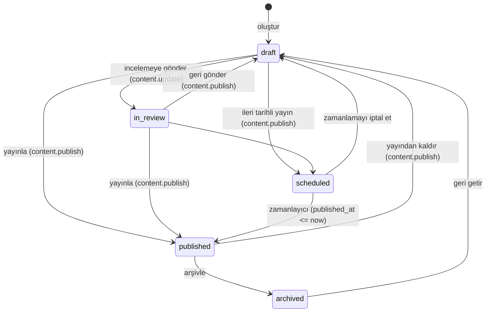
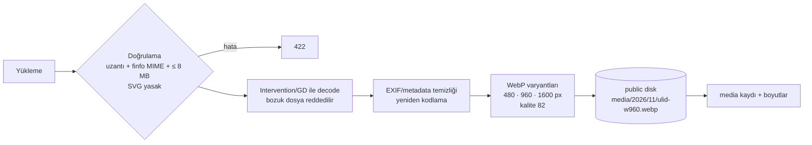
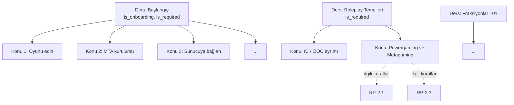
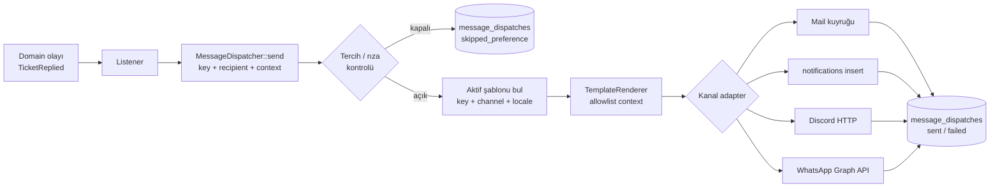

# CMS — İçerik Yönetimi, Akademi Müfredatı ve Şablon Motorları

> **Sürüm:** 1.0.0 · **Son güncelleme:** 2026-11-11 · **Durum:** Onay bekliyor
> **İlgili:** [DATABASE §10](DATABASE.md#10-i̇çerik-cms) · [ROUTES §6.8–6.9](ROUTES.md) · [DESIGN](DESIGN.md)

> **Yorum notu (PRD D-12):** Talep edilen "müfredat ders/konu tanımlama" bu projede **Akademi** (yeni oyuncu eğitim müfredatı), "sistem şablonları" **sayfa bölüm şablonları + sistem mesaj şablonları**, "WhatsApp şablon motoru" ise **çok kanallı mesaj şablon motorunun** WhatsApp kanalı olarak tanımlanmıştır.

---

## 1. Amaç ve ilkeler

1. **Kodsuz yönetim:** Brief §7.11'deki her içerik ACP'den, geliştirici olmadan değiştirilebilir.
2. **Güvenli zenginlik:** İçerik editörü HTML veya PHP yazamaz. Markdown + yapılandırılmış alanlar (JSON şema) kullanır. Çıktı her zaman sanitize edilir.
3. **Dürüst yayın:** `game_systems.is_live_in_game=false` olan sistem public'te görünmez. "Yakında" etiketi yalnızca açıkça `coming_soon` bölümünde kullanılabilir.
4. **İz sürülebilirlik:** Yayın, geri alma ve sürüm artırma işlemleri revizyon ve audit kaydı bırakır.
5. **Tasarım tutarlılığı:** Editör renk, font veya boşluk seçemez. Bölümler tasarım sisteminin sabit varyantlarından seçilir ([DESIGN §6](DESIGN.md)).

## 2. Yayın iş akışı



| Durum | Public'te görünür mü? | Not |
|---|---|---|
| `draft` | Hayır | İmzalı önizleme bağlantısıyla görülebilir |
| `in_review` | Hayır | Yayın yetkilisine "İncelemeyi bekleyenler" listesinde ve panel bildiriminde gösterilir |
| `scheduled` | Hayır (`published_at` gelene kadar) | Zamanlayıcı her dakika kontrol eder |
| `published` | Evet | `published_at <= now()` |
| `archived` | Hayır | URL 410 döndürür (haberlerde 404 yerine) |

Yayınlanmış bir içerik **düzenlendiğinde** değişiklik anında canlıya yansır (taslak kopya modeli R2'ye bırakılmıştır). Bu nedenle düzenleme formunda "Canlı içeriği düzenliyorsun" uyarısı gösterilir ve kayıt öncesi revizyon alınır (`pages`, `rules` için).

## 3. İçerik türleri

| Tür | Tablo | Public rota | Ana alanlar | Yetki |
|---|---|---|---|---|
| Sayfa | `pages` + `page_sections` | `/`, `/about`, yasal, `/p/{slug}` | template, body/sections, sürüm (yasal) | `content.*` |
| Haber | `news_posts` | `/news/{slug}` | kategori, kapak, özet, gövde, etiket, sabitle | `content.*` |
| Oyun sistemi | `game_systems` | `/systems/{slug}` | kategori, nasıl çalışır, nasıl erişilir, gereksinimler, medya/video, `is_live_in_game` | `content.*` |
| Meslek | `game_jobs` | `/jobs/{slug}` | sınıf, görevler, ilerleme, kazanç bilgisi, başvuru türü | `content.*` |
| Fraksiyon | `factions` | `/factions/{slug}` | tür, logo, gereksinimler, başvuru açık/kapalı, kural kategorisi | `content.*` / `factions.update_own` |
| Kural | `rule_categories` + `rules` | `/rules#KOD` | kod, başlık, gövde, ciddiyet ipucu | `content.*` |
| SSS | `faqs` | `/faq` | grup, soru, cevap, ana sayfada göster | `content.*` |
| Etkinlik | `community_events` | `/events/{slug}` | başlangıç/bitiş, konum etiketi | `content.*` |
| Duyuru | `announcements` | Banner / panel | hedef kitle, kanallar, tarih aralığı | `announcements.*` |
| Navigasyon | `navigation_items` | Header/footer | konum, rota adı veya URL, görünürlük | `content.update` |
| Sosyal bağlantı | `social_links` | Footer, topluluk bölümü | platform, URL | `content.update` |
| Akademi | `academy_courses` + `academy_topics` | `/academy/…`, `/start` | §5 | `academy.manage` |
| Medya | `media` | `/storage/media/…` | alt metin, varyantlar | `media.*` |

### 3.1 Ortak alan kuralları

| Alan | Kural |
|---|---|
| `slug` | Başlıktan otomatik üretilir, düzenlenebilir. Türkçe dönüşüm tablosu: `ç→c, ğ→g, ı→i, İ→i, ö→o, ş→s, ü→u`. Biçim `[a-z0-9-]`, en fazla 120 karakter, tür içinde benzersiz. Rezerv kelimeler (`create, edit, category, new`) kullanılamaz |
| `seo_title` | ≤ 70 karakter. Boşsa `{title} · {site.name}` kullanılır |
| `meta_description` | ≤ 170 karakter. Boşsa özetten (veya gövdenin ilk 160 karakterinden) üretilir |
| `sort` | Sürükle-bırak ile (`reorder` rotası), klavyeyle de yapılabilir (yukarı/aşağı butonları — NFR-A11Y-001) |
| Görsel | `media` referansı. `alt_text` zorunludur; dekoratif ise açıkça işaretlenir |
| Video | Yalnızca `youtube.com` / `youtube-nocookie.com` URL'leri. Embed `youtube-nocookie` ile ve **tıklayınca yüklenen** (facade) biçimde yapılır: çerez onayı ve performans için |
| Harici bağlantı | `https://` zorunlu. Markdown render'ında `rel="noopener nofollow ugc"` + harici ikon eklenir |

### 3.2 Markdown profili
- CommonMark + GFM (tablo, üstü çizili, otomatik bağlantı). Başlık seviyeleri gövdede `##` ile başlar (`#` sayfa başlığına aittir; render sırasında bir seviye kaydırılır).
- `html_input: 'escape'`, `allow_unsafe_links: false`, `max_nesting_level: 10`.
- Render sonrası `symfony/html-sanitizer` allowlist'i: `p, h2–h4, ul, ol, li, strong, em, del, a[href|title], blockquote, code, pre, table, thead, tbody, tr, th, td, hr, br, img[src|alt|width|height]` (img yalnızca kendi `storage/media` yolumuzdan).
- Özel kısa kodlar (Markdown uzantısı, R1):
  - `:::not` / `:::uyari` / `:::ipucu` → callout bileşenleri.
  - `[[kural:RP-4.2]]` → kurala bağlantı ve hover/odak özeti.
  - `[[adres]]` → sunucu adresi "plaka" bileşeni (değer ayarlardan okunur, içeriğe yazılmaz).
- Render sonucu `SafeHtml` value object'idir. Blade'de yalnızca bu tip `{!! !!}` ile basılabilir (RULES §6).

### 3.3 Medya işleme hattı



- Orijinal dosya da yeniden kodlanmış hâliyle saklanır (en fazla 2400 px). Ham yüklenen dosya saklanmaz.
- AVIF varyantı GD'nin AVIF desteğine bağlıdır: destek varsa üretilir, yoksa atlanır.
- `<x-ui.image :media="$m" sizes="(min-width: 1024px) 50vw, 100vw" />` bileşeni `srcset`, `width/height`, `loading`, `decoding="async"` özniteliklerini üretir.

## 4. Sistem şablonları — sayfa bölümleri (page builder)

Ana sayfa ve `landing` sayfaları **sıralı bölümlerden** oluşur. Her bölüm türü kodda tanımlı bir **sistem şablonudur**: bir Blade görünümü + JSON şeması + varsayılan veri. Editör yalnızca veriyi doldurur; düzeni ve stili şablon belirler.

### 4.1 Kayıt defteri

`App\Services\Content\SectionRegistry` her şablonu şu biçimde kaydeder:

```php
SectionType::make('feature_grid')
    ->label('Özellik kartları')
    ->view('sections.feature-grid')
    ->schema([
        'eyebrow'  => ['string', 'max:40', 'nullable'],
        'title'    => ['string', 'max:80', 'required'],
        'intro'    => ['string', 'max:300', 'nullable'],
        'variant'  => ['in:grid-3,grid-4,bento', 'required'],
        'items'    => ['array', 'min:3', 'max:9'],
        'items.*.icon'  => ['in_lucide_allowlist', 'required'],
        'items.*.title' => ['string', 'max:48', 'required'],
        'items.*.text'  => ['string', 'max:160', 'required'],
        'items.*.system_slug' => ['nullable', 'exists:game_systems,slug'],
    ])
    ->defaults([...]);
```

- Şema Laravel doğrulama kurallarıdır. ACP formu da şemadan otomatik üretilir (alan tipi → form bileşeni).
- Bir bölüm başka bir içerik türüne referans verebilir (`system_slug`). Referans verilen içerik yayında değilse kart **render edilmez** (ilke 3).
- Şablon sürümü değişip şema daraldığında, `content:validate-sections` komutu uyumsuz bölümleri raporlar.

### 4.2 Şablon kataloğu (R1)

| Anahtar | Ad | Veri | Notlar |
|---|---|---|---|
| `hero` | Karşılama | logo varyantı, slogan (≤ 60), açıklama (≤ 220), birincil CTA etiketi, ikincil CTA etiketi + hedef, arka plan medyası (görsel veya ≤ 8 sn sessiz video + poster), canlı rozet göster | Birincil CTA her zaman "Oyuna Katıl" panelini açar. Video düşük efekt modunda poster olarak gösterilir |
| `server_status` | Canlı sunucu durumu | başlık, açıklama, gösterilecek alanlar (oyuncu, kapasite, harita, mod, son heartbeat) | Veri köprüden gelir, editör sayı **giremez** |
| `feature_grid` | Özellik kartları | §4.1 | Brief §4.2 Bölüm 3 |
| `world_gallery` | Dünyayı keşfet | başlık, görseller (3–12), opsiyonel video | Lightbox klavye erişilebilir |
| `lifestyle_split` | Legal / illegal yaşam | iki sütun: başlık, metin, görsel, bağlantı | |
| `onboarding_steps` | Yeni oyuncu akışı | adımlar (3–8): başlık, kısa metin. Ya da "Akademi onboarding dersinden çek" anahtarı | Brief §4.2 Bölüm 5 |
| `community` | Topluluk | Discord daveti (ayarlardan), YouTube videosu, sosyal bağlantılar | |
| `news_latest` | Son haberler | adet (3/6), kategori filtresi | Otomatik |
| `events_upcoming` | Yaklaşan etkinlikler | adet | Otomatik. Boşsa bölüm gizlenir |
| `faq_list` | SSS | `show_on_home` SSS'leri veya seçili grup | FAQPage JSON-LD |
| `cta_banner` | Son çağrı | başlık, metin, CTA | |
| `rich_text` | Serbest metin | Markdown | |
| `stats_strip` | Doğrulanabilir sayılar | metrik anahtarları: `registered_users`, `peak_players_30d`, `factions_count` | Sayılar **hesaplanır**, elle girilemez (ilke: sahte sayı yok) |

### 4.3 Ana sayfa varsayılan dizilişi (seed)
`hero → server_status → feature_grid → world_gallery → lifestyle_split → onboarding_steps → community → news_latest → faq_list → cta_banner`

## 5. Akademi — Müfredat (Ders → Konu)

### 5.1 Amaç
Yeni oyuncunun (P2) kuralları ve oyun kültürünü **sunucuya girmeden önce** öğrenmesi. Bu sayede ilk gün ceza oranı düşer ve destek yükü azalır. `/start` rehberi de Akademi'nin bir dersidir.

### 5.2 Model



| Kavram | Kural |
|---|---|
| **Ders** (`academy_courses`) | Seviye (`beginner/intermediate/advanced`), tahmini süre, kapak görseli, `is_required`, `is_onboarding` (sistemde tek kayıt) |
| **Konu** (`academy_topics`) | Ders içinde sıralı. Markdown gövde, tahmini süre, `step_label` (`/start` adım başlığı), ilgili kurallar (çoka çok) |
| **İlerleme** (`academy_progress`) | Konu "Okudum" ile tamamlanır (idempotent). Ders ilerlemesi = tamamlanan / **yayındaki** konu sayısı |
| **Zorunluluk** | `is_required` derslerin tamamlanma durumu panelde rozetle gösterilir. Başvuru türleri ileride (`requires_academy_course_id`, R2) bunu şart koşabilir |
| **Sınav** (R2) | Konu sonu çoktan seçmeli quiz, geçme eşiği, deneme sınırı. Tablolar Faz 10'da DATABASE'e eklenir |

### 5.3 Kural onayı (rules acknowledgement)
- `settings.rules.current_version` (ör. `2026.11.1`) yalnızca `content.publish` yetkisiyle `bump-version` rotası üzerinden artırılır. Artırmak için **değişiklik notu** zorunludur ve bu not oyuncuya gösterilir.
- Sürüm artınca giriş yapan oyuncuya panelde engelleyici olmayan bir banner gösterilir: "Kurallar güncellendi (değişiklik notu) — Okudum, onaylıyorum". Onay `rule_acknowledgements` ve `consents(rules_ack)` tablolarına yazılır.
- Küçük düzeltmeler (yazım hatası) sürüm artırmadan yayınlanabilir. Her kural değişikliği `rule_revisions` kaydı oluşturur.

## 6. Mesaj şablon motoru (çok kanallı)

### 6.1 Amaç
Sistemin gönderdiği **her** mesajın (e-posta, panel bildirimi, Discord, WhatsApp) metni kodda değil, ACP'den düzenlenebilir şablonlardadır. Ancak bu şablonlar **güvenli** ve **mantıksız** (logic-less) bir dilde yazılır.

> ⚠️ **Kesin kural:** Admin tarafından düzenlenen şablonlar **asla** Blade/PHP olarak derlenmez (C-02). Blade derlemesi PHP kodu çalıştırır. Bu, ACP hesabı ele geçirildiğinde uzaktan kod çalıştırma (RCE / SSTI) anlamına gelir.

### 6.2 Söz dizimi

| Yapı | Örnek | Anlam |
|---|---|---|
| Değişken | `{{ user.username }}` | Allowlist'teki değişken. Bilinmeyen değişken **kayıt anında** hata verir |
| Filtre | `{{ ticket.created_at \| date }}` | İzinli filtreler: `upper`, `lower`, `title`, `date` (`d MMMM yyyy`), `datetime`, `relative`, `number`, `money` (minor → `1.250,00 ₺`), `truncate(n)`, `default("…")` |
| Koşul (tek seviye) | `{{#if ticket.character}}…{{/if}}` | Yalnızca değişkenin varlık/doluluk kontrolü. Karşılaştırma ve ifade yoktur |
| Bağlantı | `{{ link.ticket }}` | Bağlantılar **değişken olarak** sağlanır (imzalı URL'ler kodda üretilir). Editör URL'i kendisi kuramaz |
| Escape | `{{{ … }}}` | **Desteklenmez.** Ham çıktı yoktur |

Uygulama: `App\Services\Messaging\TemplateRenderer` — küçük bir tokenizer + AST, regex tabanlı kör değiştirme değil. Döngü yoktur, iç içe koşul yoktur. Maksimum şablon boyutu 20 KB, render süresi sınırı 50 ms.

### 6.3 Kanala göre çıktı ve escape

| Kanal | Gövde biçimi | Escape stratejisi | Sınırlar |
|---|---|---|---|
| `mail` | Markdown → Laravel mail teması (bizim marka temamız) | Değişkenler HTML-escape edilir. Markdown render'ı §3.2 profiliyle yapılır | Konu ≤ 200 karakter |
| `panel` | Düz metin + başlık | HTML-escape edilir (Blade `{{ }}` ile basılır) | Başlık ≤ 100, gövde ≤ 500 karakter |
| `discord_webhook` | Discord Markdown | Discord biçimlendirme karakterleri (`* _ ~ \` > \|`) ve `@everyone/@here` nötrlenir | ≤ 2000 karakter, `allowed_mentions: {parse: []}` |
| `whatsapp` | **Meta onaylı şablon** + parametreler | Parametreler düz metindir. Yeni satır ve 4'ten fazla ardışık boşluk temizlenir (Meta kuralı) | Parametre ≤ 1024 karakter |

### 6.4 Sistem şablon anahtarları (seed)

| Anahtar | Kanallar | Değişkenler | Tercihe bağlı mı? |
|---|---|---|---|
| `auth.verify_email` | mail | `user.username`, `link.verify`, `expires_minutes` | Hayır (transactional) |
| `auth.already_registered` | mail | `link.login`, `link.reset` | Hayır |
| `auth.password_reset` | mail | `user.username`, `link.reset`, `expires_minutes` | Hayır |
| `security.password_changed` | mail, panel | `user.username`, `event.time`, `event.device`, `link.security` | Hayır |
| `security.email_change_requested` | mail (yeni adres) | `user.username`, `link.confirm` | Hayır |
| `security.email_changed_notice` | mail (eski adres) | `user.username`, `new_email_masked`, `link.support` | Hayır |
| `security.new_login` (S) | mail, panel | `event.device`, `event.ip_masked`, `event.time`, `link.sessions` | Hayır |
| `security.two_factor_changed` | mail, panel | `user.username`, `state` | Hayır |
| `accounts.linked` | panel, mail | `account.name`, `server.name` | Evet |
| `accounts.unlink_decided` | panel, mail | `account.name`, `decision` | Evet |
| `support.ticket_created` | panel | `ticket.number`, `ticket.subject`, `link.ticket` | Evet |
| `support.staff_replied` | panel, mail, whatsapp* | `user.username`, `ticket.number`, `ticket.subject`, `link.ticket` | Evet |
| `support.player_replied` (personele) | panel | `ticket.number`, `link.ticket_admin` | Evet |
| `support.status_changed` | panel | `ticket.number`, `ticket.status_label` | Evet |
| `applications.status_changed` | panel, mail, whatsapp* | `application.type`, `application.status_label`, `note_public`, `link.application` | Evet |
| `sanctions.issued` | panel, mail | `sanction.type_label`, `sanction.ends_at`, `public_reason`, `link.appeal` | Hayır (hukuki bildirim) |
| `sanctions.appeal_decided` | panel, mail | `decision`, `note_public` | Hayır |
| `payments.succeeded` | panel, mail | `order.number`, `order.amount`, `credit_amount`, `wallet.name` | Hayır (işlem bildirimi) |
| `payments.failed` | panel, mail | `order.number`, `reason_label` | Hayır |
| `payments.refunded` | panel, mail | `order.number`, `refund.amount` | Hayır |
| `wallet.adjusted` | panel | `direction_label`, `amount`, `wallet.name`, `reason_public` | Hayır |
| `announcements.published` | panel, mail, discord_webhook | `announcement.title`, `announcement.excerpt`, `link.announcement` | Evet (mail) |
| `rules.updated` | panel | `rules.version`, `change_note`, `link.rules` | Hayır |
| `contact.received` (otomatik yanıt, S) | mail | `name`, `expected_response` | Hayır |
| `staff.role_changed` | panel, mail | `role.name`, `action` | Hayır |
| `ops.reconciliation_mismatch` (personele) | panel, mail | `wallet.ulid`, `diff` | Hayır |

\* WhatsApp kanalı R3'tedir ve yalnızca opt-in kullanıcılar içindir.

### 6.5 Gönderim hattı



- **Context sözleşmesi:** Her anahtar için kodda bir `TemplateContext` sınıfı vardır (`SupportStaffRepliedContext`). Sınıf, şablona hangi değişkenlerin verileceğini kesin olarak tanımlar. `message_templates.variables` sütunu bu sınıftan seed edilir ve salt okunurdur.
- **Yedek (fallback):** Aktif şablon bulunamazsa veya render hata verirse kodda gömülü varsayılan şablon kullanılır, hata loglanır ve ACP sistem sağlığı ekranında uyarı gösterilir. Kritik mesajlar (doğrulama, sıfırlama) hiçbir koşulda gönderilmeden kalmaz.
- **Önizleme:** ACP editörü, context sınıfının `sample()` verisiyle canlı önizleme yapar. "Test gönder" butonu yalnızca düzenleyen yetkilinin kendi adresine/kanalına gönderir.

### 6.6 WhatsApp kanalı (R3) özel kuralları

| Kural | Uygulama |
|---|---|
| Yasal dayanak | Açık rıza zorunludur: `consents(whatsapp_optin, granted=true)` + doğrulanmış numara (`user_contact_channels.verified_at`) |
| Numara doğrulama | Panelde numara girilir → onaylı `otp_verify` şablonuyla 6 haneli kod gönderilir → kod girilir (10 dk, 5 deneme) |
| Şablon onayı | İşletme tarafından başlatılan mesajlar yalnızca **Meta onaylı** şablonlarla gönderilebilir. `message_templates.provider_template_name` + `provider_params_map` alanları, bizim değişkenlerimizi konumsal `{{1}}, {{2}}` parametrelerine eşler. ACP'deki gövde yalnızca **referans/önizleme** amaçlıdır. Gerçek metin Meta panelinde onaylanır ve iki metin manuel olarak senkron tutulur (ACP'de "Meta'daki metinle aynı mı?" onay kutusu) |
| Kategori | Yalnızca `UTILITY` (işlem bildirimi). `MARKETING` kategorisi kullanılmaz |
| Opt-out | Gelen `STOP`/`DUR` mesajı (webhook) → `opted_out_at` + `consents(granted=false)`. Panelde tek tıkla kapatma |
| Hız | Kullanıcı başına günde en fazla 5 WhatsApp mesajı. Fazlası e-postaya düşer |
| Gizlilik | Numara şifreli saklanır (`encrypted`), aramalar `address_hash` üzerinden yapılır. Loglarda maskeli gösterilir (`+90 5** *** ** 12`) |
| Hata | Gönderilemeyen mesaj (24 saat penceresi, engelli numara…) `failed` olarak loglanır. Transactional mesajlar e-posta ile tekrar denenir |

## 7. Önbellek ve geçersizleştirme

| Olay | Temizlenen |
|---|---|
| İçerik kaydı / yayın / yayından kaldırma | `content:{type}:{slug}`, ilgili liste anahtarları, `sitemap`, `page:home` (bölüm referansı varsa) |
| Bölüm kaydı | `page:{slug}` |
| Navigasyon / sosyal bağlantı | `nav:*` |
| Ayar kaydı | `settings` |
| Şablon kaydı | `tpl:{key}:{channel}:{locale}` |

Uygulama: `ContentObserver` (Eloquent observer) + sürüm anahtarı deseni ([ARCHITECTURE §11](ARCHITECTURE.md#11-önbellekleme)).

## 8. SEO çıktısı

- `<x-seo :model="$post" />` bileşeni title, description, canonical, OG/Twitter ve JSON-LD üretir.
- JSON-LD: `Organization` + `WebSite` (layout), `Article` (haber), `FAQPage` (yalnızca SSS sayfası ve görünür SSS bölümü için), `BreadcrumbList` (detay sayfaları), `Event` (etkinlik).
- OG görseli: içerikte varsa onun 1200×630 varyantı, yoksa `settings.site.og_default_media_id`.
- Taslak, zamanlanmış ve arşivlenmiş içerik sitemap'e girmez.

## 9. ACP editör deneyimi (özet)

- **Liste:** durum sekmeleri (Tümü / Taslak / İncelemede / Zamanlanmış / Yayında / Arşiv), arama, sıralama, toplu "arşivle".
- **Form:** sol sütunda içerik, sağ sütunda yan panel (durum, yayın tarihi, slug, SEO, görsel). Taslak 30 sn'de bir **tarayıcı localStorage'ına** otomatik kaydedilir; kayıt DB'ye kullanıcı "Kaydet" dediğinde yapılır. Sayfadan çıkarken kaydedilmemiş değişiklik uyarısı gösterilir.
- **Markdown editörü:** Hafif textarea + araç çubuğu (kalın, başlık, liste, bağlantı, callout, kural bağlantısı) ve yan yana önizleme sekmesi. WYSIWYG kullanılmaz (güvenlik ve tutarlılık için).
- **Bölüm düzenleyici:** Bölüm kartları listesi, sürükle-bırak + klavye sıralama, şemadan üretilen form, görünür/gizli anahtarı, "varsayılana dön".

## 10. Faz 5 uygulama notları (R1)

Faz 5'te teslim edilen ACP deneyimi §9'daki hedefin sade bir ilk sürümüdür. Farklar bilinçlidir ve sonraki fazlarda kapatılır:

| Konu | Faz 5 durumu | Hedef |
|---|---|---|
| Bölüm düzenleyici | Her bölüm için **JSON veri alanı** + şema alan listesi + görünür/gizli + yukarı/aşağı taşıma. Kayıtta tür şemasıyla doğrulanır; şema dışı anahtarlar atılır (`SectionRegistry::schema()`) | Şemadan otomatik form (R2) |
| Markdown editörü | Düz textarea + söz dizimi ipucu; önizleme imzalı **önizleme sayfasında** (30 dk) | Araç çubuğu + yan yana canlı önizleme (R2) |
| Taslak otomatik kayıt (localStorage) | Yok | R2 |
| Şablon editörü | Kaydedilmiş sürümün örnek veriyle önizlemesi + `preview` JSON uç noktası + kendine test gönderimi + revizyon geri yükleme | Kaydetmeden canlı önizleme (JS) |
| Kısa kodlar (`:::not`, `[[kural:…]]`, `[[adres]]`) | Henüz yok (Markdown düz render edilir) | R2 |
| `factions.update_own` | Faz 8'e ertelendi | Fraksiyon branşı ile |
| Mesaj kanalları | Yalnızca `mail` (+ `message_dispatches` logu). Duyurularda `public_banner` ve `panel` kanalı kendi ekranlarında gösterilir | `panel` bildirimi Faz 6, Discord/WhatsApp Faz 10 |

Şablon motoru (`App\Services\Messaging\TemplateRenderer`) §6.2 söz dizimini eksiksiz uygular: değişken allowlist, filtreler (`upper, lower, title, date, datetime, relative, number, money, truncate(n), default("…")`), tek seviye `{{#if}}`, `{{{ }}}` yasağı, 20 KB / 50 ms sınırı. Mail kanalında değişken değerleri HTML + Markdown escape edilir; `link.*` değişkenleri yalnızca `http(s)` olabilir. DB şablonu render edilemezse kodda gömülü varsayılan (`lang/tr/messages.php`) kullanılır ve uyarı loglanır.
