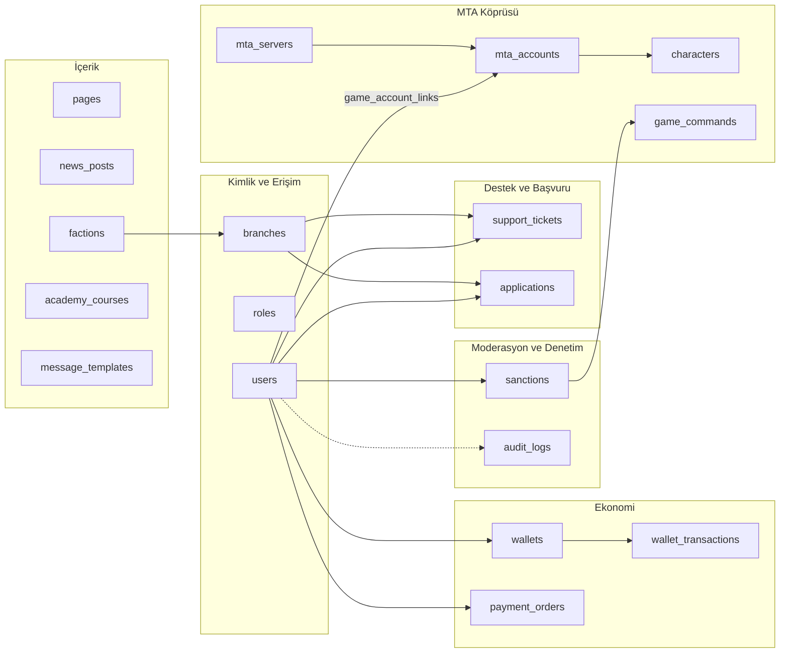
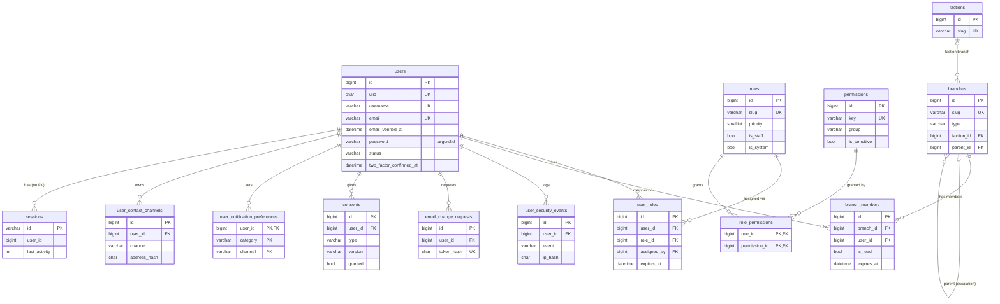
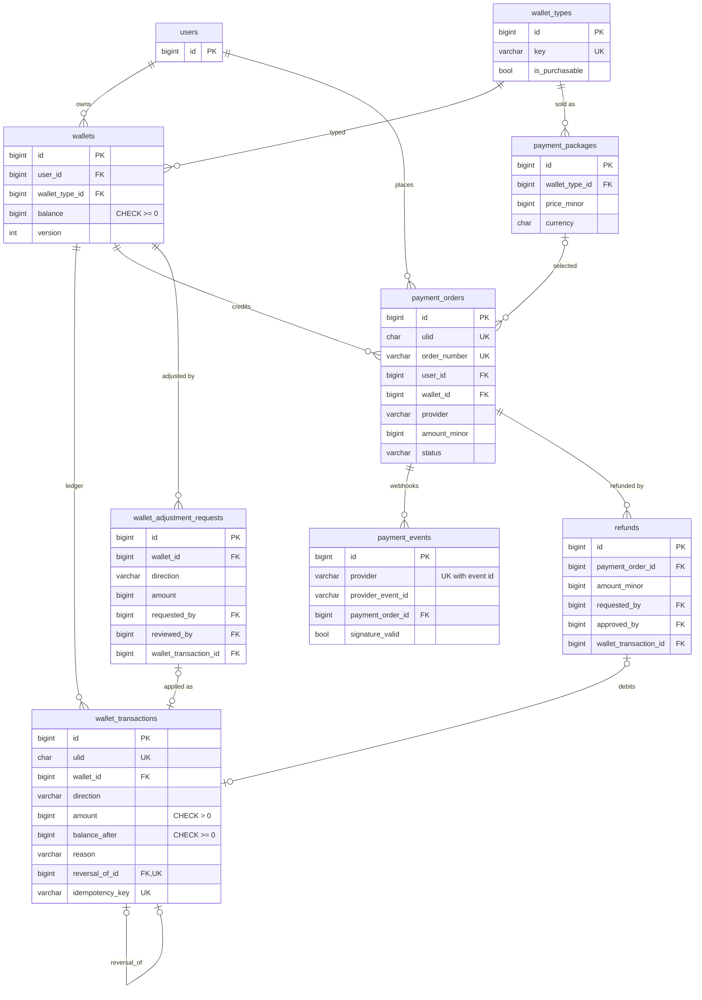
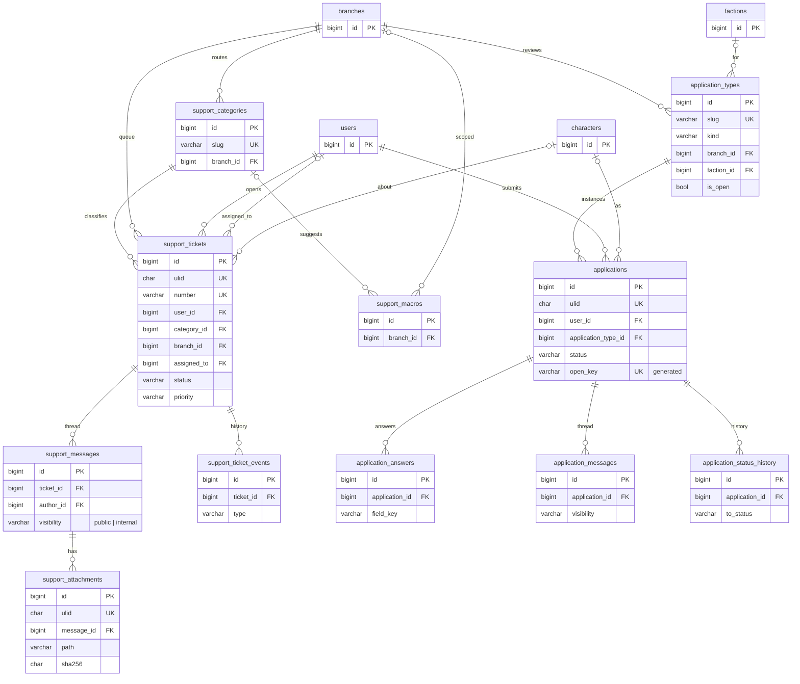
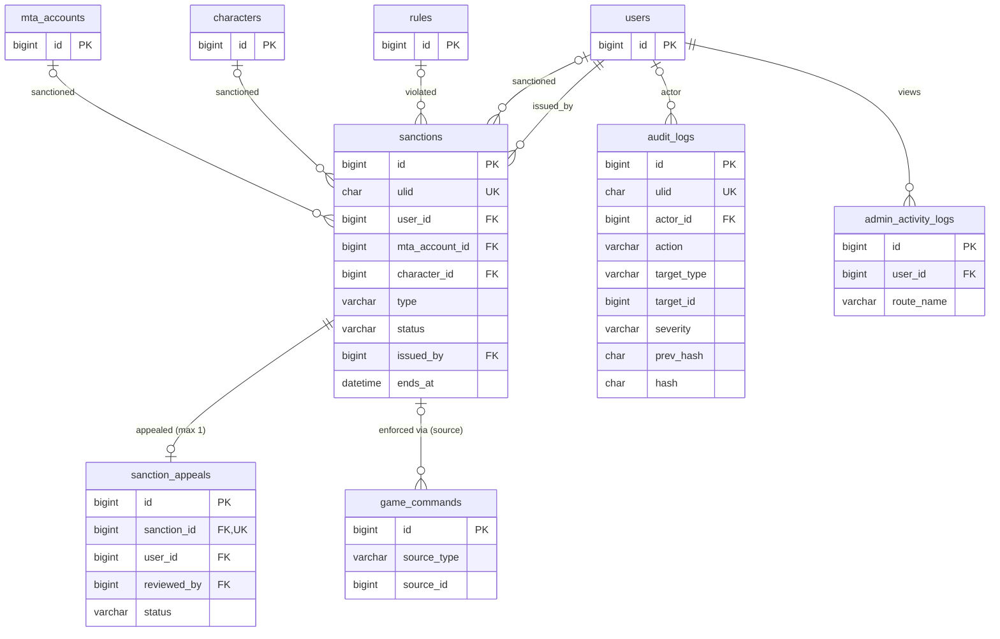

# ERD — Varlık İlişki Diyagramları

> **Sürüm:** 1.0.0 · **Son güncelleme:** 2026-11-11 · **Durum:** Onay bekliyor
> **İlgili:** [DATABASE](DATABASE.md) (kolon ayrıntıları, tipler ve cascade kuralları orada)

Diyagramlar okunabilirlik için **alanlara bölünmüştür**. Her diyagramda yalnızca anahtar ve ilişkiyi belirleyen kolonlar gösterilir. Tam kolon listesi [DATABASE.md](DATABASE.md) içindedir. Kardinalite gösterimi: `||` tam bir, `o|` sıfır veya bir, `|{` bir veya çok, `o{` sıfır veya çok.

## 0. Genel bakış (alanlar arası)

## 1. Kimlik, rol ve branş

## 2. MTA hesapları, karakterler ve köprü

```mermaid
erDiagram
    mta_servers ||--o{ integration_credentials : "authenticates"
    integration_credentials ||--o{ bridge_nonces : "used"
    mta_servers ||--o{ server_heartbeats : "reports"
    mta_servers ||--o{ server_stats_daily : "aggregates"
    mta_servers ||--o{ mta_accounts : "hosts"
    mta_servers ||--o{ characters : "hosts"
    mta_servers ||--o{ game_events : "emits"
    mta_servers ||--o{ game_commands : "receives"
    users ||--o{ game_account_links : "links"
    mta_accounts ||--o{ game_account_links : "linked by (max 1 active)"
    users ||--o{ game_link_codes : "generates"
    mta_accounts o|--o{ game_link_codes : "consumed by"
    mta_accounts ||--o{ characters : "owns"
    mta_accounts ||--o{ mta_account_devices : "uses"
    mta_accounts o|--o{ game_events : "subject of"
    mta_accounts o|--o{ game_commands : "target of"
    factions o|--o{ characters : "member"
    game_jobs o|--o{ characters : "works as"

    mta_servers {
        bigint id PK
        varchar slug UK
        varchar connect_host
        smallint connect_port
        datetime last_heartbeat_at
        smallint last_player_count
        bool is_maintenance
    }
    integration_credentials {
        bigint id PK
        bigint mta_server_id FK
        varchar key_id UK
        text secret "encrypted"
        datetime revoked_at
    }
    bridge_nonces {
        char nonce PK
        bigint credential_id FK
        datetime created_at
    }
    server_heartbeats {
        bigint id PK
        bigint mta_server_id FK
        smallint player_count
        datetime received_at
    }
    server_stats_daily {
        bigint mta_server_id PK,FK
        date date PK
        smallint peak_players
    }
    mta_accounts {
        bigint id PK
        char ulid UK
        bigint mta_server_id FK
        varchar mta_account_ref "UK with server"
        varchar account_name
    }
    game_account_links {
        bigint id PK
        bigint user_id FK
        bigint mta_account_id FK
        varchar status
        bigint active_mta_account_id UK "generated"
    }
    game_link_codes {
        bigint id PK
        bigint user_id FK
        varchar purpose
        char code_hash UK
        datetime expires_at
        datetime used_at
        bigint used_by_mta_account_id FK
    }
    characters {
        bigint id PK
        char ulid UK
        bigint mta_account_id FK
        varchar mta_character_ref "UK with server"
        varchar name
        bigint faction_id FK
        bigint game_job_id FK
    }
    mta_account_devices {
        bigint id PK
        bigint mta_account_id FK
        char serial_hmac
        varchar status
    }
    game_events {
        bigint id PK
        bigint mta_server_id FK
        char event_id "UK with server"
        varchar type
        varchar status
    }
    game_commands {
        bigint id PK
        char ulid UK
        bigint mta_server_id FK
        varchar type
        varchar idempotency_key UK
        varchar status
        bigint requested_by FK
    }
    users {
        bigint id PK
    }
    factions {
        bigint id PK
    }
    game_jobs {
        bigint id PK
    }
```

## 3. Ekonomi ve ödeme

## 4. Destek ve başvurular

## 5. İçerik (CMS), Akademi ve şablonlar

```mermaid
erDiagram
    pages ||--o{ page_sections : "composed of"
    pages ||--o{ page_revisions : "versions"
    media o|--o{ pages : "og image"
    news_categories ||--o{ news_posts : "groups"
    news_posts ||--o{ news_post_tag : ""
    tags ||--o{ news_post_tag : ""
    media o|--o{ news_posts : "cover"
    game_system_categories ||--o{ game_systems : "groups"
    application_types o|--o{ game_jobs : "apply via"
    application_types o|--o{ factions : "apply via"
    rule_categories o|--o{ factions : "rules"
    rule_categories ||--o{ rules : "contains"
    rules ||--o{ rule_revisions : "versions"
    users ||--o{ rule_acknowledgements : "acknowledges"
    academy_courses ||--o{ academy_topics : "has topics"
    academy_topics ||--o{ academy_topic_rule : ""
    rules ||--o{ academy_topic_rule : "taught in"
    users ||--o{ academy_progress : "completes"
    academy_topics ||--o{ academy_progress : ""
    announcements ||--o{ announcement_reads : ""
    users ||--o{ announcement_reads : ""
    navigation_items o|--o{ navigation_items : "parent"
    message_templates ||--o{ message_template_revisions : "versions"
    message_templates o|--o{ message_dispatches : "rendered as"
    users o|--o{ message_dispatches : "receives"

    pages {
        bigint id PK
        varchar slug UK
        varchar template
        varchar status
        bool is_system
    }
    page_sections {
        bigint id PK
        bigint page_id FK
        varchar type "system template key"
        json data
        smallint sort
    }
    page_revisions {
        bigint id PK
        bigint page_id FK
        json snapshot
    }
    media {
        bigint id PK
        char ulid UK
        varchar path
        json variants
        varchar alt_text
    }
    news_posts {
        bigint id PK
        varchar slug UK
        bigint news_category_id FK
        bigint cover_media_id FK
        varchar status
        datetime published_at
    }
    news_categories {
        bigint id PK
    }
    tags {
        bigint id PK
    }
    news_post_tag {
        bigint news_post_id PK,FK
        bigint tag_id PK,FK
    }
    game_system_categories {
        bigint id PK
    }
    game_systems {
        bigint id PK
        bigint game_system_category_id FK
        bool is_live_in_game
    }
    game_jobs {
        bigint id PK
        varchar class
        bigint application_type_id FK
    }
    factions {
        bigint id PK
        varchar type
        bigint application_type_id FK
        bigint rule_category_id FK
        bool applications_open
    }
    rule_categories {
        bigint id PK
        varchar prefix
    }
    rules {
        bigint id PK
        varchar code UK
        bigint rule_category_id FK
    }
    rule_revisions {
        bigint id PK
        bigint rule_id FK
    }
    rule_acknowledgements {
        bigint id PK
        bigint user_id FK
        varchar version
    }
    academy_courses {
        bigint id PK
        varchar slug UK
        bool is_required
        bool is_onboarding
    }
    academy_topics {
        bigint id PK
        bigint academy_course_id FK
        varchar slug
    }
    academy_topic_rule {
        bigint academy_topic_id PK,FK
        bigint rule_id PK,FK
    }
    academy_progress {
        bigint user_id PK,FK
        bigint academy_topic_id PK,FK
        datetime completed_at
    }
    announcements {
        bigint id PK
        varchar audience
        json channels
    }
    announcement_reads {
        bigint announcement_id PK,FK
        bigint user_id PK,FK
    }
    navigation_items {
        bigint id PK
        varchar location
        bigint parent_id FK
    }
    message_templates {
        bigint id PK
        varchar key "UK with channel+locale"
        varchar channel
        bool is_system
    }
    message_template_revisions {
        bigint id PK
        bigint message_template_id FK
    }
    message_dispatches {
        bigint id PK
        bigint message_template_id FK
        bigint user_id FK
        varchar status
    }
    users {
        bigint id PK
    }
    application_types {
        bigint id PK
    }
```

Bağımsız tablolar (ilişkisi yok veya yalnızca `users` ilişkisi var): `faqs`, `community_events`, `social_links`, `redirects`, `contact_messages`, `system_settings`.

## 6. Moderasyon ve denetim

## 7. Kritik bütünlük kuralları (özet)

| Kural | Mekanizma | Tablo |
|---|---|---|
| Bir oyun hesabı = en fazla 1 aktif web bağlantısı | Generated column + unique | `game_account_links.active_mta_account_id` |
| Kullanıcı × başvuru türü = en fazla 1 açık başvuru | Generated column + unique | `applications.open_key` |
| Aynı webhook iki kez işlenmez | Unique | `payment_events (provider, provider_event_id)` |
| Aynı köprü olayı iki kez işlenmez | Unique | `game_events (mta_server_id, event_id)` |
| Replay engeli | PK çakışması | `bridge_nonces.nonce` |
| Ledger değiştirilemez | Trigger + CHECK | `wallet_transactions` |
| Bir işlem en fazla bir kez ters çevrilir | Unique | `wallet_transactions.reversal_of_id` |
| Ceza başına tek itiraz | Unique | `sanction_appeals.sanction_id` |
| Audit kaydı değiştirilemez | Trigger + hash zinciri | `audit_logs` |
