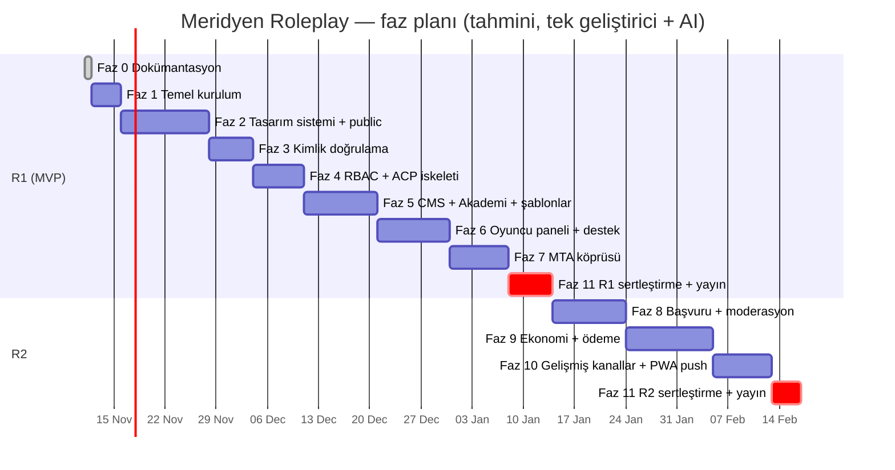

# ROADMAP — Geliştirme Fazları

> **Sürüm:** 1.0.0 · **Son güncelleme:** 2026-11-11 · **Durum:** Onay bekliyor
> **İlgili:** [PRD §5](PRD.md#5-kapsam-ve-sürüm-planı) · [TODO](TODO.md) · [RULES §12](RULES.md)

Her faz **küçük, test edilebilir ve yayınlanabilir** bir artıştır. Bir faz, **çıkış kriterleri** sağlanmadan kapanmaz ve sonraki faza geçilmez. Faz sırası brief §18.3 ilkesini izler: önce veri modeli ve sözleşme, sonra backend, sonra arayüz.

## Genel görünüm

> Süreler **iş günü tahminidir**, taahhüt değildir. Her faz sonunda gerçekleşen süre [TODO.md](TODO.md) "Faz günlüğü" bölümüne yazılır ve sonraki tahminler buna göre güncellenir.

**Sürümler:** R1 = Faz 0–7 + Faz 11 kontrol listesi. R2 = Faz 8–10 + Faz 11 kontrol listesi (tekrar). Faz 11 bir **yayın kapısıdır**; her sürüm öncesi baştan uygulanır.

---

## Faz 0 — Dokümantasyon ✅
**Hedef:** Tek doğruluk kaynağının oluşturulması.
**Teslimatlar:** `/docs` altındaki 12 doküman + README dizini.
**Çıkış kriterleri:** Proje sahibi PRD §10 kararlarını ve §11 açık kararlarını gözden geçirir. OD-01..08 için varsayılanlar kabul edilir veya değiştirilir.

## Faz 1 — Temel kurulum
**Hedef:** Boş ama doğru yapılandırılmış, testleri ve kalite araçları çalışan bir Laravel uygulaması.

| # | Görev | Referans |
|---|---|---|
| 1.1 | Composer kurulumu. XAMPP `php.ini` içinde `intl, gd, zip, sodium` eklentilerinin açılması | SRS C-01 |
| 1.2 | Laravel 13 kurulumu (geçici dizinde oluşturulup proje köküne taşınır, `docs/` korunur) | ARCH §3 |
| 1.3 | `git init`, `.gitignore`, `.gitattributes` (LF), ilk commit | RULES §10 |
| 1.4 | MariaDB veritabanı + ayrı test DB'si, `utf8mb4_unicode_ci`, PDO seçenekleri | DB §1.1 |
| 1.5 | `.env.example` (tüm anahtarlar, secret yok), config doğrulaması (`AppServiceProvider` içinde zorunlu anahtar kontrolü) | ARCH §14 |
| 1.6 | Apache vhost `roleplay-web.test` → `public/`, hosts kaydı. Opsiyonel mkcert TLS | TODO |
| 1.7 | Paketler: Fortify, Pest, Larastan, Pint, blade-lucide-icons, commonmark, html-sanitizer, intervention/image | ARCH §1 |
| 1.8 | Vite + Tailwind v4 + Alpine CSP + self-host fontlar | ARCH §1 |
| 1.9 | Global middleware: `AssignRequestId`, `SecurityHeaders` (CSP nonce), JSON hata formatı, hata sayfaları iskeleti | SRS §8, SEC-024/025 |
| 1.10 | `config/roleplay.php`, `config/permissions.php` iskeletleri. Rota dosyaları (`web`, `panel`, `admin`, `api`, `webhooks`) bağlanmış ve boş | ROUTES |
| 1.11 | Pest `arch()` testleri (katman kuralları), `composer test` / `composer lint` / `composer analyse` scriptleri | ARCH §3.1 |
| 1.12 | Mailpit kurulumu (veya `MAIL_MAILER=log`), `composer dev` (server + queue + vite) | ARCH §14 |

**Çıkış kriterleri:** `composer lint`, `composer analyse`, `composer test`, `npm run build` hatasız geçer. `/up` 200 döner. Güvenlik başlıkları `curl -I` ile doğrulanır. Hata sayfaları render edilir.

## Faz 2 — Tasarım sistemi ve public site
**Hedef:** DESIGN.md'nin koda dökülmesi ve tüm public sayfaların (statik/seed veriyle) hazır olması.

| # | Görev |
|---|---|
| 2.1 | Token'lar (`@theme`), dark/light, düşük efekt, flaşsız tema, kontrast testi |
| 2.2 | `x-ui.*` temel bileşenleri + **bileşen vitrini** sayfası (`/_styleguide`, yalnızca local) |
| 2.3 | İmza bileşenleri: address-plate, route-steps, eyebrow, link-code (statik), meridian-grid, status-pill |
| 2.4 | Public layout: header (responsive nav, drawer), footer, SEO bileşeni, çerez banner'ı |
| 2.5 | İçerik tabloları için migration'lar + modeller + `ContentSeeder` (gerçek içerik değil, işaretli taslak metin). Public okuma tarafı |
| 2.6 | Sayfalar: ana sayfa (bölüm sistemi), about, systems, jobs, factions, start, rules, news, faq, contact, yasal |
| 2.7 | Sunucu durum kartı: `mta_servers` tablosu + `ServerStatusResolver` + public API (heartbeat gelene kadar "offline") |
| 2.8 | Sitemap, robots, RSS, JSON-LD, 404/419/429/500/503 tasarımları |
| 2.9 | Logo SVG, favicon, OG varsayılan görseli |

**Çıkış kriterleri:** DESIGN §10'daki 1–3. ve 10. ekranlar 6 kırılım noktasında, iki temada kontrol edilmiştir. Lighthouse (mobil): Performans ≥ 90, Erişilebilirlik ≥ 95. Klavye ile tam gezinti yapılabilir. Kontrast testi yeşildir.

## Faz 3 — Kimlik doğrulama
**Hedef:** Güvenli kayıt, giriş, doğrulama, sıfırlama ve oturum yönetimi.

| # | Görev | FR |
|---|---|---|
| 3.1 | `users` (ulid, username, status, theme…), `user_security_events`, `consents` migration'ları | DB §3 |
| 3.2 | Fortify kurulumu: views, `authenticateUsing` (e-posta veya kullanıcı adı), Argon2id | FR-AUTH-003, 007 |
| 3.3 | Kayıt: doğrulama kuralları, rezerv adlar, uncompromised, honeypot, enumerasyonsuz akış, rıza kayıtları | FR-AUTH-001..004 |
| 3.4 | E-posta doğrulama + `verified` kapıları | FR-AUTH-005, 006 |
| 3.5 | Giriş rate limit'leri, güvenlik olayları, askı kontrolü (`EnsureAccountActive`) | FR-AUTH-008..011 |
| 3.6 | Şifre sıfırlama + diğer oturumları sonlandırma | FR-AUTH-013 |
| 3.7 | Mesaj gönderiminin ilk sürümü: `MessageDispatcher` + `mail` kanalı + kodda gömülü varsayılan şablonlar (ACP düzenlemesi Faz 5'te) | FR-NTF-001, 005 |
| 3.8 | `IpMasker`, `UserAgentSummary`, log redaction processor | SEC-043, NFR-OBS-003 |

**Çıkış kriterleri:** `tests/Feature/Auth/*` tüm FR-AUTH-001..015 maddelerini kapsar ve yeşildir. Brute force testi (6. denemede 429) geçer. Kullanıcı enumerasyonu testi (var olan ve olmayan e-posta için yanıt eşitliği) geçer.

## Faz 4 — RBAC, branşlar ve ACP iskeleti
**Hedef:** Yetki modeli, MFA zorunluluğu, audit altyapısı ve yönetim paneli kabuğu.

| # | Görev | Ref |
|---|---|---|
| 4.1 | `roles, permissions, role_permissions, user_roles, branches, branch_members, audit_logs, admin_activity_logs, system_settings` migration'ları + seeder'lar | DB §3–4, §11 |
| 4.2 | `PermissionRegistry`, `Gate::before`, izin cache'i, `BranchScope`, `RoleHierarchy` | ADMIN §1, §5 |
| 4.3 | `AuditLogger` (hash zinciri, append-only trigger), `audit:verify` komutu | DB §7, §11.3 |
| 4.4 | Admin middleware zinciri: `staff`, `mfa`, `admin.idle`, `admin.activity`. 2FA kurulum akışı (panel) | FR-AUTH-016, 017, FR-ADM-001..004 |
| 4.5 | ACP layout (sidebar, izin filtreli menü), dashboard (ilk metrikler) | DESIGN §7.3 |
| 4.6 | Kullanıcı yönetimi: liste, detay, askıya alma, PII maskeleme | FR-ADM-005, 006 |
| 4.7 | Personel, rol ve branş yönetimi ekranları | ROUTES §6.10 |
| 4.8 | Audit log ve aktivite log ekranları | FR-ADM-008 |
| 4.9 | Ayarlar ekranı (gruplar, secret maskeleme), bakım modu | FR-ADM-009, FR-PUB-018 |
| 4.10 | `mrp:make-super-admin` komutu | ADMIN §4.3 |
| 4.11 | `AdminRouteProtectionTest`, `RoleMatrixTest` | SEC-010 |

**Çıkış kriterleri:** Rol matrisindeki **her** izin için pozitif ve negatif test vardır. MFA'sız personel `/admin` alanına giremez. Son süper admin korunur. Audit zinciri doğrulaması geçer.

## Faz 5 — CMS, Akademi ve şablon motoru
**Hedef:** Public içeriğin tamamen ACP'den yönetilmesi.

| # | Görev | Ref |
|---|---|---|
| 5.1 | CMS kaynak deseni (`AdminResource` makrosu), yayın iş akışı, slug, redirect'ler, revizyonlar | CMS §2–3 |
| 5.2 | Markdown hattı (`MarkdownRenderer` + sanitizer + kısa kodlar), `SafeHtml` | CMS §3.2 |
| 5.3 | Medya kütüphanesi + işleme hattı | CMS §3.3 |
| 5.4 | Bölüm düzenleyici + `SectionRegistry` + şema doğrulama | CMS §4 |
| 5.5 | Tüm içerik türlerinin ACP ekranları, navigasyon ve sosyal bağlantılar | ROUTES §6.8 |
| 5.6 | Akademi: ders/konu, `/academy` public, panel ilerlemesi, `/start` entegrasyonu, kural onayı | CMS §5 |
| 5.7 | `TemplateRenderer` (tokenizer/AST), `message_templates` + revizyonlar, ACP editörü + önizleme + test gönderimi, sistem şablonlarının seed'i | CMS §6 |
| 5.8 | Duyurular (banner + panel + e-posta batch) | FR-ADM-011 |
| 5.9 | Zamanlanmış yayın komutu, cache geçersizleştirme | FR-CMS-008, CMS §7 |

**Çıkış kriterleri:** Brief §16.3 E2E-11 senaryosu (admin içerik yayınlar → public'te görünür) geçer. Şablon motorunda SSTI denemeleri (`{{ system('…') }}`, `@php`, `{!! !!}`) reddedilir. Markdown XSS test seti (OWASP XSS filter evasion örnekleri) temiz çıkar.

## Faz 6 — Oyuncu paneli ve destek
**Hedef:** UCP'nin tamamı (MTA'ya bağımlı olmayan kısımlar) ve uçtan uca destek sistemi.

| # | Görev | Ref |
|---|---|---|
| 6.1 | Panel layout (sidebar + mobil alt sekme), dashboard, boş durumlar | DESIGN §7.2 |
| 6.2 | Bildirimler (Laravel notifications + duyuru okumaları), sayaç polling | FR-UCP-002, 003 |
| 6.3 | Güvenlik sayfası: parola, e-posta değişikliği, 2FA, oturumlar, güvenlik olayları | FR-AUTH-014..019 |
| 6.4 | Ayarlar: tema, düşük efekt, bildirim tercihleri | FR-UCP-004 |
| 6.5 | Destek: kategoriler, ticket oluşturma (ekler, idempotency), mesaj dizisi, kapatma/yeniden açma | FR-SUP-001..004, 011 |
| 6.6 | ACP destek: kuyruk, branş kapsamı, yanıt/iç not, atama, escalation, makrolar, sayaçlar | FR-SUP-005..010 |
| 6.7 | Otomatik ticket geçişleri (zamanlayıcı) | FR-SUP-005 |
| 6.8 | Hesap silme talebi + anonimleştirme | FR-AUTH-020, DB §13 |
| 6.9 | Temel PWA: manifest, ikonlar, SW (precache + offline + güncelleme toast'ı + logout temizliği) | FR-PWA-001..005 |

**Çıkış kriterleri:** Brief §16.3 E2E-8, 9, 10 senaryoları geçer. İç notun oyuncuya sızmadığı üç katmanda (scope, policy, view) test edilmiştir. IDOR testi (başka kullanıcının ticket ULID'si → 404) geçer. Dosya yükleme bypass denemeleri (çift uzantı, sahte MIME, polyglot) reddedilir.

## Faz 7 — MTA köprüsü
**Hedef:** Web ↔ MTA güvenli entegrasyonu ve hesap bağlama.

| # | Görev | Ref |
|---|---|---|
| 7.1 | **Spike:** MTA 1.6 `hash` fonksiyonunda HMAC desteği. Yoksa saf Lua HMAC. Ortak test vektörleri | ARCH §7.3 |
| 7.2 | `integration_credentials`, `bridge_nonces`, `server_heartbeats`, `mta_accounts`, `game_account_links`, `game_link_codes`, `characters`, `game_events` migration'ları | DB §4–5 |
| 7.3 | `VerifyBridgeSignature` + `SignatureVerifier` + `NonceStore` + `BridgeSecurityTest` | FR-BRG-001..008 |
| 7.4 | Heartbeat, ping, durum çözümleyici, public kart entegrasyonu, günlük istatistik | FR-BRG-009, 010 |
| 7.5 | Hesap bağlama (panel UI + köprü ucu + polling) | FR-ACC-001..007 |
| 7.6 | Oyuncu olayları, hesap ve karakter senkronu, karakter ekranları | FR-ACC-008, 009 |
| 7.7 | Lua resource: config, request (retry/kuyruk), signature, heartbeat, player_events, account_link, character_sync | ARCH §7.7 |
| 7.8 | ACP: MTA entegrasyon ekranı (sunucular, credential oluşturma/rotasyon/iptal), oyun hesapları ve karakter listeleri, bağlantı kaldırma onayı | FR-ADM-012, ROUTES §6.3 |
| 7.9 | Köprü uyarıları (imza hatası eşiği) | FR-BRG-008 |

**Çıkış kriterleri:** Brief §16.3 E2E-5, 6, 7, 13 senaryoları **gerçek bir MTA test sunucusuyla** geçer. Replay, eski zaman damgası ve hatalı imza testleri geçer. MTA kapatıldığında public sitenin "Çevrimdışı" gösterdiği ve diğer işlevlerin çalıştığı doğrulanır (NFR-REL-002).

## Faz 8 — Başvurular, moderasyon, cihazlar, oyun komutları (R2)

| # | Görev | Ref |
|---|---|---|
| 8.1 | Başvuru türleri, sabit form şemaları, oyuncu akışı, ACP inceleme (branş kapsamlı) | FR-APP-* |
| 8.2 | Cezalar, panel ceza geçmişi, itirazlar | FR-MOD-* |
| 8.3 | Komut kuyruğu (pending/result/requeue) + Lua `commands.lua` + allowlist | FR-BRG-011, ARCH §7.5 |
| 8.4 | Cihaz/serial ilişkilendirme | FR-ACC-010, ARCH §7.6 |

**Çıkış kriterleri:** Fraksiyon yöneticisinin başka fraksiyonun başvurusuna erişememesi testi geçer. Ceza → komut → sonuç döngüsü test sunucusunda doğrulanır. Ham serial hiçbir log veya yanıtta bulunmaz (grep testi).

## Faz 9 — Ekonomi ve ödeme (R2)
**Ön koşul:** OD-03 (cüzdan türleri) ve OD-04 (sağlayıcı) kararları verilmiştir. Verilmediyse yalnızca `FakeProvider` ile geliştirilir ve `features.payments` kapalı kalır.

| # | Görev | Ref |
|---|---|---|
| 9.1 | Cüzdan tabloları, `LedgerService` (lock, idempotency, CHECK, trigger) | FR-WAL-001..005 |
| 9.2 | Düzeltme talepleri + dört göz | FR-WAL-006 |
| 9.3 | `PaymentProvider` arayüzü + `FakeProvider` + checkout + webhook inbox + işleme job'u | FR-PAY-001..004 |
| 9.4 | Gerçek sağlayıcı adapter'ı (sandbox) | OD-04 |
| 9.5 | İadeler | FR-PAY-005 |
| 9.6 | Mutabakat görevi ve raporu | FR-WAL-007 |
| 9.7 | Panel: cüzdan, işlemler, top-up, dönüş sayfası. ACP: ekonomi ve ödemeler | ROUTES §5.7, §6.7 |
| 9.8 | `/refund-policy` yasal metni | FR-PUB-014 |

**Çıkış kriterleri:** Aynı webhook 2 kez gönderildiğinde tek kredi oluşur. Eşzamanlı 50 debit isteğinde bakiye negatife düşmez (eşzamanlılık testi). Ledger toplamı ile bakiye eşitliği mutabakatta doğrulanır. Finans yöneticisi rol yönetemez; destek yetkilisi finans uçlarına erişemez.

## Faz 10 — Gelişmiş kanallar ve deneyim (R2)

| # | Görev | Ref |
|---|---|---|
| 10.1 | Laravel Reverb: ticket mesajları, bildirimler, durum değişimi (polling yedek kalır) | ARCH §9 |
| 10.2 | Web Push (VAPID, `push_subscriptions` tablosu — önce DATABASE güncellenir) | ARCH §8.1 |
| 10.3 | Discord webhook kanalı (duyurular, ops uyarıları) | CMS §6.3 |
| 10.4 | WhatsApp kanalı (OD-05 onaylanırsa): numara doğrulama, opt-in/out, Meta şablon eşlemesi, webhook | CMS §6.6 |
| 10.5 | Akademi sınavları (önce DATABASE güncellenir) | CMS §5.2 |
| 10.6 | KVKK veri dışa aktarımı (JSON) | SRS §6.3 |

## Faz 11 — Sertleştirme ve yayın (her sürümde tekrarlanır)

| # | Kontrol |
|---|---|
| 11.1 | Brief §16.5 yayın öncesi kontrol listesi (sürüm kapsamındaki maddeler) |
| 11.2 | Güvenlik testleri: brief §16.4 listesinin tamamı. `composer audit`, `npm audit` temiz |
| 11.3 | Performans: Lighthouse (public sayfalar), yük testi (`server-status` 1000 eşzamanlı istek), sayfa başına sorgu sayısı |
| 11.4 | Production ortamı: Nginx + PHP-FPM + TLS + HSTS, `__Host-` cookie, supervisor, cron, ayrı DB kullanıcıları (migration ve uygulama), trigger yetkisi kısıtı |
| 11.5 | Yedekleme + **geri yükleme testi** (tarih TODO'ya yazılır) |
| 11.6 | İzleme: uptime, hata izleme, `failed_jobs` uyarısı, disk ve kuyruk alarmları |
| 11.7 | Hukuk: yasal metinlerin onayı (OD-08), veri sorumlusu bilgileri |
| 11.8 | Marka finalizasyonu (OD-01), gerçek içerik ve ekran görüntüleri, "taslak" içerik kalmadığının kontrolü |
| 11.9 | Operasyon dokümantasyonu: dağıtım, geri alma, break-glass, credential rotasyonu |
| 11.10 | Yayın sonrası 72 saat yakın izleme ve hata günlüğü |

## Faz geçiş kuralı

Her fazın sonunda:
1. Çıkış kriterleri [TODO.md](TODO.md) içinde işaretlenir ve kanıt (test çıktısı, ekran görüntüsü, Lighthouse raporu) bağlantısı eklenir.
2. Dokümanlarda faz sırasında yapılan değişiklikler sürüm notuyla kaydedilir.
3. Bilinen eksikler açıkça listelenir. "Tamamlandı" işareti eksik özelliği gizlemez (brief §18.1).
