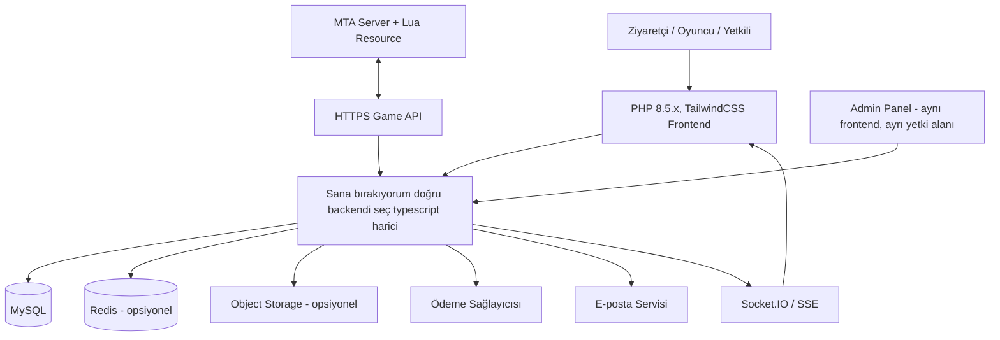

# MTA Roleplay Platformu – Web Sitesi, Oyuncu Paneli ve Yönetim Sistemi

> **Proje türü:** GrandRoleplay benzeri, özgün markalı MTA:SA roleplay topluluğu platformu  
> **Belge türü:** Ürün kapsamı + fonksiyonel gereksinimler + teknik şartname + geliştirme yol haritası  
> **Hedef:** Tek geliştirici + AI destekli geliştirme süreci  
> **Belge sürümü:** 1.0  
> **Tarih:** 11 Kasım 2026  
> **Durum:** Geliştirme başlangıç şartnamesi

---

## 0. Bu dokümanın amacı ve kullanım şekli

Bu doküman; GrandRoleplay.net üzerinde gözlemlenen ürün yaklaşımını referans alan, ancak kendi markası, tasarımı, metinleri, görselleri, kodu ve veritabanı modeliyle geliştirilecek bir **MTA:SA roleplay topluluğu web platformunun** kapsamını tanımlar.

Hedef yalnızca bir tanıtım sitesi oluşturmak değildir. Proje aşağıdaki dört ana sistemi tek bir ürün çatısı altında birleştirecektir:

1. **Public Website:** Ziyaretçilerin sunucuyu tanıdığı, oyun sistemlerini öğrendiği ve oyuna katılma adımlarını takip ettiği halka açık web sitesi.
2. **User Control Panel (UCP):** Oyuncuların web hesaplarını, bağlı oyun hesaplarını, karakterlerini, bakiyelerini, ödemelerini, başvurularını ve destek taleplerini takip ettiği oyuncu paneli.
3. **Admin Control Panel (ACP):** Yetkili personelin oyuncuları, başvuruları, destek taleplerini, içerikleri, ekonomi kayıtlarını, ödemeleri ve sistem ayarlarını yönettiği yönetim paneli.
4. **MTA Server Bridge:** MTA sunucusundaki Lua resource ile web backend arasında güvenli veri alışverişi sağlayan entegrasyon katmanı.

### 0.1 Özgünlük ve fikrî mülkiyet ilkesi

Referans alınan siteden **işlevsel fikirler ve kullanıcı akışları** örnek alınabilir. Ancak aşağıdakiler birebir kopyalanmayacaktır:

- GrandRoleplay / Grandoria marka adı, logo, slogan ve özel kimlik öğeleri.
- Referans siteye ait metinler, görseller, karakter çizimleri, videolar ve tasarıma özgü illüstrasyonlar.
- Kaynak kodu, özel veritabanı yapısı veya erişilemeyen yönetim sistemleri.
- Başka bir sunucuya ait özel oyun mekanikleri veya ticari materyaller.

Yeni projeye ait marka, renk paleti, logo, içerik, ikonografi, ekran tasarımları ve oyun içi sistem açıklamaları özgün hazırlanmalıdır.

### 0.2 Varsayımlar

Bu şartname aşağıdaki varsayımlarla hazırlanmıştır. Proje geliştirilirken farklı karar alınırsa ilgili bölüm güncellenmelidir.

- Oyun altyapısı **Multi Theft Auto: San Andreas (MTA:SA)** olacaktır.
- İlk sürüm masaüstü ve mobil tarayıcılarda çalışacaktır; native mobil uygulama kapsam dışıdır.
- Web uygulaması React + Vite tabanlı SPA olacaktır.
- Backend Node.js + Express.js olacaktır.
- Ana veritabanı PostgreSQL olacaktır.
- Oyun sunucusuyla iletişim, MTA server-side Lua resource üzerinden ve HTTPS API aracılığıyla kurulacaktır.
- Web uygulaması ile MTA sunucusu aynı sunucuda bulunmak zorunda değildir.
- Ödeme sağlayıcısı henüz kesinleşmediğinden ödeme katmanı sağlayıcıdan bağımsız adapter mantığında geliştirilecektir.
- Web hesabı ve MTA oyun hesabı kavramsal olarak ayrı tutulacak, güvenli bağlantı mekanizması sağlanacaktır.

---

# 1. Ürün hedefleri ve kapsam

## 1.1 Temel hedefler

- Ziyaretçinin sunucuyu kısa sürede anlayıp oyuna katılabilmesini sağlamak.
- Sunucu durumu ve çevrimiçi oyuncu sayısı gibi bilgileri mümkün olduğunca canlı göstermek.
- Oyun kurulumunu ve bağlantı adımlarını anlaşılır hale getirmek.
- Oyuncuya güvenli hesap yönetimi sunmak.
- Karakter, bakiye, işlem geçmişi ve başvurular gibi bilgileri web panelinden erişilebilir hale getirmek.
- Destek taleplerini e-posta/Discord mesajlarına bağımlı kalmadan takip etmek.
- Yetkililerin günlük operasyonlarını tek bir admin panelinden yönetebilmesini sağlamak.
- Web platformu ile MTA sunucusu arasında güvenli ve denetlenebilir veri senkronizasyonu kurmak.
- Ödeme, bakiye, ceza, serial ve yönetici işlemlerinin denetlenebilir kayıtlarını tutmak.

## 1.2 İlk sürümde yapılacaklar (MVP)

İlk sürümün tamamlanmış sayılması için aşağıdaki alanlar çalışır durumda olmalıdır:

- Ana sayfa, hakkımızda, oyun özellikleri, nasıl oynanır/indir, kurallar, haberler, SSS ve yasal sayfalar.
- Kayıt, giriş, e-posta doğrulama, şifre sıfırlama ve oturum yönetimi.
- Oyuncu paneli ana ekranı.
- Web hesabı ile MTA oyun hesabını ilişkilendirme akışı.
- Bağlı hesap ve karakter bilgilerinin en azından okunabilir şekilde gösterilmesi.
- Canlı/son bilinen sunucu durumu ve oyuncu sayısı.
- Oyuncu destek talebi açma ve yanıtları görüntüleme.
- Admin panelinde oyuncu, rol, içerik, duyuru ve destek talebi yönetimi.
- Audit log (kritik yönetici ve finans işlemleri).
- MTA server-side resource üzerinden heartbeat ve temel oyuncu olaylarının backend'e aktarılması.
- Temel rate limit, doğrulama, hata yönetimi, yedekleme ve loglama.

## 1.3 Sonraki sürümlere bırakılabilecekler

- Gelişmiş fraksiyon/whitelist başvuru sistemi.
- Ödeme sağlayıcısı entegrasyonları ve otomatik bakiye yükleme.
- Oyun içi karakterin kapsamlı düzenleme ekranı.
- Ceza/itiraz ve oyuncu sicili modülü.
- Gelişmiş ekonomi raporları.
- Discord bot entegrasyonu.
- Çoklu MTA sunucusu desteği.
- Gelişmiş analitik, retention ve oyuncu davranışı panelleri.
- Çoklu dil desteği.

---

# 2. Teknoloji yığını ve mimari kararlar

## 2.1 Önerilen teknoloji yığını

| Katman | Teknoloji | Kullanım |
|---|---|---|
| Frontend | PHP 8.5.x, Larevel 13.x | Public site, UCP ve ACP |
| UI | Tailwind CSS | Responsive tasarım ve stil sistemi |
| UI Components | shadcn/ui | Form, modal, dropdown, dialog, table vb. |
| İkonlar | Lucide React | Tutarlı ikon sistemi |
| Animasyon | Framer Motion (ölçülü) | Sayfa geçişleri ve mikro etkileşimler |
| Backend | Laravel için en doğru backend seçimini yap typescript harici | REST API ve iş kuralları |
| Veritabanı | MySQL | Kalıcı sistem verileri |
| ORM | Prisma (veya ekip kararıyla Drizzle) | Şema, migration ve sorgular |
| Kimlik doğrulama | Güvenli server-side session veya kısa ömürlü access + refresh token | JWT | Web oturumu |
| Parola hash | Argon2id (tercih) veya güncel güvenli bcrypt ayarı | Parola saklama |
| Gerçek zaman | Socket.IO veya SSE | Destek bildirimi, canlı durum ve panel olayları |
| Cache / Queue | Redis (gerektiğinde) | Rate limit, cache, görev kuyruğu |
| Dosya depolama | S3 uyumlu object storage (opsiyonel) | Ticket ekleri, medya, yedekler |
| Oyun entegrasyonu | MTA server-side Lua resource | MTA ↔ Backend iletişimi |
| Web sunucusu / Proxy | Nginx | TLS, reverse proxy ve statik dosyalar |
| Process yönetimi | PM2 veya Docker Compose | Uygulama çalıştırma |

> **Önemli:** Bu proje için MTA oyun sunucusunun kendi veritabanına herkese açık internet erişimi verilmemelidir. Web backend, oyun sunucusuyla kontrollü API üzerinden haberleşmelidir.

## 2.2 Genel sistem mimarisi



## 2.3 Uygulama alanlarının ayrılması

Tek frontend projesi içinde route bazlı olarak üç ayrı deneyim kurulabilir:

- `/` – public site.
- `/panel/*` – oyuncu paneli.
- `/admin/*` – yönetici paneli.

Ancak route ayrımı tek başına güvenlik değildir. Her API isteğinde backend kullanıcının kimliğini, rolünü ve ilgili kaynağa erişim iznini doğrulamalıdır.

## 2.4 Önerilen klasör yapısı

```text
project-root/
├── apps/
│   ├── web/
│   │   ├── public/
│   │   └── src/
│   │       ├── app/
│   │       ├── assets/
│   │       ├── components/
│   │       ├── features/
│   │       │   ├── auth/
│   │       │   ├── public-site/
│   │       │   ├── player-panel/
│   │       │   └── admin-panel/
│   │       ├── hooks/
│   │       ├── layouts/
│   │       ├── lib/
│   │       ├── pages/
│   │       ├── routes/
│   │       ├── services/
│   │       ├── stores/
│   │       ├── styles/
│   │       └── types/
│   └── api/
│       └── src/
│           ├── config/
│           ├── middleware/
│           ├── modules/
│           │   ├── auth/
│           │   ├── users/
│           │   ├── game-accounts/
│           │   ├── characters/
│           │   ├── wallet/
│           │   ├── payments/
│           │   ├── support/
│           │   ├── applications/
│           │   ├── announcements/
│           │   ├── content/
│           │   ├── server-status/
│           │   ├── game-bridge/
│           │   └── audit-logs/
│           ├── jobs/
│           ├── lib/
│           ├── prisma/
│           ├── routes/
│           ├── tests/
│           └── utils/
├── mta-resource/
│   └── web_bridge/
│       ├── meta.xml
│       ├── config.example.lua
│       ├── server/
│       ├── shared/
│       └── README.md
├── docs/
│   ├── architecture.md
│   ├── api.md
│   ├── deployment.md
│   ├── security.md
│   └── operations.md
├── infra/
│   ├── nginx/
│   └── docker/
├── .env.example
├── package.json
└── README.md
```

---

# 3. Marka, tasarım sistemi ve kullanıcı deneyimi

## 3.1 Görsel yön

Referans projedeki oyun topluluğu havasından ilham alınabilir; yeni marka için özgün bir tasarım sistemi oluşturulmalıdır.

Önerilen görsel dil:

- Koyu antrasit / gece teması.
- Ana vurgu rengi olarak mor, elektrik mavisi veya turkuazdan yalnızca biri.
- İkincil vurgu olarak sınırlı miktarda neon ton.
- Yüksek kontrastlı, okunabilir tipografi.
- Oyun içi ekran görüntüleri ve özgün karakter görselleri.
- Kartlarda kontrollü radius, ince border ve dengeli boşluklar.
- Çok fazla glow, gradient ve hareket kullanımından kaçınılması.

## 3.2 Tema sistemi

- Dark mode varsayılan olabilir.
- Light mode desteklenmelidir.
- Tema tercihi kullanıcı bazında saklanmalıdır.
- `prefers-reduced-motion` dikkate alınmalıdır.
- Düşük efekt modunda arka plan animasyonları, parallax ve ağır hareketler kapatılmalıdır.
- Tema değişiminde ani beyaz/siyah flaş oluşmamalıdır.

## 3.3 Responsive tasarım

En az aşağıdaki ekran genişlikleri test edilmelidir:

- 360 px mobil.
- 390–430 px mobil.
- 768 px tablet.
- 1024 px küçük laptop.
- 1366 px standart masaüstü.
- 1920 px geniş ekran.

UCP ve ACP tabloları mobilde yatay kaydırma veya kart görünümüyle kullanılabilir olmalıdır. Admin işlemleri yalnızca hover etkileşimine bağlı kalmamalıdır.

## 3.4 Ortak UI bileşenleri

- Header ve responsive navigation.
- Footer.
- Primary / secondary / danger button.
- Form input, textarea, select, checkbox, radio ve switch.
- Modal, drawer, popover ve confirmation dialog.
- Toast / notification.
- Data table, pagination ve filter bar.
- Status badge.
- Avatar ve kullanıcı menüsü.
- Skeleton screen.
- Empty state.
- Error state.
- Loading state.
- Breadcrumb.
- Tabs.
- File upload alanı.
- Date range picker.

## 3.5 Loading ve hata davranışı

- Sayfa ilk yüklenirken boş beyaz ekran gösterilmemelidir.
- İçerik yapısını taklit eden skeleton ekranlar kullanılmalıdır.
- API hatalarında kullanıcıya anlaşılır mesaj gösterilmelidir.
- Kritik işlem başarısız olduğunda form verisi kaybolmamalıdır.
- Tekrarlanabilir işlemlerde idempotency mantığı kullanılmalıdır.
- Loading durumunda buton tekrar tıklanarak çift işlem oluşturulmamalıdır.

---

# 4. Public Website – Ziyaretçi arayüzü

## 4.1 Genel header / navigasyon

Header menüsü admin panelinden yönetilebilir olmalıdır.

Önerilen menü:

- Ana Sayfa.
- Sunucu Hakkında.
- Oyun Sistemleri.
- Nasıl Oynanır?
- Kurallar.
- Haberler.
- Topluluk.
- Oyuncu Paneli / Giriş Yap.

Header sağ tarafında:

- Sunucu durumu göstergesi.
- Oyuncu Paneli butonu.
- İsteğe bağlı Discord bağlantısı.
- Tema değiştirme.

Mobilde erişilebilir hamburger menü kullanılmalıdır.

## 4.2 Ana sayfa – `/`

Ana sayfa, ziyaretçiyi sunucuya katılmaya yönlendiren ana dönüşüm sayfasıdır.

### Bölüm 1: Hero / ilk karşılama

İçerikler:

- Özgün logo.
- Kısa ve akılda kalan slogan.
- Sunucunun ne sunduğunu tek paragrafta anlatan metin.
- **Oyuna Katıl** CTA.
- **Nasıl Oynanır?** ikincil CTA.
- Arka planda özgün oyun içi video veya görsel.
- Sunucu aktiflik rozeti.

CTA davranışları:

- Oyuna Katıl: bağlantı adresini kopyalar veya MTA bağlantı protokolü için kullanıcıya yönerge verir.
- Nasıl Oynanır?: kurulum rehberine gider.

### Bölüm 2: Canlı sunucu durumu

Gösterilecek bilgiler:

- Sunucu online/offline/maintenance durumu.
- Anlık oyuncu sayısı.
- Maksimum oyuncu kapasitesi.
- Sunucu adı.
- Oyun modu.
- Harita / şehir bilgisi (MTA'dan alınabiliyorsa).
- Son heartbeat zamanı.
- Bağlantı adresi ve port.

Veri kaynağı yalnızca backend olmalıdır. Frontend'in MTA sunucusuna doğrudan bağlanması gerekmez.

**Önemli:** MTA sunucusundan uzun süre heartbeat gelmezse arayüz son oyuncu sayısını canlıymış gibi göstermemeli; `Durum doğrulanamıyor` veya `Çevrimdışı` göstermelidir.

### Bölüm 3: Sunucu özellikleri

Admin panelinden düzenlenebilir özellik kartları:

- Sesli roleplay.
- Legal / illegal rol seçenekleri.
- Ekonomi ve meslek sistemi.
- Şirket ve işletme sistemi.
- Araç ve garaj sistemi.
- Ev / mülk sistemi.
- Fraksiyonlar.
- Etkinlikler.
- Gelişim ve karakter ilerlemesi.

Sadece gerçekten oyunda bulunan ve aktif olan sistemler yayınlanmalıdır. Henüz geliştirilmemiş özellikler oyuncuya varmış gibi sunulmamalıdır.

### Bölüm 4: Oyun dünyasını keşfet

- Şehir / bölge görselleri.
- Oyun içi ekran görüntüsü galerisi.
- Video tanıtımı.
- Legal ve illegal yaşam biçimleri.
- Mesleklerden örnekler.

### Bölüm 5: Yeni oyuncu akışı

1. Oyunun yasal kopyasını edin.
2. MTA istemcisini resmi kaynaktan yükle.
3. Gerekli istemci sürümünü kontrol et.
4. Sunucu adresini kopyala.
5. Sunucuya bağlan.
6. Oyun hesabını oluştur veya mevcut hesabınla giriş yap.
7. Kuralları oku ve karakterini oluştur.

### Bölüm 6: Topluluk

- Discord daveti.
- YouTube tanıtım videosu.
- Son haberler.
- Yaklaşan etkinlikler.
- Topluluk ekran görüntüleri.

### Bölüm 7: Sık sorulan sorular

Örnek sorular:

- Sunucuya nasıl katılırım?
- Hangi MTA sürümü gerekiyor?
- Sesli konuşma zorunlu mu?
- Hesabımı nasıl oluştururum?
- Şifremi unuttum, ne yapmalıyım?
- Karakterimle ilgili destek talebini nereden açarım?
- Bakiye yükleme nasıl yapılır?
- Kurallara nereden ulaşabilirim?

### Bölüm 8: Son CTA ve footer

Footer içerikleri:

- Logo ve kısa açıklama.
- Hızlı bağlantılar.
- Discord / YouTube / sosyal medya.
- Gizlilik politikası.
- KVKK aydınlatma metni.
- Çerez politikası.
- Kullanım koşulları.
- İletişim / veri sorumlusu bilgisi.
- Telif ve marka açıklaması.

## 4.3 Hakkımızda – `/about`

İçerikler:

- Projenin amacı.
- Sunucunun kuruluş hikâyesi.
- Vizyon ve misyon.
- Roleplay yaklaşımı.
- Topluluk değerleri.
- Yönetim ekibi (yayınlanması tercih edilirse).
- Geliştirme yaklaşımı.

Sadece doğrulanabilir bilgiler yazılmalı; sahte oyuncu sayısı, sahte yorum veya doğrulanmamış başarı kullanılmamalıdır.

## 4.4 Oyun sistemleri – `/systems`

Kategori tabanlı detay sayfası:

- Ekonomi.
- Meslekler.
- Legal fraksiyonlar.
- Illegal fraksiyonlar.
- Şirketler ve işletmeler.
- Araçlar ve modifikasyonlar.
- Evler ve mülkler.
- Envanter.
- Karakter gelişimi.
- Etkinlikler.

Her sistem detayında:

- Sistem adı.
- Açıklama.
- Nasıl çalıştığı.
- Oyuncunun nasıl erişeceği.
- Gereksinimler.
- İlgili ekran görüntüsü / video.
- Son güncelleme tarihi.

Admin panelinden kategori ve içerik yönetimi yapılabilmelidir.

## 4.5 Meslekler – `/jobs`

Meslek kartları:

- Meslek adı.
- Kısa açıklama.
- Legal / özel / etkinlik bazlı sınıfı.
- Başvuru veya erişim şartı.
- Görsel.
- Aktif / pasif durumu.

Meslek detay sayfası:

- Görev tanımı.
- Oyuncunun yapacağı işler.
- İlerleme / seviye sistemi varsa açıklaması.
- Kazanç sistemi hakkında yayınlanmasına izin verilen bilgi.
- Başvuru bağlantısı.

## 4.6 Fraksiyonlar – `/factions`

- Legal fraksiyonlar.
- Illegal fraksiyonlar.
- Kamu / resmi kurumlar.
- Özel organizasyonlar.

Her fraksiyonda:

- Adı ve logosu.
- Tanıtım metni.
- Başvuru durumu.
- Minimum gereksinimler.
- Başvuru formu.
- İlgili kurallar.

Yetkili panelinden fraksiyon görünürlüğü ve başvuru kabul durumu yönetilmelidir.

## 4.7 Nasıl oynanır / indirme – `/start`

Kurulum rehberi adım adım hazırlanmalıdır.

1. GTA San Andreas için yasal edinim / kurulum yönergesi.
2. Resmî MTA indirme sayfasına yönlendirme.
3. MTA kurulum adımları.
4. Sunucu adresi ve port.
5. Bağlantı talimatı.
6. İlk giriş ve oyun hesabı.
7. Teknik sorunlarda destek bağlantısı.

**Güvenlik ve lisans notu:** Bilinmeyen üçüncü taraf sitelerden değiştirilmiş oyun arşivleri dağıtılmamalıdır. Dosya dağıtımı yapılacaksa telif/lisans hakkı, kaynak, dosya bütünlüğü, sürüm ve zararlı yazılım taraması doğrulanmalıdır. Tercih edilen yol, resmi ve yasal edinim kaynaklarına yönlendirmektir.

## 4.8 Kurallar – `/rules`

Kurallar kategori bazlı yönetilmelidir:

- Genel sunucu kuralları.
- Roleplay kuralları.
- Sesli iletişim kuralları.
- Legal fraksiyon kuralları.
- Illegal fraksiyon kuralları.
- Ekonomi / ticaret kuralları.
- Ceza ve itiraz süreçleri.

Özellikler:

- Başlık ve içerik.
- Sıralama.
- Yayın durumu.
- Son güncelleme tarihi.
- İsteğe bağlı sürüm geçmişi.
- Oyuncunun güncel kuralları okuduğunu onaylama (gerekiyorsa).

## 4.9 Haberler – `/news`

- Haber listeleme.
- Haber detay sayfası.
- Kapak görseli.
- Yayın tarihi.
- Yazar / yönetim ekibi etiketi.
- SEO başlığı ve açıklaması.
- Taslak / zamanlanmış / yayınlandı durumları.
- Kategori ve etiketler.

## 4.10 İletişim – `/contact`

- Genel iletişim formu.
- Destek paneline yönlendirme.
- Discord bağlantısı.
- E-posta adresi (kullanılıyorsa).
- Beklenen yanıt süresi bilgisi (gerçekçi olmalı).

Public iletişim formu spam koruması ve rate limit içermelidir.

## 4.11 Yasal sayfalar

Zorunlu ürün kapsamı:

- `/privacy` – Gizlilik politikası.
- `/kvkk` – KVKK aydınlatma metni.
- `/terms` – Kullanım koşulları.
- `/cookies` – Çerez politikası ve tercihleri.
- Ödeme alınacaksa `/refund-policy` – İade / iptal koşulları.

Hukuki metinler kopyala-yapıştır şablon olarak bırakılmamalı; gerçek veri işleme, ödeme ve işletme yapısına göre hukuk uzmanı tarafından kontrol edilmelidir.

---

# 5. Kimlik doğrulama ve hesap yapısı

## 5.1 Web hesabı ile oyun hesabı ayrımı

Bu proje için en kritik mimari karar budur.

- **Web hesabı:** E-posta, parola, web oturumu, panel tercihleri, destek ve başvuru işlemlerini yöneten sistem hesabı.
- **MTA oyun hesabı:** MTA sunucusu üzerinde oyuncunun oyun oturumu ve oyun verileriyle ilişkili hesaptır.
- **Karakter:** Oyun hesabı altında bulunabilen, rol yapma kimliğini ve oyun içi varlığı temsil eden ayrı kayıttır.

Web parolası ile MTA oyun parolası otomatik olarak aynı kabul edilmemelidir. MTA'nın dahili parola veritabanı web uygulamasından okunmamalı ve MTA parolaları web veritabanına taşınmamalıdır.

### Önerilen hesap bağlama akışı

1. Oyuncu web sitesinde kayıt olur ve e-posta adresini doğrular.
2. Oyuncu MTA sunucusuna bağlanır ve oyun hesabına giriş yapar.
3. Oyun içindeki `/webbagla` gibi bir komut tek kullanımlık, kısa süreli bir bağlantı kodu üretir.
4. Oyuncu bu kodu web paneline girer.
5. Web backend, kodu MTA bridge üzerinden doğrular.
6. Backend, kodun hangi doğrulanmış MTA hesabına ait olduğunu kontrol eder.
7. Bağlantı başarılıysa `web_user_id` ile `mta_account_id` eşleştirilir.
8. Kod kullanıldıktan sonra geçersiz olur.

Bu yöntem, tarayıcıdan MTA serial okumaya veya oyuncudan rastgele serial yazmasını istemeye göre daha kontrollüdür.

### Alternatif yöntem

Mevcut bir oyun hesabı altyapısı varsa ve oyun içi kod akışı uygulanamıyorsa, e-posta doğrulama + yönetici kontrollü hesap ilişkilendirmesi değerlendirilebilir. Ancak hesap sahipliğini kanıtlamayan yalnızca kullanıcı adı girişi yeterli kabul edilmemelidir.

## 5.2 Kayıt – `/register`

Alanlar:

- Kullanıcı adı.
- E-posta.
- Parola.
- Parola tekrarı.
- Kullanım koşulları onayı.
- KVKK aydınlatma metnine erişim ve gerekli onay/tercih kayıtları.
- İsteğe bağlı doğum tarihi gibi gereksiz kişisel veriler ilk sürümde alınmamalıdır.

Kurallar:

- Kullanıcı adı benzersiz olmalıdır.
- E-posta benzersiz olmalıdır.
- Parola backend'de Argon2id ile hashlenmelidir.
- E-posta doğrulanmadan kritik işlemler açılmamalıdır.
- Kayıt endpoint'i rate limit ve bot korumasına sahip olmalıdır.
- Hata mesajları hesap varlığını gereksiz yere açığa çıkarmamalıdır.

## 5.3 Giriş – `/login`

Alanlar:

- E-posta veya kullanıcı adı.
- Parola.
- Beni hatırla (güvenli kalıcı oturum politikasıyla).
- Şifremi unuttum.

Güvenlik:

- Başarısız giriş limiti.
- IP ve hesap bazlı rate limit.
- Şüpheli giriş logu.
- Güvenli session cookie (`HttpOnly`, `Secure`, uygun `SameSite`).
- Oturum kapatma.
- Kritik admin hesaplarında MFA zorunluluğu.

## 5.4 E-posta doğrulama

- Tek kullanımlık token.
- Token hash'i veritabanında tutulmalı.
- Süre sınırı olmalı.
- Yeniden e-posta gönderme limiti olmalı.
- Başarılı doğrulamada token geçersizleşmeli.

## 5.5 Şifre sıfırlama – `/forgot-password`

1. Kullanıcı e-posta adresini girer.
2. Sistem her durumda hesap varlığını ifşa etmeyen genel yanıt verir.
3. Kayıtlı hesap için tek kullanımlık ve süreli token gönderilir.
4. Yeni parola belirlenir.
5. Eski oturumlar iptal edilir veya kullanıcıya diğer oturumları kapatma seçeneği sunulur.
6. İşlem audit/security log'a kaydedilir.

## 5.6 Oturum ve cihaz yönetimi

Oyuncu panelinde:

- Aktif oturumlar.
- Oturum açılan yaklaşık cihaz/tarayıcı bilgisi.
- Son giriş zamanı.
- Diğer oturumları kapat.
- Tüm oturumları kapat.

IP adresi ve cihaz verileri yalnızca güvenlik amacı için, belirli saklama politikasıyla kullanılmalıdır.

---

# 6. Oyuncu Paneli (UCP)

Oyuncu paneli route kökü: `/panel`.

## 6.1 Panel layout

- Sol sidebar (desktop).
- Mobil drawer menü.
- Üst bar: bildirim, kullanıcı menüsü, tema, çıkış.
- İçerik alanı.
- Breadcrumb.
- Responsive dashboard kartları.

## 6.2 Genel bakış – `/panel`

Kartlar:

- Bağlı oyun hesabı sayısı.
- Karakter sayısı.
- Toplam bakiye (tek bir bakiye tanımı kesinleştirildiyse).
- Açık destek talebi sayısı.
- Bekleyen başvuru sayısı.
- Son giriş.
- Sunucu durumu.

Alt bölümler:

- Son hesap aktiviteleri.
- Son bakiye işlemleri.
- Son duyurular.
- Hızlı işlemler.

## 6.3 Oyun hesaplarım – `/panel/game-accounts`

- Bağlı MTA hesaplarını listele.
- Oyun hesabı adı.
- Bağlanma tarihi.
- Durum.
- İlişkili karakterler.
- Hesap bağlantısını kaldırma talebi.

Hesap bağlantısını doğrudan ve denetimsiz kaldırmak yerine, karakter veya ekonomi verileriyle ilişkili riskler kontrol edilmelidir.

## 6.4 Karakterlerim – `/panel/characters`

Liste kartı:

- Karakter adı.
- Karakter ID.
- Oluşturulma tarihi.
- Oyun hesabı.
- Karakter durumu.
- Son görülme (oyundan senkronize edilebiliyorsa).

Karakter detay sayfası:

- Temel profil bilgileri.
- Meslek / fraksiyon (oyun sisteminde mevcutsa).
- Oyun içi seviye / deneyim (varsa).
- Son aktif olma zamanı.
- Kamuya açık gösterilmesine izin verilen sınırlı istatistikler.

Oyuncu panelinden oyun kurallarını aşacak veya oyun ekonomisini bozacak kritik karakter değişiklikleri yapılmamalıdır. Bu tür işlemler oyun içinden veya yetkili onayıyla gerçekleştirilmelidir.

## 6.5 Bakiye / cüzdan – `/panel/wallet`

Bakiye ekranı yalnızca hangi bakiyenin gösterildiği net tanımlandıktan sonra geliştirilmelidir.

Olası bakiye türleri birbirinden ayrı tutulmalıdır:

- Oyun içi para.
- Web mağazası kredisi / bağış bakiyesi.
- Premium puan / özel para birimi.

Bunlar aynı sütunda karıştırılmamalıdır.

Gösterilecekler:

- Mevcut bakiye.
- Bakiye türü.
- Son işlemler.
- Bekleyen işlemler.
- Yükleme CTA'sı (ödeme modülü aktifse).
- İşlem detayları.

## 6.6 İşlem geçmişi – `/panel/transactions`

Alanlar:

- İşlem numarası.
- İşlem tipi.
- Tutar.
- Para birimi / bakiye türü.
- Önceki ve sonraki bakiye (uygunsa).
- İşlem açıklaması.
- Tarih.
- İşlem durumu.
- İlgili ödeme / oyun olayı referansı.

Oyuncu geçmiş işlemleri silememelidir.

## 6.7 Bakiye yükleme – `/panel/top-up`

Ödeme sağlayıcısı henüz seçilmediyse bu sayfa `Yakında` veya kapalı modda tutulabilir.

Akış:

1. Oyuncu yüklemek istediği tutarı seçer.
2. Minimum / maksimum sınır doğrulanır.
3. Backend sipariş oluşturur.
4. Oyuncu sağlayıcının güvenli ödeme ekranına yönlendirilir.
5. Sağlayıcı webhook/callback gönderir.
6. Backend imza, tutar, para birimi, sipariş kimliği ve durum kontrolü yapar.
7. Ödeme gerçekten başarılıysa ledger üzerinden bakiye kredilendirilir.
8. İşlem oyuncu panelinde gösterilir.

**Asla:** Frontend'in başarı sayfasına dönmesi tek başına bakiye yükleme kanıtı kabul edilmemelidir.

## 6.8 Başvurularım – `/panel/applications`

Başvuru türleri:

- Fraksiyon başvurusu.
- Yetkili başvurusu.
- Özel rol / organizasyon başvurusu.
- Etkinlik veya whitelist başvurusu.

Durumlar:

- Taslak.
- Gönderildi.
- İncelemede.
- Ek bilgi bekleniyor.
- Onaylandı.
- Reddedildi.
- İptal edildi.

Oyuncu kendi başvurusunu ve yetkili yanıtlarını görebilmelidir.

## 6.9 Destek taleplerim – `/panel/support`

- Yeni ticket oluştur.
- Kategori seç.
- Konu ve açıklama yaz.
- İsteğe bağlı ekran görüntüsü/dosya ekle.
- Mesaj geçmişini görüntüle.
- Yeni yanıt gönder.
- Ticket durumunu takip et.
- Çözüldüyse kapat veya yeniden açma talebi gönder.

Dosya yüklemede uzantı, MIME türü, boyut ve zararlı içerik kontrolleri yapılmalıdır.

## 6.10 Ceza geçmişi – `/panel/sanctions`

Yalnızca oyuncuya gösterilmesi uygun olan alanlar:

- Ceza türü.
- Tarih.
- Süre / bitiş tarihi.
- Genel açıklama.
- İtiraz edilebilir mi?
- İtiraz bağlantısı.

İç moderasyon notları ve hassas personel yorumları oyuncuya gösterilmemelidir.

## 6.11 Bildirimler – `/panel/notifications`

- Sistem duyuruları.
- Destek yanıtları.
- Başvuru durumları.
- Ödeme durumları.
- Güvenlik bildirimleri.

Okundu/okunmadı durumu ve tümünü okundu yap işlevi bulunmalıdır.

## 6.12 Güvenlik ayarları – `/panel/security`

- Parola değiştir.
- E-posta adresi değişikliği (eski/yeni e-posta doğrulamasıyla).
- MFA etkinleştir (opsiyonel oyuncu, admin için zorunlu).
- Aktif oturumları görüntüle.
- Tüm oturumları kapat.
- Hesap bağlantıları.
- Güvenlik aktiviteleri.

## 6.13 Serial / cihaz değişikliği yaklaşımı

MTA serial, tarayıcıdan güvenilir şekilde elde edilebilen sıradan bir profil alanı değildir. Kullanıcıdan rastgele yeni serial yazması istenmemelidir.

Önerilen akış:

1. Oyuncu panelden cihaz/serial ilişkilendirme talebi açar.
2. Sistem oyuncuya oyun içinde kullanılacak tek kullanımlık kod üretir.
3. Oyuncu MTA sunucusunda ilgili komutu çalıştırır.
4. Lua resource mevcut oyuncu oturumundan server-side serial bilgisini alır.
5. Resource, imzalı API isteğiyle doğrulama olayını backend'e gönderir.
6. Backend kodu, oyuncu hesabını, süreyi ve tek kullanımlık olma şartını doğrular.
7. Gerekirse yönetici onayı ister.
8. Eski cihaz ilişkisi ve yeni ilişki audit log'a yazılır.

Serial gibi tanımlayıcılar hassas kabul edilmeli, gereksiz yere gösterilmemeli ve erişim sınırlandırılmalıdır. Mümkünse ham serial yerine anahtarlı HMAC/hash tabanlı referans kullanılmalı; gerçek serial gerekiyorsa şifrelenmiş ve kısıtlı erişimli saklanmalıdır.

---

# 7. Admin Control Panel (ACP)

Admin route kökü: `/admin`.

## 7.1 Admin panel güvenlik ilkeleri

- Admin paneli yalnızca yetkili hesaplarla açılmalıdır.
- Admin hesaplarında MFA zorunlu olmalıdır.
- Her işlem backend'de permission kontrolünden geçmelidir.
- Admin işlemleri audit log'a yazılmalıdır.
- Finans, rol ve güvenlik işlemleri için tekrar onay istenmelidir.
- İsteğe bağlı IP allowlist/VPN erişimi uygulanabilir.
- Admin oturum süresi oyuncu oturumundan daha kısa tutulmalıdır.

## 7.2 Rol tabanlı erişim kontrolü (RBAC)

Önerilen roller:

| Rol | Yetki kapsamı |
|---|---|
| Super Admin | Tüm sistem, roller ve kritik ayarlar |
| Admin | Genel web ve oyuncu yönetimi |
| Community Manager | Duyuru, haber, etkinlik ve topluluk |
| Game Master | Oyun olayları, oyuncu/karakter moderasyonu |
| Moderator | Sınırlı ceza ve oyuncu işlemleri |
| Support Agent | Destek talepleri |
| Faction Manager | Fraksiyon ve başvuru yönetimi |
| Finance Manager | Ödeme ve bakiye kayıtları |
| Content Editor | Public sayfa, haber ve kurallar içeriği |

Rol adları örnektir. Yetkiler role sabit ve kontrolsüz şekilde bağlanmamalı; `permissions` tablosuyla ayrıştırılmalıdır.

Örnek izinler:

- `users.read`, `users.update`, `users.suspend`.
- `characters.read`, `characters.review`.
- `wallet.read`, `wallet.adjust`.
- `payments.read`, `payments.refund`.
- `support.read`, `support.reply`, `support.assign`, `support.close`.
- `applications.read`, `applications.review`.
- `content.read`, `content.create`, `content.update`, `content.publish`.
- `roles.read`, `roles.manage`.
- `settings.read`, `settings.update`.
- `audit.read`.

## 7.3 Admin dashboard – `/admin`

Özet kartlar:

- Toplam web hesabı.
- Bugün kayıt olanlar.
- E-posta doğrulaması bekleyenler.
- Son 24 saatte aktif oyuncu (MTA'dan güvenilir veri varsa).
- Sunucu durumu.
- Açık destek talepleri.
- Bekleyen başvurular.
- Bekleyen ödeme incelemeleri.

Grafikler:

- Günlük kayıt grafiği.
- Oyuncu eşleştirme grafiği.
- Günlük aktif oyuncu (veri varsa).
- Ödeme / bakiye raporu (ödeme modülü aktifse).
- Destek talebi yoğunluğu.

Dashboard'da gösterilen her sayı için veri kaynağı ve güncellik zamanı tanımlanmalıdır.

## 7.4 Oyuncu yönetimi – `/admin/users`

- Oyuncu arama.
- Kullanıcı adı ve e-posta filtreleri.
- Kayıt tarihi.
- E-posta doğrulama durumu.
- Hesap durumu.
- Bağlı oyun hesabı.
- Rol bilgileri.
- Son giriş.
- Oyuncu detay ekranı.

İşlemler:

- Hesabı aktif/pasif yap.
- Hesabı geçici olarak askıya al.
- E-posta doğrulama durumunu denetle.
- Bağlı oyun hesaplarını gör.
- Destek ve başvuru geçmişini gör.
- Güvenlik olaylarını gör (yetki gerektirir).

Parola admin tarafından görüntülenemez. Admin oyuncu parolasını bilmemelidir.

## 7.5 Oyun hesabı ve karakter yönetimi – `/admin/game-accounts`

- Web hesabı ↔ MTA hesabı ilişki listesi.
- MTA kullanıcı adı.
- Bağlantı tarihi.
- Bağlantı durumu.
- İlgili karakterler.
- Son senkronizasyon zamanı.
- Çakışma / eşleştirme uyarıları.

Karakter yönetiminde:

- Karakter kayıtlarını görüntüle.
- Web'de gösterilecek alanları kontrol et.
- Oyun tarafı verisiyle son senkronizasyonu gör.
- Oyuncu itiraz / destek bağlantısını aç.

Web panelinden oyun veritabanına doğrudan SQL yazılmamalıdır. Oyun verisi değişecekse MTA bridge üzerinden doğrulanmış komut/iş akışı kullanılmalıdır.

## 7.6 Bakiye ve ekonomi yönetimi – `/admin/economy`

- Cüzdan/bakiye türleri.
- İşlem listesi.
- Oyuncu bazlı işlem geçmişi.
- Başarılı/başarısız/bekleyen ödemeler.
- Manuel düzeltme talebi.
- İade / iptal kaydı.
- Günlük / aylık toplamlar.

Manuel bakiye değişimi:

- Yetkili izni gerektirir.
- Tutar ve gerekçe zorunludur.
- İkinci onay eşiği belirlenebilir.
- Önceki ve sonraki bakiye kaydı tutulur.
- İşlem silinemez; düzeltme gerekiyorsa ters kayıt oluşturulur.
- Oyuna yansıtma işlemi idempotent olmalıdır.

## 7.7 Ödeme yönetimi – `/admin/payments`

- Ödeme sağlayıcısı.
- Sipariş numarası.
- Oyuncu.
- Brüt tutar.
- Para birimi.
- Sağlayıcı işlem ID'si.
- Ödeme durumu.
- Webhook doğrulama durumu.
- Oluşturulma / onay zamanı.
- İade durumu.

Admin, sağlayıcıdan bağımsız ödeme iş akışını görebilmelidir. Sağlayıcı panelinde gerçekleşen ödeme ile web sistemindeki kayıtlar mutabakat edilebilmelidir.

## 7.8 Destek yönetimi – `/admin/support`

- Açık / bekleyen / çözülen / kapatılan ticket listesi.
- Öncelik filtresi.
- Kategori filtresi.
- Atanan yetkili.
- Son mesaj zamanı.
- Okunmamış ticket sayacı.
- Ticket detay ve mesajlaşma.
- Dosya ekleri.
- İç not (yalnızca personel).
- Hazır yanıt şablonları.
- Yetkiliye / üst yöneticiye iletme.

Ticket durumları:

- `open`
- `in_progress`
- `waiting_for_player`
- `waiting_for_staff`
- `resolved`
- `closed`

Oyuncuya gönderilen mesaj ile personel iç notu kesinlikle aynı görünürlükte olmamalıdır.

## 7.9 Başvuru yönetimi – `/admin/applications`

- Başvuru listesi.
- Başvuru türü.
- Oyuncu.
- Gönderim tarihi.
- Durum.
- Atanan yetkili.
- Form yanıtları.
- Yönetici notu.
- Onay / ret / ek bilgi iste.
- Durum değişikliği geçmişi.

Başvuru formları dinamik alanlarla admin tarafından oluşturulabilir; ancak ilk MVP'de sabit formlar yeterlidir.

## 7.10 Ceza ve moderasyon – `/admin/moderation`

- Ceza kayıtları.
- Ceza türü.
- Oyuncu / karakter.
- Başlangıç ve bitiş tarihi.
- İşlemi yapan yetkili.
- Gerekçe.
- Kanıt bağlantısı.
- İtiraz durumu.

MTA sunucusunda ban/kick gibi işlem gerekiyorsa backend isteği doğrudan MTA admin ACL'ine dönüştürülmemeli; izinli ve kayıtlı bir oyun komutu olarak uygulanmalıdır. Komutlar allowlist üzerinden yönetilmelidir.

## 7.11 İçerik yönetimi (CMS) – `/admin/content`

Admin aşağıdaki içerikleri kod yazmadan yönetebilmelidir:

- Ana sayfa hero metni ve görseli.
- Özellik kartları.
- Oyun sistemleri.
- Meslekler.
- Fraksiyonlar.
- Haberler.
- Etkinlikler.
- SSS.
- Kurallar.
- Footer bağlantıları.
- Sosyal medya URL'leri.

Her içerikte:

- Taslak / yayında durumu.
- Sıralama.
- Slug.
- SEO title.
- Meta description.
- Görsel alt metni.
- Oluşturan / güncelleyen.
- Son güncelleme tarihi.

## 7.12 Duyuru ve bildirim yönetimi – `/admin/announcements`

- Duyuru oluştur.
- Hedef kitle belirle (tüm oyuncular / belirli roller / belirli bağlı hesap grubu gibi).
- Yayın başlangıcı ve bitişi.
- Public sayfada göster / panel bildirimi gönder.
- Öncelik.
- Yayın geçmişi.

## 7.13 Yetkili ve rol yönetimi – `/admin/staff`

- Personel listesi.
- Rol atama.
- İzin görüntüleme.
- Geçici rol süresi (gerekiyorsa).
- Personel durumu.
- Son admin girişi.
- MFA durumu.
- Yetki değişikliği logu.

Super Admin rolü yalnızca mevcut Super Admin tarafından atanabilmeli ve bu işlem ayrıca audit log'a yazılmalıdır.

## 7.14 Audit log – `/admin/audit-logs`

Kaydedilecek önemli olaylar:

- Admin giriş / çıkış.
- Başarısız admin girişi.
- Rol ve izin değişikliği.
- Oyuncu hesabı askıya alma / açma.
- Bakiye kredisi / borç / düzeltme.
- Ödeme iadesi.
- Başvuru kararı.
- Ceza oluşturma / değiştirme.
- Serial/cihaz ilişkilendirme onayı.
- Sistem ayarı değişikliği.
- Oyun sunucusuna gönderilen yönetim komutu.

Log kaydı mümkün olduğunca değiştirilemez olmalı; normal admin kullanıcıları log silememelidir.

## 7.15 Sistem ayarları – `/admin/settings`

- Site adı ve logo.
- Sunucu IP ve port bilgisi.
- Discord / YouTube URL'leri.
- Bakım modu.
- Kayıt sistemi açık/kapalı.
- Ödeme modülü açık/kapalı.
- Başvuru türleri açık/kapalı.
- E-posta gönderim ayarlarının durumu (secret değerleri göstermeden).
- MTA bridge bağlantı durumu.
- Tema / görünüm ayarları.

Secret değerler admin arayüzünde açık metin olarak görüntülenmemelidir.

---

# 8. MTA:SA – Web API entegrasyonu

## 8.1 Entegrasyon ilkesi

MTA sunucusundaki Lua resource, web backend ile HTTPS üzerinden haberleşen bir **bridge/connector** görevi görür.

- MTA, oyuncu oturumu ve gerçek oyun verisinin kaynağıdır.
- PostgreSQL, web hesapları, destek, başvuru, ödeme ve web paneli verilerinin kaynağıdır.
- İki sistem arasında hangi alanın sahibi olduğu açıkça belirlenmelidir.
- Aynı verinin iki sistemde kontrolsüz şekilde düzenlenmesine izin verilmemelidir.

## 8.2 MTA tarafı resource yapısı

```text
mta-resource/web_bridge/
├── meta.xml
├── config.example.lua
├── README.md
├── shared/
│   └── constants.lua
└── server/
    ├── main.lua
    ├── heartbeat.lua
    ├── account_link.lua
    ├── player_events.lua
    ├── character_sync.lua
    ├── wallet_sync.lua
    ├── request.lua
    ├── signature.lua
    └── admin_commands.lua
```

## 8.3 MTA tarafından gönderilecek temel veriler

- Sunucu heartbeat.
- Online oyuncu sayısı.
- Maksimum oyuncu kapasitesi.
- Sunucu adı ve oyun modu.
- Oyuncu giriş / çıkış olayları.
- Oyun hesabı bağlantı kodu doğrulama olayları.
- Karakter oluşturma / güncelleme olayları.
- Web paneline yansıtılmasına izin verilen sınırlı oyun istatistikleri.
- Oyun içi bakiye değişim referansları (gerçek ekonomi modülü uygunsa).

IP ve serial gibi tanımlayıcılar yalnızca gerçekten gerekli olduğunda, hukuki ve güvenlik kontrolleriyle işlenmelidir.

## 8.4 Örnek API endpoint taslağı

Tüm endpoint'ler örnektir; kesin sözleşme API dokümantasyonunda sabitlenmelidir.

| Method | Endpoint | Amaç |
|---|---|---|
| POST | `/api/v1/game/heartbeat` | Sunucu heartbeat ve oyuncu sayısı |
| POST | `/api/v1/game/player/connected` | Oyuncu giriş olayı |
| POST | `/api/v1/game/player/disconnected` | Oyuncu çıkış olayı |
| POST | `/api/v1/game/account-link/verify` | Tek kullanımlık hesap bağlama kodu doğrulama |
| POST | `/api/v1/game/characters/sync` | Karakter özetini senkronize etme |
| POST | `/api/v1/game/wallet/events` | Oyun ekonomisi işlem olayı (uygunsa) |
| POST | `/api/v1/game/commands/result` | İzinli oyun komutunun sonucunu bildirme |
| GET | `/api/v1/game/commands/pending` | MTA resource için bekleyen izinli komutlar (gerekiyorsa) |

Oyun resource'una genel amaçlı SQL veya shell komutu çalıştırma yetkisi verilmemelidir.

## 8.5 İstek imzalama ve güvenlik

MTA resource → Backend istekleri için aşağıdaki güvenlik katmanı uygulanmalıdır:

- HTTPS zorunlu.
- Her MTA sunucusu için ayrı API credential.
- Secret yalnızca MTA server config ve backend secret manager/environment üzerinde tutulmalı.
- İstek gövdesi için HMAC imza.
- Timestamp kontrolü.
- Nonce veya benzersiz request ID ile replay koruması.
- Kısa zaman penceresi (örneğin birkaç dakika; operasyonel gereksinime göre).
- IP allowlist mümkünse ek katman olarak kullanılmalı; tek güvenlik mekanizması olmamalı.
- İstek boyutu ve JSON schema doğrulaması.
- Rate limit.
- Her istekte server ID ve event ID.
- Başarısız istek loglanmalı; secret loglara yazılmamalı.

Örnek imza girdisi:

```text
METHOD + "\n" + PATH + "\n" + TIMESTAMP + "\n" + NONCE + "\n" + SHA256(BODY)
```

Backend, imzayı aynı canonical içerik üzerinden yeniden hesaplar. İmza eşleşmiyorsa istek reddedilir. Nonce daha önce kullanılmışsa tekrar oynatma saldırısı olarak reddedilir.

Bu örnek protokol, gerçek uygulamada backend ve Lua resource tarafında aynı şekilde test edilmelidir.

## 8.6 Heartbeat mantığı

- MTA resource belirli aralıklarla heartbeat gönderir.
- Backend son heartbeat zamanını kaydeder.
- Tanımlanan eşik süresinden sonra heartbeat gelmezse sunucu `offline` veya `unknown` olur.
- Oyuncu sayısı eskiyse public sayfada eski veri olduğu belirtilir.
- Sunucu yeniden açıldığında durum otomatik güncellenir.
- Birden fazla MTA sunucusu olacaksa her biri ayrı `server_id` ile izlenir.

## 8.7 MTA oyuncu hesabı ve serial güvenliği

- Oyuncunun kimliği mümkün olduğunca MTA hesabı ve sunucu tarafından doğrulanmış oturum üzerinden belirlenmelidir.
- `getPlayerSerial` gibi serial fonksiyonları sadece server-side güvenilir bağlamda kullanılmalıdır.
- Serial tek başına hesap sahipliğinin kesin kanıtı kabul edilmemelidir.
- Serial değeri public API response içinde gönderilmemelidir.
- Serial'i oyuncu panelinde açıkça göstermekten kaçınılmalıdır.
- Serial geçmişi gerekiyorsa erişimi kısıtlı ve şifreli tutulmalıdır.
- MTA hesabının mevcut parola hash'leri web sistemine kopyalanmamalıdır.

## 8.8 Oyun verisi senkronizasyon kuralları

Her alan için **source of truth** belirlenmelidir.

| Veri | Ana kaynak | Web'deki yaklaşım |
|---|---|---|
| Web e-postası | PostgreSQL | Web backend yönetir |
| Web parolası | PostgreSQL | Yalnızca hash saklanır |
| MTA oyun hesabı | MTA | Bridge ile referans/senkronizasyon |
| Oyun karakteri | MTA | Web'de read-only özet veya kontrollü işlem |
| Oyun içi para | MTA ekonomi sistemi | Olay/ledger senkronizasyonu |
| Web kredi bakiyesi | PostgreSQL | Web ledger yönetir |
| Destek talepleri | PostgreSQL | Web backend yönetir |
| Public sunucu durumu | MTA | Heartbeat ile güncellenir |
| Haber/duyuru | PostgreSQL | Admin CMS yönetir |

## 8.9 MTA bağlantısı başarısız olduğunda

- Public site tamamen çökmemelidir.
- Son bilinen heartbeat zamanı gösterilmelidir.
- Web hesap girişi ve destek sistemi çalışmaya devam etmelidir.
- Oyun verisi gerektiren işlemler geçici olarak devre dışı bırakılmalıdır.
- Kuyruğa alınabilecek olaylar idempotent şekilde tekrar denenmelidir.
- Kritik finans işlemleri için bağlantı yokken varsayımsal başarı gösterilmemelidir.

---

# 9. Ödeme ve bakiye mimarisi

## 9.1 Ödeme katmanı

Ödeme sağlayıcısı seçilmediğinden backend'de adapter modeli kullanılmalıdır.

```text
PaymentProvider
├── createCheckout()
├── verifyWebhook()
├── getPaymentStatus()
├── refundPayment()
└── normalizeProviderEvent()
```

Sağlayıcıya özgü kod, cüzdan ve sipariş iş mantığından ayrılmalıdır.

## 9.2 Ödeme durumları

- `created`
- `pending`
- `requires_action`
- `succeeded`
- `failed`
- `cancelled`
- `refunded`
- `partially_refunded` (sağlayıcı destekliyorsa)
- `disputed` (sağlayıcı destekliyorsa)

## 9.3 Cüzdan / ledger kuralı

Bakiye yalnızca `users.balance = users.balance + amount` gibi denetimsiz bir güncellemeyle yönetilmemelidir.

Önerilen yapı:

- Her bakiye hareketi ayrı ledger kaydıdır.
- Kaydın nedeni ve kaynak referansı bulunur.
- İşlemler silinmez.
- Hatalı kayıt ters işlemle düzeltilir.
- Her ödeme için unique provider event / order kontrolü yapılır.
- Aynı webhook tekrar gelirse ikinci kez bakiye yüklenmez.
- Finansal değişiklikler transaction içinde gerçekleştirilir.
- Gerektiğinde reconciliation görevi sağlayıcı kayıtlarıyla DB'yi karşılaştırır.

## 9.4 Önemli güvenlik kuralları

- Kart bilgileri kendi veritabanımızda tutulmamalıdır.
- Ödeme sağlayıcısının güvenli checkout yöntemi tercih edilmelidir.
- Webhook imzası doğrulanmalıdır.
- Tutar ve para birimi backend'de sipariş kaydıyla karşılaştırılmalıdır.
- Oyuncu ID'si yalnızca frontend'den geldiği için güvenilir kabul edilmemelidir.
- İade işlemi yetki ve audit log gerektirmelidir.

---

# 10. Veritabanı tasarımı – önerilen tablo envanteri

Aşağıdaki liste başlangıç veri modelidir. Uygulama öncesi ERD hazırlanmalı, ilişkiler ve silme politikaları netleştirilmelidir.

## 10.1 Kullanıcı ve kimlik

- `users`
  - `id`, `username`, `email`, `password_hash`, `email_verified_at`, `status`, `created_at`, `updated_at`.
- `user_sessions`
  - Oturum hash'i, kullanıcı, son kullanım, ip/agent özetleri, süre sonu.
- `email_verification_tokens`
  - Token hash'i, user ID, expiry, used_at.
- `password_reset_tokens`
  - Token hash'i, user ID, expiry, used_at.
- `user_security_events`
  - Login, password change, suspicious activity gibi olaylar.
- `roles`
- `permissions`
- `user_roles`
- `role_permissions`

## 10.2 MTA hesap ve karakter

- `mta_servers`
  - Server ID, ad, host etiketi, port, max players, aktiflik durumu.
- `mta_accounts`
  - Web sistemindeki dahili ID, MTA hesap referansı, görünen ad, son senkronizasyon.
- `user_game_account_links`
  - User ID, MTA account ID, bağlanma tarihi, doğrulama yöntemi, durum.
- `game_link_codes`
  - Kod hash'i, server ID, MTA account referansı, expiry, used_at.
- `characters`
  - MTA character ID, MTA account ID, ad, public profile fields, status, synced_at.
- `character_snapshots` (gerekiyorsa)
  - Zaman içinde salt okunur istatistik snapshot'ları.
- `server_heartbeats`
  - Server ID, player count, max players, status data, received_at.
- `game_events`
  - Event ID, server ID, event type, idempotency key, payload reference, received_at.

## 10.3 Ekonomi ve ödeme

- `wallets`
  - Owner type/ID, wallet type, currency, status.
- `wallet_transactions`
  - Wallet ID, direction, amount, currency, reason, source type/ID, idempotency key, created_at.
- `payment_orders`
  - User ID, provider, order number, amount, currency, status.
- `payment_events`
  - Provider event ID, order ID, signature status, normalized payload reference, processed_at.
- `refunds`
  - Payment ID, amount, reason, status, admin ID.
- `wallet_adjustment_requests`
  - Talep eden admin, onaylayan admin, gerekçe ve tutar.

## 10.4 Destek ve başvurular

- `support_tickets`
- `support_messages`
- `support_attachments`
- `support_categories`
- `support_macros`
- `applications`
- `application_types`
- `application_answers`
- `application_status_history`

## 10.5 İçerik ve iletişim

- `pages`
- `page_sections`
- `news_posts`
- `news_categories`
- `game_systems`
- `jobs`
- `factions`
- `rules_categories`
- `rules`
- `faqs`
- `announcements`
- `notifications`
- `notification_reads`
- `social_links`

## 10.6 Moderasyon ve denetim

- `sanctions`
- `sanction_appeals`
- `audit_logs`
- `admin_activity_logs`
- `integration_credentials` (şifreli/secret reference; mümkünse secret manager)
- `webhook_inbox`
- `system_settings`

## 10.7 Veri modeli prensipleri

- Primary key olarak UUID kullanılması değerlendirilebilir.
- Tüm tarih alanları UTC saklanmalı ve arayüzde uygun yerel saate çevrilmelidir.
- Para alanları float kullanmamalı; `NUMERIC/DECIMAL` veya kuruş bazlı integer kullanılmalıdır.
- Unique index gerektiren alanlar açıkça tanımlanmalıdır.
- Finansal ve audit kayıtları normal kullanıcı işlemiyle silinmemelidir.
- Foreign key ve transaction kuralları uygulanmalıdır.
- Hassas veriler için kolon bazlı şifreleme veya ayrı secret storage düşünülmelidir.
- Gereksiz kişisel veri toplanmamalıdır.

---

# 11. API tasarım standardı

## 11.1 Genel kurallar

- Prefix: `/api/v1`.
- JSON request/response.
- Tutarlı HTTP status code.
- Merkezi error handler.
- Zod veya benzeri schema validation.
- Pagination, filtering ve sorting standardı.
- Request ID / correlation ID.
- OpenAPI/Swagger dokümantasyonu.
- Rate limit.
- API versiyonlama.

## 11.2 Public API örnekleri

| Method | Endpoint | Açıklama |
|---|---|---|
| GET | `/api/v1/public/site-config` | Public site ayarları |
| GET | `/api/v1/public/server-status` | Son sunucu durumu |
| GET | `/api/v1/public/news` | Haber listesi |
| GET | `/api/v1/public/news/:slug` | Haber detayı |
| GET | `/api/v1/public/systems` | Oyun sistemleri |
| GET | `/api/v1/public/jobs` | Meslekler |
| GET | `/api/v1/public/factions` | Fraksiyonlar |
| GET | `/api/v1/public/rules` | Kurallar |
| GET | `/api/v1/public/faqs` | SSS |

## 11.3 Authentication API örnekleri

| Method | Endpoint | Açıklama |
|---|---|---|
| POST | `/api/v1/auth/register` | Web hesabı oluştur |
| POST | `/api/v1/auth/login` | Giriş yap |
| POST | `/api/v1/auth/logout` | Çıkış yap |
| GET | `/api/v1/auth/me` | Oturum kullanıcısı |
| POST | `/api/v1/auth/verify-email` | E-posta doğrula |
| POST | `/api/v1/auth/resend-verification` | Doğrulama e-postası gönder |
| POST | `/api/v1/auth/forgot-password` | Şifre sıfırlama talebi |
| POST | `/api/v1/auth/reset-password` | Yeni parola belirle |
| GET | `/api/v1/auth/sessions` | Aktif oturumlar |
| DELETE | `/api/v1/auth/sessions/:id` | Oturum kapat |

## 11.4 Player API örnekleri

| Method | Endpoint | Açıklama |
|---|---|---|
| GET | `/api/v1/player/dashboard` | Panel özet verisi |
| GET | `/api/v1/player/game-accounts` | Bağlı oyun hesapları |
| POST | `/api/v1/player/game-accounts/link-code` | Bağlama kodu başlat |
| POST | `/api/v1/player/game-accounts/unlink-request` | Bağlantı kaldırma talebi |
| GET | `/api/v1/player/characters` | Karakterler |
| GET | `/api/v1/player/characters/:id` | Karakter detayı |
| GET | `/api/v1/player/wallets` | Cüzdanlar |
| GET | `/api/v1/player/transactions` | İşlem geçmişi |
| POST | `/api/v1/player/payments/checkout` | Ödeme başlat |
| GET | `/api/v1/player/applications` | Başvurularım |
| POST | `/api/v1/player/applications` | Başvuru gönder |
| GET | `/api/v1/player/support/tickets` | Ticket listesi |
| POST | `/api/v1/player/support/tickets` | Ticket oluştur |
| POST | `/api/v1/player/support/tickets/:id/messages` | Mesaj gönder |
| GET | `/api/v1/player/notifications` | Bildirimler |
| PATCH | `/api/v1/player/notifications/:id/read` | Bildirimi okundu yap |

## 11.5 Admin API örnekleri

Admin endpoint'leri permission bazlı korunmalıdır.

| Method | Endpoint | Açıklama |
|---|---|---|
| GET | `/api/v1/admin/dashboard` | Yönetim özeti |
| GET | `/api/v1/admin/users` | Kullanıcı listesi |
| GET | `/api/v1/admin/users/:id` | Kullanıcı detayı |
| PATCH | `/api/v1/admin/users/:id/status` | Hesap durumu |
| GET | `/api/v1/admin/game-accounts` | MTA hesap bağlantıları |
| GET | `/api/v1/admin/characters` | Karakter kayıtları |
| GET | `/api/v1/admin/wallet-transactions` | Bakiye hareketleri |
| POST | `/api/v1/admin/wallet-adjustments` | Bakiye düzeltme talebi |
| GET | `/api/v1/admin/payments` | Ödemeler |
| POST | `/api/v1/admin/payments/:id/refund` | İade talebi |
| GET | `/api/v1/admin/support/tickets` | Ticket listesi |
| PATCH | `/api/v1/admin/support/tickets/:id` | Ticket güncelle |
| POST | `/api/v1/admin/support/tickets/:id/messages` | Yanıt gönder |
| GET | `/api/v1/admin/applications` | Başvurular |
| PATCH | `/api/v1/admin/applications/:id/status` | Başvuru kararı |
| GET | `/api/v1/admin/content` | CMS içerikleri |
| POST | `/api/v1/admin/content` | İçerik oluştur |
| PATCH | `/api/v1/admin/content/:id` | İçerik güncelle |
| GET | `/api/v1/admin/staff` | Yetkili listesi |
| PATCH | `/api/v1/admin/staff/:id/roles` | Rol ata |
| GET | `/api/v1/admin/audit-logs` | Denetim kayıtları |
| GET | `/api/v1/admin/settings` | Sistem ayarları |
| PATCH | `/api/v1/admin/settings` | Sistem ayarı güncelle |

## 11.6 API hata formatı

Örnek:

```json
{
  "success": false,
  "error": {
    "code": "VALIDATION_ERROR",
    "message": "Gönderilen bilgiler kontrol edilmeli.",
    "details": [
      { "field": "email", "message": "Geçerli bir e-posta adresi girin." }
    ]
  },
  "requestId": "req_example"
}
```

Gerçek hata yanıtlarında stack trace, SQL sorgusu, secret veya iç sistem path'i gönderilmemelidir.

---

# 12. Güvenlik gereksinimleri

## 12.1 Web uygulaması

- HTTPS zorunlu.
- Güvenli cookie ayarları.
- CSRF koruması (session cookie tabanlı auth kullanılıyorsa).
- XSS önleme ve output escaping.
- SQL injection için ORM/parameterized query.
- Content Security Policy.
- Güvenlik header'ları.
- Dosya yükleme kontrolleri.
- Rate limit ve bot koruması.
- CORS yalnızca gerekli origin'lere açık.
- Admin MFA.
- Parola hashleme.
- Reset ve verification token hashleme.
- Kullanıcı enumerasyonunu azaltma.
- Bağımlılık ve güvenlik açığı taraması.

## 12.2 Yetkilendirme

- Frontend'de buton gizlemek güvenlik kontrolü değildir.
- Her admin API route permission kontrolü yapmalıdır.
- Oyuncu yalnızca kendi verisine erişebilmelidir.
- Destek personeli finansal verilere erişememelidir.
- Finance Manager içerik veya rol yönetimi yapamamalıdır.
- Super Admin işlemleri ayrıca kaydedilmelidir.

## 12.3 MTA entegrasyonu

- MTA secret'ları kaynak koduna commit edilmemelidir.
- Test ve production secret'ları farklı olmalıdır.
- Sadece allowlist endpoint'leri kullanılmalıdır.
- Replay koruması olmalıdır.
- Oyun komutları parametre doğrulaması yapmalıdır.
- Sunucu resource'u başarısız isteklerde kontrollü retry yapmalıdır.
- Loglarda oyuncunun ham serial'i, parola veya token gösterilmemelidir.

## 12.4 Ödeme güvenliği

- Webhook imza kontrolü.
- Idempotency.
- Tutar/para birimi eşleşmesi.
- Aynı sağlayıcı event'inin ikinci kez işlenmesini engelleme.
- İade işlemi yetki kontrolü.
- Finansal ledger.
- Periyodik mutabakat.

## 12.5 Yedekleme ve felaket kurtarma

- PostgreSQL düzenli yedeklenmeli.
- Yedekler uygulama sunucusundan ayrı lokasyonda tutulmalı.
- Yedekleme şifrelenmeli.
- Geri yükleme düzenli test edilmeli.
- Yedek erişimi en az ayrıcalık prensibiyle sınırlandırılmalı.
- Yedek alma başarısız olursa admin/ops bildirimi üretilmeli.

---

# 13. KVKK, gizlilik ve veri yönetişimi

Bu bölüm teknik gereksinimdir; hukuki danışmanlık yerine geçmez.

Toplanması muhtemel veriler:

- Web kullanıcı adı ve e-posta.
- Parola hash'i.
- Oturum ve güvenlik olayları.
- IP / user-agent gibi güvenlik metaverileri.
- MTA hesap referansı.
- Oyuncunun oyun hesabı ve karakter bilgileri.
- Serial gibi cihaz tanımlayıcıları (yalnızca gerekli ve uygun hukuki şartlar varsa).
- Ödeme referansları ve işlem geçmişi.
- Destek talebi içerikleri ve ekleri.
- Başvuru formu yanıtları.

Gereksinimler:

- Her veri alanının amacı belirlenmeli.
- Gereksiz veri toplanmamalı.
- Veri saklama süresi tanımlanmalı.
- Silme / anonimleştirme prosedürü oluşturulmalı.
- Yetkili erişimi sınırlandırılmalı.
- Veri ihlali müdahale prosedürü hazırlanmalı.
- Üçüncü taraf servisler ve veri aktarımı aydınlatma metninde açıklanmalı.
- Çerez tercihleri uygulanmalı.
- Kullanıcı başvuru kanalı belirtilmeli.
- KVKK metinleri gerçek veri akışına göre hukuk kontrolünden geçmeli.

Ödeme ve finansal kayıtların saklama zorunlulukları varsa bunlar kullanıcı hesabının silinmesinden ayrı değerlendirilmelidir.

---

# 14. SEO, erişilebilirlik ve performans

## 14.1 SEO

Public sayfalar için:

- Anlamlı title ve meta description.
- Canonical URL.
- Open Graph ve sosyal paylaşım görseli.
- Sitemap.xml.
- Robots.txt.
- Semantik HTML heading düzeni.
- Görsellerde alt metin.
- İç linkleme.
- Breadcrumb.
- Uygun Schema.org yapılandırılmış veri (Organization, WebSite, Article, FAQPage koşulları uygunsa).
- 404 sayfası.

UCP ve ACP sayfaları arama motorlarına indexletilmemelidir.

## 14.2 Erişilebilirlik

- Klavye ile navigasyon.
- Focus görünürlüğü.
- Form label'ları.
- Yeterli renk kontrastı.
- Sadece renkle durum anlatmama.
- Modal focus yönetimi.
- Reduced motion.
- Görsel alt metinleri.

## 14.3 Performans

- Görseller WebP/AVIF ve uygun boyutta sunulmalı.
- Lazy loading uygulanmalı.
- Public sayfada gereksiz büyük JS bundle'dan kaçınılmalı.
- Route bazlı code splitting.
- Cache-Control politikası.
- API pagination.
- Veritabanı indexleri.
- N+1 sorgu kontrolü.
- Ağır raporlar arka plan job olarak çalıştırılmalı.
- Lighthouse/Core Web Vitals testleri yapılmalı.

---

# 15. Bildirim, e-posta ve gerçek zamanlı özellikler

## 15.1 E-posta bildirimleri

- Kayıt doğrulama.
- Şifre sıfırlama.
- E-posta değişikliği.
- Yeni destek yanıtı.
- Başvuru durumu.
- Ödeme sonucu.
- Güvenlik uyarısı.

Transactional e-postalar kullanıcı pazarlama izninden bağımsız değerlendirilmelidir; hukuki gereklilikler ayrıca kontrol edilmelidir.

## 15.2 Panel içi bildirimler

- Destek yanıtı.
- Başvuru güncellemesi.
- Duyuru.
- Ödeme sonucu.
- Hesap güvenlik olayı.

## 15.3 Gerçek zamanlı güncelleme

Socket.IO veya SSE ile:

- Admin destek sayacı.
- Yeni ticket mesajı.
- Sunucu durum değişimi.
- Panel bildirimi.

Gerçek zaman bağlantısı kesilirse REST API ile yeniden senkronizasyon yapılmalıdır.

---

# 16. Test ve kalite güvence planı

## 16.1 Unit test

- Form doğrulama.
- Permission kontrolü.
- Wallet ledger hesaplaması.
- Payment webhook normalization.
- Link code expiry / one-time check.
- HMAC signature verification.
- Server heartbeat status logic.

## 16.2 API integration test

- Register/login/logout.
- E-posta doğrulama.
- Şifre sıfırlama.
- Oyuncu kendi verisine erişebilir.
- Oyuncu başka kullanıcının verisine erişemez.
- Support Agent finans endpoint'ine erişemez.
- Payment webhook aynı event için iki kez bakiye yazmaz.
- MTA imzası hatalı isteği reddeder.
- Eski timestamp/nonce isteği reddedilir.
- Heartbeat kesilince status stale/offline olur.

## 16.3 E2E senaryoları

1. Ziyaretçi ana sayfayı açar ve oyun indirme rehberine gider.
2. Yeni oyuncu kayıt olur.
3. E-posta doğrular.
4. Giriş yapar.
5. Oyun içi bağlantı kodu üretir.
6. MTA bridge üzerinden hesabını bağlar.
7. Panelinde bağlı hesabını görür.
8. Destek talebi açar.
9. Support Agent yanıt verir.
10. Oyuncu yanıtı panelinde görür.
11. Admin içerik yayınlar ve public sayfada görünür.
12. Finance Manager bakiye hareketlerini görüntüler ancak rol yönetemez.
13. MTA heartbeat public durum kartını günceller.

## 16.4 Güvenlik testleri

- SQL injection denemeleri.
- Stored/reflected XSS.
- CSRF.
- IDOR / BOLA.
- Brute force.
- Session fixation / hijacking kontrolleri.
- Yetkisiz admin API çağrısı.
- Dosya upload bypass.
- Webhook replay.
- Game API HMAC replay.
- Rate limit bypass.

## 16.5 Yayın öncesi kabul kontrolü

- [ ] Public sayfalar mobil ve masaüstünde düzgün.
- [ ] Tüm navigasyon bağlantıları çalışıyor.
- [ ] Kayıt/giriş/e-posta doğrulama çalışıyor.
- [ ] Şifre sıfırlama tek kullanımlık token kullanıyor.
- [ ] Oyuncu başka oyuncunun bilgisine erişemiyor.
- [ ] Admin route permission ile korunuyor.
- [ ] MFA admin hesabında çalışıyor.
- [ ] MTA heartbeat imza kontrolünden geçiyor.
- [ ] MTA bağlantı kodu süreli ve tek kullanımlık.
- [ ] Aynı payment webhook ikinci kez bakiye oluşturmuyor.
- [ ] Wallet işlemleri audit/ledger kayıtlı.
- [ ] Ticket dosya yüklemesi güvenli.
- [ ] Audit log kritik olayları kaydediyor.
- [ ] Yedek geri yükleme testi yapıldı.
- [ ] Production secrets repo dışında tutuluyor.
- [ ] Error response secret veya stack trace sızdırmıyor.
- [ ] KVKK ve kullanım metinleri gerçek veri akışına göre kontrol edildi.

---

# 17. Geliştirme aşamaları ve teslimatlar

## Aşama 1 – Proje temelinin kurulması

Teslimatlar:

- Monorepo veya ayrılmış web/api proje yapısı.
- TypeScript yapılandırması.
- React/Vite başlangıç uygulaması.
- Express API başlangıcı.
- PostgreSQL bağlantısı.
- ORM ve migration altyapısı.
- `.env.example`.
- Merkezi config ve error handler.
- Lint / format / test altyapısı.

## Aşama 2 – UI sistemi ve public site

Teslimatlar:

- Renk ve tipografi token'ları.
- Header/footer.
- Responsive layout.
- Ana sayfa.
- Hakkımızda.
- Oyun sistemleri.
- Meslekler/fraksiyonlar.
- Start rehberi.
- Kurallar.
- Haberler.
- SSS.
- Yasal sayfalar.
- CMS API bağlantıları.

## Aşama 3 – Auth ve oyuncu paneli

Teslimatlar:

- Register/login/logout.
- E-posta doğrulama.
- Password reset.
- Session management.
- UCP layout.
- Dashboard.
- Oyun hesabı bağlantı ekranı.
- Karakter listesi.
- Bildirimler.
- Güvenlik ayarları.

## Aşama 4 – MTA bridge

Teslimatlar:

- Lua resource iskeleti.
- HMAC request signing.
- Heartbeat.
- Server status API.
- Tek kullanımlık hesap bağlama kodu.
- Oyun hesabı sync.
- Karakter snapshot sync.
- Hata ve retry mekanizması.

## Aşama 5 – Admin paneli

Teslimatlar:

- RBAC.
- Admin login/MFA.
- Dashboard.
- Oyuncu yönetimi.
- Oyun hesapları/karakterler.
- CMS.
- Duyuru sistemi.
- Başvuru yönetimi.
- Destek yönetimi.
- Audit log.

## Aşama 6 – Ekonomi ve ödeme

Teslimatlar:

- Wallet ve ledger.
- Payment adapter.
- Checkout akışı.
- Webhook doğrulama.
- İdempotency.
- Admin ödeme ekranı.
- İade ve manuel düzeltme akışı.
- Mutabakat raporu.

## Aşama 7 – Sertleştirme ve yayın

Teslimatlar:

- E2E testler.
- Güvenlik testleri.
- Performans kontrolü.
- Nginx/TLS.
- Production environment.
- DB backup ve restore testi.
- Monitoring ve alert.
- Operasyon dokümantasyonu.
- Yayın sonrası hata izleme.

---

# 18. Tek geliştirici + AI ile çalışma kuralları

Bu proje tek geliştirici ve AI desteğiyle yürütülebileceği için geliştirme küçük, test edilebilir parçalara bölünmelidir.

## 18.1 AI'ya verilecek çalışma prensipleri

- Önce mevcut repo yapısını incele; dosyaları görmeden mimari varsayımıyla değişiklik yapma.
- Her görevde hangi modülün değişeceğini açıkça belirt.
- Önce plan ve etkilenecek dosya listesi üret.
- Tek görevde tüm sistemi yeniden yazma.
- Mevcut çalışan özellikleri gereksiz yere silme.
- Backend API sözleşmesini frontend ile eş zamanlı güncelle.
- Her yeni endpoint için validation, permission ve test ekle.
- Database migration olmadan model değişikliği yapma.
- Secret değerleri kod, README veya örnek payload içine yazma.
- Hata yakalamayı sessiz `catch` ile geçiştirme.
- Mock veriyi production verisi gibi sunma.
- Her aşamada `npm run lint`, test ve build çalıştır.
- Çalışmayan özellikleri tamamlanmış gibi işaretleme.

## 18.2 AI görev formatı

Her geliştirme görevi şu formatta hazırlanmalıdır:

```text
AMAÇ:
Bu görevde tamamlanacak tek iş.

MEVCUT DURUM:
İlgili modül ve mevcut davranış.

GEREKSİNİMLER:
İstenen işlevler ve kurallar.

DOKUNULACAK ALANLAR:
Tahmini klasör/dosyalar.

KABUL KRİTERLERİ:
Görevin tamamlanmış sayılması için test edilebilir şartlar.

GÜVENLİK:
Yetkilendirme, validation, veri gizliliği ve hata davranışı.

TEST:
Çalıştırılacak test/build komutları.

TESLİM RAPORU:
Değişen dosyalar, migration'lar, test sonuçları ve bilinen eksikler.
```

## 18.3 Geliştirme sırası kuralı

Önce veritabanı ve API sözleşmesi, sonra backend, ardından frontend ekranları geliştirilmelidir. Mock ekranlar erken tasarım için kullanılabilir ancak gerçek API entegrasyonuyla değiştirilmeden tamamlandı kabul edilmemelidir.

---

# 19. Definition of Done – tamamlanma ölçütü

Bir modülün tamamlandı sayılması için:

1. UI tasarımı responsive olmalı.
2. Loading, empty, success ve error durumları olmalı.
3. API validation çalışmalı.
4. Auth ve permission kontrolü backend'de bulunmalı.
5. Veritabanı migration'ı eklenmeli.
6. Kritik iş mantığı için test bulunmalı.
7. Kullanıcıya anlaşılır hata mesajı verilmeli.
8. Kritik olay audit log'a yazılmalı.
9. README/API dokümanı güncellenmeli.
10. Lint, test ve production build başarılı olmalı.

---

# 20. İlk geliştirme sprinti için net görev listesi

İlk olarak aşağıdaki işleri tamamla; tüm modülleri aynı anda kodlamaya başlama.

- [ ] Proje adını ve özgün markayı belirle.
- [ ] Domain ve deployment yaklaşımını belirle.
- [ ] React/Vite/TypeScript frontend oluştur.
- [ ] Express/TypeScript backend oluştur.
- [ ] PostgreSQL ve ORM bağlantısını kur.
- [ ] `.env.example` ve config doğrulamasını ekle.
- [ ] Public, panel ve admin route iskeletlerini oluştur.
- [ ] Tasarım token'larını ve ortak UI bileşenlerini oluştur.
- [ ] İlk ERD'yi hazırla.
- [ ] Users, sessions, roles, permissions tablolarını oluştur.
- [ ] Auth API'lerini geliştir ve test et.
- [ ] Public ana sayfa ve navigasyonu geliştir.
- [ ] Oyuncu paneli temel layout'unu oluştur.
- [ ] Admin paneli temel layout'unu oluştur.

**İlk sprintte ödeme, bakiye, serial değiştirme veya oyun içi admin komutlarını geliştirmeye başlama.** Önce kimlik, veri modeli, yetki ve temel mimari doğru kurulmalıdır.

---

# 21. Projeye özel dikkat edilmesi gereken kritik kararlar

## 21.1 Web hesabı mı, MTA hesabı mı?

Web hesabı ve oyun hesabı ayrı kimliklerdir. Bunları aynı kullanıcı adı/parola tablosuna zorla birleştirmek yerine güvenli bağlantı modeli kullan.

## 21.2 Oyun içi para ile web bakiyesi aynı mı?

Bu karar verilmeden cüzdan modülü geliştirilmemeli. Oyun içi para, bağış kredisi ve premium puan farklı ekonomik varlıklar olabilir.

## 21.3 Web panelinden karakter düzenleme yapılacak mı?

İlk sürümde karakterler read-only gösterilebilir. Oyun mekaniğini etkileyen düzenlemeler MTA tarafında yetkili resource ve doğrulanmış komutla yapılmalıdır.

## 21.4 Serial değiştirme nasıl yapılacak?

Tarayıcıdan serial okumaya veya kullanıcıdan yeni serial yazmasını istemeye dayalı sistem kurma. Oyun içi doğrulama kodu ve server-side event akışını tercih et.

## 21.5 Ödeme hangi sağlayıcıyla yapılacak?

Sağlayıcı kesinleşmeden yalnızca adapter arayüzü ve test akışı hazırlanmalı. Kart verisi saklanmamalı; sağlayıcı webhook'u doğrulanmalı.

## 21.6 Tek sunucu mu, çoklu sunucu mu?

İlk sürüm tek MTA sunucusu için geliştirilebilir; ancak `mta_servers` modeli çoklu sunucuya genişletilebilecek şekilde tasarlanmalıdır.

## 21.7 Oyun verisinin sahibi kim?

Karakter, oyun hesabı ve oyun içi ekonomi MTA tarafında; web hesabı, ticket, CMS ve web oturumu PostgreSQL tarafında ana kaynak kabul edilmelidir. Her veri alanı için bu karar yazılı hale getirilmelidir.

---

# 22. Resmî teknik kaynaklar

MTA entegrasyonu geliştirilirken güncel resmi MTA Wiki belgeleri esas alınmalıdır:

- [MTA Server Manual](https://wiki.multitheftauto.com/wiki/Server_Manual) – Sunucu kurulumu, kaynaklar ve sunucu yönetimi.
- [MTA Scripting Introduction](https://wiki.multitheftauto.com/wiki/Scripting_Introduction) – Resource ve Lua script yapısı.
- [MTA FetchRemote](https://wiki.multitheftauto.com/wiki/FetchRemote) – Sunucu tarafında HTTP isteği gönderme ve callback davranışı.
- [MTA CallRemote](https://wiki.multitheftauto.com/wiki/CallRemote) – HTTP erişimi olan resource fonksiyonları ve HTTP çağrısı yaklaşımı.
- [MTA Account](https://wiki.multitheftauto.com/wiki/Account) – MTA oyun hesabı modeli.
- [MTA GetPlayerSerial](https://wiki.multitheftauto.com/wiki/GetPlayerSerial) – Oyuncu serial bilgisi ve server-side kullanım uyarıları.
- [MTA Serial](https://wiki.multitheftauto.com/wiki/Serial) – Serial yapısı ve sınırlamaları.

MTA `fetchRemote` çağrıları asenkron çalışır; yanıt callback üzerinden alınır. Bu nedenle Lua resource tarafında istek timeout, callback, retry ve hata yönetimi tasarlanmalıdır. Serial bilgisi de tek başına kesin hesap sahipliği kanıtı olarak kullanılmamalıdır.

---

# 23. Nihai ürün tanımı

Ortaya çıkacak ürün, basit bir oyun sunucusu tanıtım sayfası değil; aşağıdaki bileşenlere sahip, modüler ve büyütülebilir bir **MTA Roleplay Community Platform** olacaktır:

- Özgün markalı, SEO uyumlu public web sitesi.
- Oyun kurulumu ve sunucuya katılım rehberi.
- MTA'dan gelen verilerle güncellenen sunucu durum alanı.
- E-posta doğrulamalı web üyeliği.
- Web hesabı ↔ MTA oyun hesabı güvenli bağlantısı.
- Karakter ve hesap özetleri.
- Oyuncu cüzdanı ve işlem geçmişi.
- Sağlayıcıdan bağımsız ödeme altyapısı.
- Başvuru ve destek talebi sistemi.
- Rol/izin tabanlı yönetici paneli.
- CMS, duyuru, haber ve kurallar yönetimi.
- Moderasyon, audit log ve sistem ayarları.
- MTA Lua resource ile HTTPS API entegrasyonu.
- Güvenlik, yedekleme, test ve operasyon dokümantasyonu.

**Geliştirme ilkesi:** Önce güvenilir temel mimari ve MVP; ardından MTA senkronizasyonu; sonrasında finans, başvuru ve gelişmiş yönetim modülleri. Çalışmayan veya henüz oyun sunucusunda bulunmayan özellikler kullanıcıya aktifmiş gibi gösterilmemelidir.
